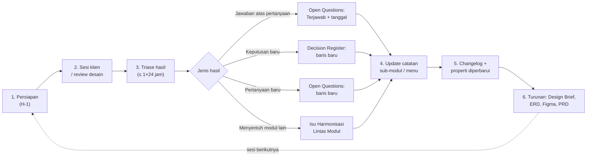

# Alur Kerja Gathering & Update

Satu siklus: vault menjadi bahan sesi, sesi menghasilkan jawaban, jawaban kembali ke vault, lalu dokumen turunan diperbarui. **Vault dulu, dokumen turunan kemudian.**

## 1. Persiapan (H-1)

- [ ] Buat catatan sesi dari [[T Sesi Review Klien]] di `60_Sesi & Review`, nama `YYYY-MM-DD <Topik>`.
- [ ] Buka Open Questions modul terkait. Ambil butir `Untuk = Rimbun Air`, mulai dari prioritas Tinggi, dan salin **kodenya** (bukan isinya) ke agenda.
- [ ] Tentukan urutan presentasi mengikuti perjalanan data (contoh: [[M2 Alur & Status]]), bukan urutan page Figma.
- [ ] Siapkan data contoh armada nyata (lihat [[Armada & Tipe Pesawat]]).
- [ ] Rapikan dulu perbaikan yang sudah pernah diminta klien agar tidak dibahas ulang.

## 2. Saat sesi

- Catat jawaban **per kode** di tabel Agenda catatan sesi, singkat dan sedekat mungkin dengan kata klien, beserta menit rekaman.
- Temuan yang belum punya kode dicatat sebagai `TEMUAN-1`, `TEMUAN-2`, … lalu diberi kode resmi saat triase.
- Ajukan pertanyaan persetujuan di akhir setiap langkah alur yang terkait, bukan menumpuk di akhir sesi.
- Tutup sesi dengan meminta konfirmasi bahwa alur sudah final kecuali butir yang masih terbuka.

## 3. Triase (≤ 1×24 jam)

Isi tabel **Triase** di catatan sesi: satu baris per jawaban atau temuan.

| Hasil | Tindakan di vault |
|---|---|
| Jawaban sesuai usulan | Open Questions: status `Terjawab <tgl>`, isi jawaban, tautkan sesi. Pindahkan ke Decision Register sebagai keputusan Final. |
| Jawaban berbeda dari usulan | Sama seperti di atas, lalu catat dampaknya ke layar/aturan. |
| Keputusan baru tanpa pertanyaan sebelumnya | Decision Register: baris baru dengan kode `{MOD}-KP-YYMMDD-nn`. |
| Pertanyaan baru | Open Questions: baris baru dengan kode `{MOD}-Q-YYMMDD-nn` dan usulan sementara. |
| Menyentuh modul PM lain | [[Isu Harmonisasi Lintas Modul]]: baris baru `LX-nn`, kabari PM pemilik. |
| Membatalkan keputusan lama | Baris lama ditandai `Diganti oleh <kode>`; baris baru menjelaskan perubahannya. |

## 4. Update catatan kondisi akhir

- [ ] Ubah aturan di catatan sub-modul: label `Usulan` → `Final`, tambahkan kode baru.
- [ ] Perbarui `diperbarui:` di frontmatter. Beri tag `#perlu-update` pada catatan yang belum sempat disesuaikan.
- [ ] Bila status objek atau aliran data berubah, perbarui diagram di catatan Alur/Integrasi.

## 5. Changelog

- [ ] Tambah satu baris di [[Changelog Vault]]: tanggal, sesi, ringkas apa yang berubah, catatan terdampak.

## 6. Dokumen turunan

- [ ] Design Brief, ERD (Lucid + Google Sheet), sitemap, dan Figma diperbarui **dari vault**, bukan dari catatan sesi.
- [ ] Untuk SSG: jawaban dimasukkan ke `rbac_data.py`, lalu PoC dan workbook dijalankan ulang (lihat [[SSG Data Integrasi & PoC]]).

## Definition of Done satu sesi

| Cek | Selesai bila |
|---|---|
| Semua jawaban tertriase | Tidak ada baris Triase tanpa tindakan |
| Register sinkron | Setiap kode yang dibahas berstatus Terjawab, Final, atau punya usulan baru |
| Catatan kondisi akhir | Tidak ada aturan yang masih berlabel Usulan padahal sudah dijawab |
| Lintas modul | Isu ke PM lain sudah tercatat dan dikabarkan |
| Jejak | Changelog terisi dan catatan sesi berstatus `selesai` |

## Ritme

| Kapan | Kegiatan |
|---|---|
| Setiap sesi | Siklus 1–5 di atas |
| Mingguan | Telusuri Open Questions: usulan yang lebih dari 14 hari tanpa jawaban masuk agenda berikutnya atau dikirim tertulis ke klien |
| Per gelombang desain | Bandingkan frame dengan catatan sub-modul; temuan desain dicatat di catatan sesi review desain |
