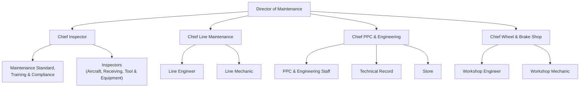

# Organisasi & Aktor

## Struktur Directorate of Maintenance (acuan CMM 2.2.2 dan MSPM 2.1)

CMM dan MSPM adalah manual yang disetujui, sehingga dipakai sebagai acuan posisi. Gambar ORG STRUCTURE di REQ dan Use Case Diagram dipakai hanya untuk fungsi di luar maintenance (Procurement, Finance, GSE, Management).

Di luar Directorate of Maintenance (CMM 2.2.1): President Director, Managing Director, Director of Corporate Quality, Safety & Security, Commercial & Finance, HR & Logistic, Operations. Director of Operation(s) muncul sebagai approver kedua DMI Extension.

## Perbedaan tiga versi struktur

| Aspek | CMM/MSPM (acuan) | REQ ORG STRUCTURE | Use Case Diagram |
|---|---|---|---|
| Chief | Inspector, Line Maintenance, PPC & Engineering, Wheel & Brake Shop | Engineering & PPC, Line Maintenance, Inspector | Chief Inspector, Engineering & PPC |
| Wheel & Brake Shop | Ada | Tidak ada | Workshop |
| Fungsi non-maintenance | Di luar Directorate | Procurement, Finance, GSE, Management | Procurement, Finance, Staff GSE |

Perbedaan ini tercatat sebagai gap G01–G02 ([[SSG Gap & Klarifikasi]]).

## Aktor per modul Yahya

| Aktor | M2 | M3 | M4 |
|---|---|---|---|
| PPC Staff | Ajukan MP, isi task, buat Check Pack, ajukan STE | Buat & ajukan WO, sign-in engineer, Book/RQ, Issue WO, Ad-hoc, NRC, cetak | Lihat report, buat RQ |
| Chief PPC & Engineering | **Satu-satunya approver MP** | Approve / Kembalikan / Cancel WO; approver RQ dari WO (usulan) | — |
| Engineering Staff | Task Library, Hard Time | — | Reliability Report, Flight Hour Report |
| Line Engineer | Ajukan STE | Kerjakan & close task card, close WO (usulan) | Isi AFML, defect, DMI, component transaction, RQ |
| Line Mechanic | — | Boleh di-sign-in, tidak bisa close task card | Bekerja di bawah supervisi pemegang AMEL |
| Inspector RII | — | Menutup task card RII (bukan pelaksana) | — |
| Chief Inspector | Putuskan STE; DAAO (usulan) | Memastikan prosedur RII | Approver 1 DMI Extension |
| Chief Line Maintenance | — | Delegasi robbing dari DoM | Ajukan DMI Extension, robbed/swap, pantau DMI, notifikasi |
| Technical Record | — | Melihat WO Closed | **Menutup halaman AFML**, koreksi flight log |
| Director of Operation | — | — | Approver 2 DMI Extension |
| Director of Maintenance | Tidak tampil di approval MP | Menyetujui robbing | Menyetujui robbed/swap; kandidat "direktur teknik" approver RQ (P-02) |
| Engineer in Charge | — | — | Membuat AOG & Serviceable Declaration |
| Storeman (M5) | — | Issue, Tool Loan, terima RTS | Issue oli/hydraulic ke WO |

Kode role resmi, matriks akses, dan kewenangan tanda tangan: [[SSG Role & Matriks RBAC]], [[SSG Model Governance & Kewenangan]].
