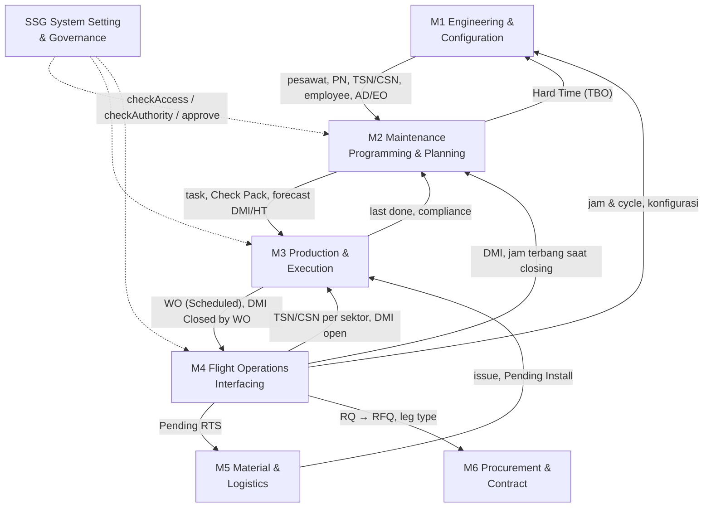

# Peta Modul & PM

## Modul sistem

| No | Modul | Sub-modul awal (REQ sheet SCOPE) | PM | Catatan |
|---|---|---|---|---|
| 1 | Engineering & Configuration (EC) — *fondasi data pesawat* | Aircraft Master & Status, As-Built Configuration, PN Master, Component Life & Control (LLP, HT & OC/CM report), Technical Document & Compliance (AD/SB, LDND, EO), Base/Employee/Training master | Fadly | Memegang LLP & OC/CM, AD/SB, EO, menu Ad-hoc (Non-routine Task), OTA (keputusan 19 Okt), Employee Master, master UOM |
| 2 | **Maintenance Programming & Planning** | AMP, Planning & Forecasting, Task Card, Work Package (Check Pack) | **Yahya** | [[M2 Overview]] |
| 3 | **Production & Execution** | WO Management, Component Transaction (Scheduled), HR License & Capability, Tool Crib & Calibration, CRS | **Yahya** | [[M3 Overview]] |
| 4 | **Flight Operations Interfacing** | AFML (persiapan EFL), Defect & Deferred, Component Transaction (Unscheduled), PIREQ, Fluid Consumption, Reliability & Repetitive, RFQ | **Yahya** | [[M4 Overview]] |
| 5 | Material & Logistics | Store/Warehouse, Receiving & Inspection, Transfer/Issue/Return, Shipment, Tool Loan | Fadly | Issue, Pending Install/RTS, Tool Loan, scrap |
| 6 | Procurement & Contract | AVL, Quotation, Order (PO, RO, Loan, Rental, Exchange, Warranty), Core Return | Wisnu | Memegang RFQ dan order (keputusan 9 Okt) |
| 7 | Publication / Document Record | Document manual, manual list status | Fadly / Gamma — konfirmasi | Nama terbaru "Document Record" (G17) |
| 8 | Costing | General Ledger, Invoice | Wisnu | |
| 9 | MRO Workshop & Hangar | Shop WO, shop task card, labor reservation, sign in/out, PN remove/install NLA, Shop ARC | Fadly / Gamma — konfirmasi | Menerima CRS dari Modul 3 |
| 10 | GSE | GSE master, PN, WO, task card, check in/out, schedule, part requisition, inventory | Wisnu | |
| 11 | Managerial Reports | — | (service 1) | Laporan lintas modul |
| SSG | **System Setting & Governance (RBAC)** | Akun, role, kewenangan, approval, penomoran, notifikasi, audit | **Yahya** | [[SSG Overview]] |

> [!note] Pembagian PM
> REQ sheet SERVICES: service 1 (Publication, EC, Workshop & Stores, Managerial Reports, Material & Logistics) → **GAMMA**; service 2 (Maintenance & Flight) → **EJA** (kini Yahya); service 3 (Procurement, Costing, GSE) → **WISNU**. Catatan Okt 2026 menyebut **Fadly** memegang Modul 1, 5, 7, dan 9, sedangkan PRD SSG (P06) masih menyebut PM Gamma untuk Modul 7, 9, 11. Pastikan pembagian terbaru sebelum mengirim pertanyaan lintas PM.

## Evolusi lingkup tiga modul Yahya

| Modul | Lingkup awal (REQ) | Lingkup sekarang | Dasar |
|---|---|---|---|
| M2 | AMP, Planning & Forecasting, Task Card, Work Package | 3 sub-modul: Maintenance Program (termasuk Task Library dan **Hard Time**), Planning & Forecast (termasuk STE), Check Pack & Out of Phase. Submodul Task Card bubar; AD/SB & EO ke M1; eksekusi task card ke M3 | M2 Decision Register no 1–13, 46 |
| M3 | WO, Component Transaction (Scheduled), HR License, Tool Crib, CRS | 1 sub-modul: **Work Order Management**. Komponen → M4; validasi lisensi → SSG `checkAuthority` + EC; tool → Tool Loan M5; CRS → Workshop (pesawat memakai RTS); OTA → M1 | Review klien 19 Okt; B-02, B-03; CT-01 |
| M4 | AFML, Defect & Deferred, Component Transaction (Unscheduled), PIREQ, Fluid, Reliability, RFQ | 7 sub-modul + Lintas (33 menu): AFML & Flight Log, Defect & Deferred (termasuk Rekap PIREP/MAREP), Component Transaction (**semua** removal/installation, robbed, swap), Fluid Consumption, Reliability & Repetitive, **RQ** (bukan RFQ), CML | Keputusan 8 dan 9 Okt; Flow Detail 3 Nov |

## Relasi parent module (REQ)

| No | Bagian | Relasi modul |
|---|---|---|
| 1 | AC configuration: aircraft, config item, NLA, NHA, PN Master | 1 |
| 2 | Maintenance Program | 1, 2 |
| 3 | Maintenance Planning / Forecast | 1, 2, 4 |
| 4 | Task card | 1, 2 |
| 5 | Work order | 1, 2, 3, 4, 5, 6 |
| 6 | Check pack (A Check, C Check, yearly) | 1, 2 |
| 7 | Flight log | 1, 4 |
| 8 | Reliability, repetitive | 1, 2, 3, 4 |
| 9 | Technical Document / AD / SB | 1, 2, 3, 4, 5 |
| 10 | Inventory (store, transfer, issue, receiving, shipment RO) | 1, 3, 4, 5, 6 |
| 11 | Order (PO, RO, Exchange, Loan, Rental, Warranty) | 1, 2, 3, 4, 5, 6 |
| 12 | Flight hour report | 1, 4 |
| 13 | Oil consumption report | 1, 4 |
| 14 | Defect / Deferred report | 1, 4 |
| 15 | Component installed report | 1, 3, 4 |
| 16 | HT report | 1, 3, 4 (kini dipegang M2) |
| 17 | LLP Engine/LDG/APU report | 1, 3, 4 |
| 18 | OCCM report | 1, 3, 4 |
| 19 | AD/SB status | 1, 3, 4, 5, 6 |
| 20 | LDND status | 1, 2, 3, 4, 5, 6 |

Rincian aliran data: [[Integrasi End-to-End]]. Siapa memegang data apa: [[Kepemilikan Data & Batas Modul]].
