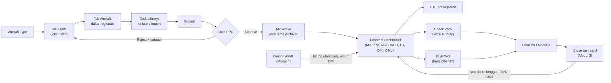
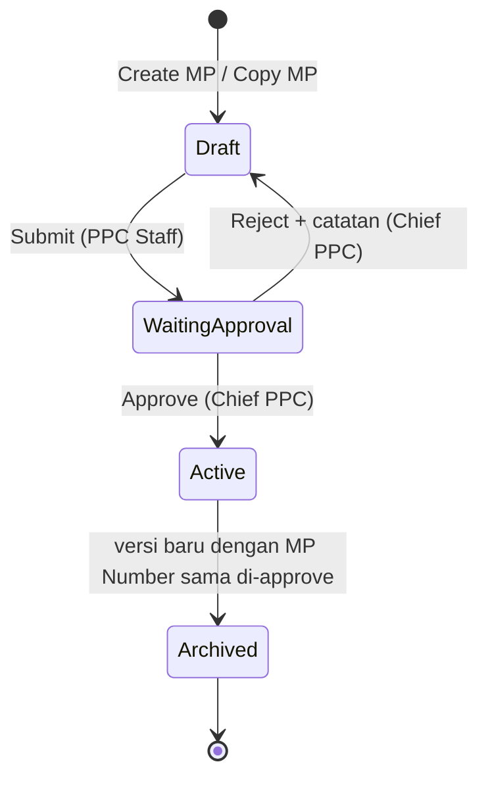
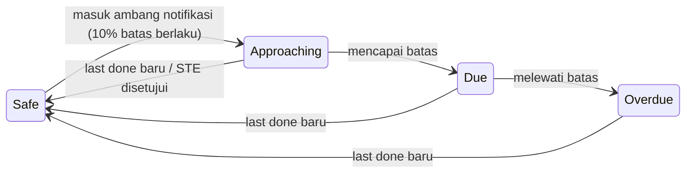

# M2 Alur & Status

## Perjalanan data (alur presentasi)

Urutan ini dipakai untuk presentasi ke klien dan untuk menguji kelengkapan desain: satu tipe pesawat, satu MP, satu registrasi, satu task dari awal sampai akhir.

| No | Langkah | Layar | Pesan kunci |
|---|---|---|---|
| 1 | Siapkan tipe pesawat | Aircraft Type list/form/detail | Identitas tipe saja; FEC dan STE Basis dihapus |
| 2 | Buat MP Draft | Daftar MP, Create MP | MP Number sama untuk semua revisi, terkunci setelah simpan |
| 3 | Daftarkan pesawat pemakai MP | Tab Aircraft, popup Add Aircraft | Hanya registrasi bertipe sama; MP Start Date = awal forecast |
| 4 | Isi task | Task Library, Add Task, Pratinjau, Import | Lima bagian; threshold lalu interval; effectivity pesawat atau komponen |
| 5 | Task dari modul lain | Detail task asal EO | EO dan Non-routine dari Modul 1, read-only; Copy membuat task MP |
| 6 | Ajukan dan setujui MP | Submit, tab Internal Approval | Hanya Chief PPC; approve → Active, versi lama Archived, forecast dihitung ulang |
| 7 | Revisi MP | Copy MP, Riwayat Revisi | Task dan interval tersalin; riwayat tidak bisa dihapus |
| 8 | Data pendukung | Check Type, Hard Time, Format Nomor | Check Type hanya referensi; HT batas per PN, sisa per SN |
| 9 | Pantau jatuh tempo | Forecast, Detail Due | Dihitung ulang setiap closing AFML |
| 10 | Perpanjang jatuh tempo | Add STE, Detail STE | Tanpa hitungan toleransi; dokumen fisik dilampirkan |
| 11 | Bentuk paket kerja | WCF Priority, Check Pack | Wadah bebas; effectivity menyaring task |
| 12 | Buat WO langsung | Forecast baris HT/DMI → Create WO | Form WO Modul 3 terisi, bertanda asal planning |
| 13 | Task di luar paket | Out of Phase | Otomatis/Manual, bisa dikembalikan |
| 14 | Notifikasi dan laporan | Notifikasi Due, Report Center | Ambang 10%; parameter → tampilkan → ekspor |

## Status Maintenance Program

- Hanya satu MP Active per tipe pesawat; versi Archived menampilkan banner dengan tautan ke versi aktif.
- Draft bisa diubah; Active tidak bisa diedit (revisi lewat Copy MP).

## Status forecast per baris

Nama status baku: Safe, Approaching, Due, Overdue. Label lain di desain (OK, Due Soon) harus diganti.

## Siklus last done

1. Task masuk WO (Modul 3) sebagai salinan master dengan referensi revisi MP asal (usulan 129).
2. Task card di-close di WO dengan tanggal, TSN, CSN (Modul 3).
3. Last done task MP diperbarui otomatis (58); status AD/EO diperbarui di Modul 1.
4. Forecast menghitung due berikutnya dari batas yang berlaku (interval setelah pelaksanaan pertama).

Task card yang dihapus, dibatalkan, atau dipindah di WO **tidak** mengubah Check Pack maupun last done (usulan 130).
