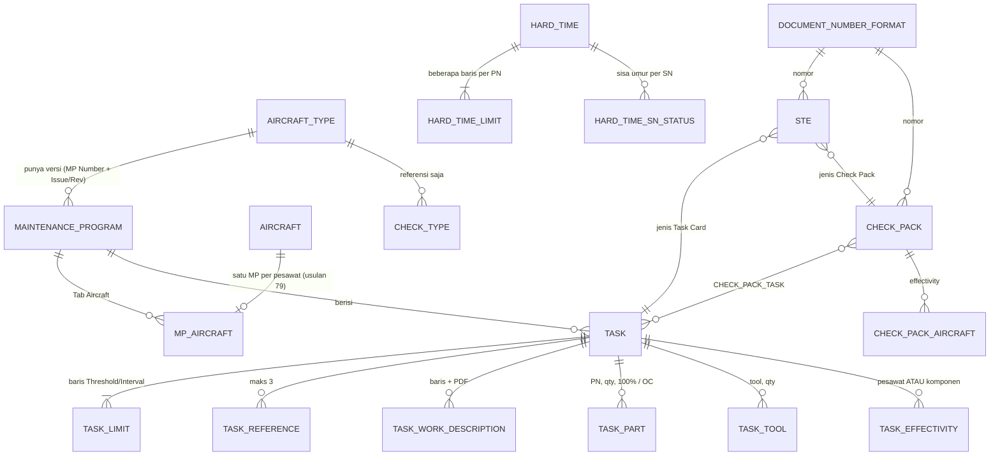

# M2 Data & Entitas

> [!warning] Acuan resmi field ada di ERD v7
> Catatan ini merangkum **objek dan relasi yang ditetapkan oleh keputusan** agar mudah diverifikasi terhadap ERD. Nama entitas di sini indikatif; nama tabel, kolom, tipe data, dan kardinalitas resmi ada di Lucid ERD v7 dan Google Sheet field ([[Workspace Lucid Figma Drive#Modul 2]]). Saat ERD diperbarui, cocokkan dengan tabel di bawah.

## Konvensi rancangan ERD (spreadsheet)

| Sheet | Isi |
|---|---|
| Rancangan ERD | Per entitas: kolom, tipe data, keterangan, kardinalitas |
| Entitas Eksternal Antar Modul | Entitas milik modul lain yang dibaca, struktur sama |
| Kardinalitas Overview | Entitas A, kardinalitas, entitas B, catatan |

## Relasi turunan keputusan

## Objek milik Modul 2

| Objek | Atribut kunci menurut keputusan | Acuan |
|---|---|---|
| Aircraft Type | Type Code, Type Name, Manufacturer, CASR 121/135, Kode AMP (teks); tanpa status, tanpa FEC, tanpa Basis STE | 16–19 |
| Maintenance Program | MP Number (terkunci), tipe, Issue, Revisi, Effective Date, status Draft/Waiting Approval/Active/Archived, catatan revisi, keputusan approval | 20–25 |
| MP Aircraft | Registrasi, MSN (dibaca dari M1), MP Start Date | 25, 79 |
| Task | Nomor task card, deskripsi, ATA 4 digit, task type, zone (multi), access panel (multi), skill group, jumlah personel, man-hours, penanda RII, STE Prohibited, asal (MP/EO/Non-routine) | 26–43 |
| Task Limit | Jenis (Threshold/Interval), basis (FH, FC, kalender angka + satuan, tanggal) | 28–31 |
| Task Part / Tool | PN dari PN Master (M1), qty, replacement code 100%/OC; tool + qty | 38, 43 |
| Task Effectivity | Pesawat (dari MP Aircraft) atau komponen (PN → SN dari M1, simpan ID komponen) | 41, 122 |
| Check Type | Nama, kode, urutan, interval dasar, work area count; referensi saja | 26–27 |
| Check Pack | Nomor otomatis, nama, deskripsi, threshold (opsional), interval (wajib), effectivity pesawat | 69–77 |
| Hard Time | PN, tipe pesawat, baris batas (tindakan, acuan hitung, FH/FC/kalender, batas pertama, task terkait, referensi); status per SN (sisa, posisi/In store, last action dengan ARC/Form 1/WO) | 46–49 |
| STE | Nomor otomatis, jenis (Check Pack/Defect/Task Card), subjek, ekstensi (FH/FC/Hari), due asli, due setelah STE, PDF dokumen fisik, HIRA, DAAO, status | 61–68 |
| Notification Rule | Ambang 10%, role penerima, aktif | Menu 14 |
| Document Number Format | Prefix, format tahun/bulan, panjang urut, pemisah, reset | 50 |

## Entitas eksternal yang dibaca

| Entitas | Pemilik | Dipakai untuk |
|---|---|---|
| Aircraft (registrasi, MSN, manufacture date) | M1 | Tab Aircraft, titik nol threshold kalender (usulan 90) |
| PN Master, komponen per SN dengan TSN/CSN | M1 | Task Part, effectivity komponen, Hard Time |
| Task EO, Non-routine Task | M1 | Task Library read-only (usulan 120, 128) |
| Status AD/SB/EO | M1 | Grup AD/SB & EO di forecast |
| DMI (due date terakhir) | M4 | Grup DMI di forecast |
| Halaman AFML Closed (jam & cycle per sektor) | M4 | Hitung ulang forecast, tanggal as of |
| Task card Closed (tanggal, TSN, CSN), WO | M3 | Last done |
| NRC/MDDR | M3 | Subjek STE Defect (usulan 126) |
| Scrap | M5 | Menghentikan hitungan HT |
