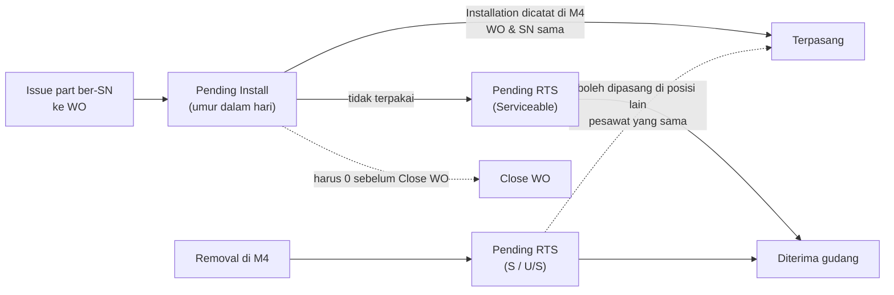

# M3 Material, Tool, dan Part

Material diminta **per task card** di WO, tetapi keluar-masuk barang dicatat gudang (Modul 5) dan pemasangan komponen dicatat di Component Transaction (Modul 4). **Close WO adalah batas akhir semua urusan material WO.**

## Material Required

| Aturan | Isi | Status | Acuan |
|---|---|---|---|
| Letak & kolom | Per task card di Task Card Execution List: PN, Description, Qty, Stock Available, Status, Action; qty per task card | Final | B-37 |
| Isi awal | Part 100% otomatis; part OC ditambah manual dari daftar PN task; Ad-hoc & baris DMI mengisi langsung; boleh ditambah/dikurangi kapan saja | Final | M2-20, B-58 |
| Cek stok | Di Modul 3 | Final | B-08 |
| **Book** | Bila stok cukup: mengunci stok untuk WO & task card, membentuk **MR** yang di-approve PPC; nomor MR satu sequence dengan RQ | Final (Book); Usulan (MR, approver) | B-38, B-44, Q-06 |
| **RQ** | Bila stok kurang: draft RQ bisa menggabungkan PN dari beberapa task card. Usulan: memakai form RQ Modul 4 dengan sumber task card WO, approve Chief PPC & Engineering, nomor dari master; nomor RQ & status order tampil sebagai info di baris | Final (draft gabung); Usulan (integrasi) | B-39, M3B-21, Q-47 |
| Status baris | Open dan Issued; menjadi Issued hanya lewat issue gudang saat qty terpenuhi | Final | B-41 |
| Pengaruh ke task card | In Progress dan Close butuh semua baris Issued | Final (Close); Usulan (In Progress) | B-29, B-42, Q-07 |

## Issue gudang

- Issue untuk WO wajib mencantumkan WO, task card, PN, qty, dengan **Material Slip** (Final, B-40, MSPM 5.3.3).
- Issue line maintenance tanpa WO (berdasarkan defect AFML atau langsung dengan keterangan) diatur Modul 5 dan tidak masuk Material Required (Usulan, Q-41).
- Oli dan hydraulic di-issue **ke WO**, bukan ke registrasi; registrasi dibaca otomatis dari WO (Final, M4 K5-09).

## Pending Install dan Pending RTS

1. Issue part ber-SN membuka satu baris **Pending Install**, umurnya dihitung hari sejak issue.
2. Tertutup sebagai **Terpasang** (Installation di M4 dengan WO dan SN sama) atau **Dikembalikan** (pindah ke Pending RTS, Serviceable).
3. Close WO aktif hanya bila Pending Install WO = 0; popup Close WO memberi aksi per baris.
4. **Pending RTS** berisi part yang dilepas (S/U/S) dan part tidak terpakai sampai diterima gudang; tidak menahan Close WO.
5. Part yang turun boleh dipasang di posisi lain pesawat yang sama tanpa kembali ke gudang (Usulan, Q27-06).
6. Detail WO menampilkan jumlah dan umur Pending Install.

Konsep Pending Install/RTS **Final** (CT-06). Close WO sebagai batasnya **Usulan** (K1, Q-34). Pemegang layar Pending di M5 **Menunggu** (Q28-12).

## Consumable dan expendable tanpa SN

Final (CT-10, LM-06, LM-07, LM-09):
- Tidak lewat Component Transaction; di-issue lalu langsung dibebankan ke WO dan pesawat.
- Bisa di-return sebelum WO ditutup dengan qty lebih kecil, tidak sesudahnya; return lewat initial load dengan referensi material slip.
- Return yang kurang dari material slip wajib reason dan approval chief store.
- Usulan: event WO Closed dikirim ke M5 agar return tertutup (Q-36).

## Tool

- Tool dari gudang dipinjam lewat **Tool Loan**, tidak lewat Book/MR/RQ, dan tidak menahan status task card (Final, K2, B-45, MSPM 5.3.3).
- Daftar tool di task card dari Task Library, read-only sebagai kebutuhan (Final, M2-20).
- Kalibrasi dicek saat dipinjam; tool overdue ditolak; tool pribadi tidak boleh (Final, MSPM 5.3.3).
- Tool rusak dikembalikan dengan Unserviceable Tag RAA-TMT-002 ke Quarantine Store (Final, MSPM 5.3.5).
- Usulan (Q-38): Tool Loan mencatat WO (wajib) dan task card (opsional); Close WO memberi peringatan bila masih ada tool dipinjam; tool non-gudang (milik MRO pemilik hangar) tidak dicatat.

## Component Transaction (dicatat di Modul 4)

| Aturan | Status | Acuan |
|---|---|---|
| Removal dan Installation dua transaksi terpisah, field sama | Final | CT-01 |
| Otomatis **Scheduled** bila WO terisi; WO wajib untuk Scheduled. Untuk WO DMI/defect usulan Scheduled hanya bila Asal WO = Planning (memengaruhi reliability: unscheduled = failure) | Final; WO DMI Menunggu | CT-02, REL-10, Q27-03 |
| Satu SN parent membawa seluruh child (mis. main wheel assy + inner, outer, tire) | Final | CT-04, CT-05 |
| Wheel assy dicatat dengan bagian **outer sebagai induk** ("Wheel Assy / Outer"), punya PN & SN sendiri | Final | M4 K5-02 |
| Installation mengambil part yang di-issue ke WO; PN divalidasi ke PN Master | Final | CT-09 |
| Titik masuk: aksi Catat Removal/Installation per baris task card membuka form M4 terisi (WO, task card, registrasi), atau dari menu M4 memilih WO open | Usulan | Q-35 |
| TSN/CSN komponen memakai umur pesawat per sektor AFML; Event Date & Time wajib | Final | LM-10, M4 AF-06 |
| Hasil dikirim ke konfigurasi M1 (Sync Modul 1) | Final | CT-07 |

## Robbed dan Swap

| | Robbed | Swap |
|---|---|---|
| Arah | Pesawat A (donor) → pesawat B (penerima), satu arah | A dan B bertukar part, dua arah |
| Proses | Menu 3.2 Robbed Part | **Proses tersendiri**, menu 3.6 Swap (bukan bagian Robbed) |
| Lewat gudang / Pending | Tidak | Tidak |
| Posisi setelahnya | A kosong, B terisi | Keduanya terisi |
| Form | Robbed Part Form | Pola sama dengan Robbed dan Record Removal/Installation: di tiap pesawat ada sisi part keluar dan masuk |
| Persetujuan | Diajukan Line Engineer / Chief LM, disetujui **Director of Maintenance** (boleh didelegasikan ke Chief LM) | Usulan mengikuti robbing; dipastikan (CT-08) |
| Status | Final | Final (proses, K5-04); Usulan (persetujuan, cetak) |

Dampak ke WO (Usulan, Q-40): baris Material Required di WO penerima terpenuhi oleh referensi transaksi robbed/swap (status Issued, sumber "Robbed dari [registrasi]"); posisi kosong donor tampil di konfigurasi M1 dan diisi lewat jalur normal.

## Hard Time

- Baris forecast HT dibuka menjadi WO lewat Buat WO dengan Asal Planning, sehingga removal-nya Scheduled (Final, M2-09, LM-05).
- Pemicu reset HT setelah overhaul/test belum diputuskan; usulan closing WO dengan referensi ARC/Form 1 (Menunggu, HT-02). Sementara tindakan terakhir dicatat manual di Modul 2.
