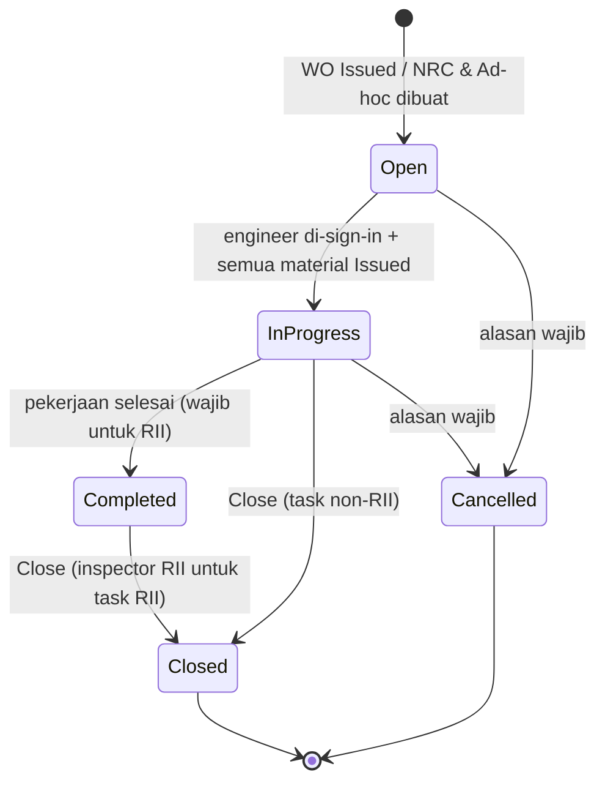

# M3 Task Card di WO

Semua jenis task card di WO memakai **satu struktur dan satu alur**: header tetap, work description berlampiran PDF, material dan tool, lalu closing berstempel. Yang membedakan hanya asal isinya dan apa yang diperbarui saat Closed. Eksekusi hanya di **Task Card Execution List** pada Detail WO (tidak ada daftar lintas WO).

## Jenis task card (kolom Sumber)

| Jenis | Asal | Cara masuk WO | Saat Closed memperbarui | Status | Acuan |
|---|---|---|---|---|---|
| MP | Task Library (asal MP) | Tarik Check Pack/task di form WO | Last done di forecast M2 | Final; pemicu Menunggu | M2-27, M2-28, Q-M2-08 |
| AD/SB, EO | Task asal EO (M1) | Tarik task | Compliance AD/EO di M1; AD berulang juga last done M2 | Final | B-17, M2-28 |
| Non-routine Task | Master di M1 | Tarik task | Last done bila punya interval | Final (asal); Usulan (lainnya) | B-06, Q-M2-09 |
| DMI | DMI open (forecast/pemilih form WO) | Satu baris per DMI tanpa master: judul = DMI description, nomor DMI, item MEL | Tidak menutup DMI; DMI ditutup saat WO Closed | Usulan | B-63, Q-25 |
| Ad-hoc | Dibuat di Detail WO | Tambah Ad-hoc Task Card | Tidak masuk master | Final | B-55, M3-03 |
| NRC | Anak task card | Tambah NRC dari baris induk | Tidak masuk master | Final | B-30–B-35 |
| CML | CML open dari forecast | Seperti DMI | CML ditutup saat WO Closed | Menunggu | Q26-09, Q-43 |
| Workshop | Task card workshop baru, melalui approval | Belum ditetapkan | — | Menunggu | M3-10 |

## Struktur task card

| Bagian | Isi | Status | Acuan |
|---|---|---|---|
| Header tetap | Mengacu Form **RAA/MD-49**: nomor, judul, referensi, ATA, kategori, penanda RII; registrasi, MSN, WO, station. Task asal MP menampilkan MP Number dan Issue/Revisi asal | Final (header); Usulan (MP asal) | B-50, M2-33 |
| Work description 1..n | Deskripsi, referensi AMM/CMM, lampiran PDF per baris (menggantikan Checklist). Task pabrikan cukup satu baris + job card pabrikan. Minimal satu lampiran untuk task asal MP. Boleh diubah selama task card Open | Usulan | Q-20, Q-29, Q-31, M3-10 |
| Material dan tool | Dari master; boleh ditambah/dikurangi di WO | Final | B-36, B-58 |
| Closing | Tanggal, TSN/CSN, work performed, penutup & stamp; inspector RII bila task RII | Final; RII Usulan | B-24, B-25, K4 |

Tab Checklist, Komponen, Material, dan Sign-off lama tidak dipakai lagi.

## Status task card

| Status | Syarat | Status keputusan | Acuan |
|---|---|---|---|
| Open | WO Issued, atau task card baru dibuat | Final | B-22, Q-23 |
| In Progress | Engineer sudah di-sign-in **dan** semua baris material Issued | Final; syarat material Usulan | B-13, B-42, Q-07 |
| Completed | Pekerjaan selesai, administrasi belum; boleh dilewati kecuali RII | Final; pengecualian RII Usulan | B-23, K4 |
| Closed | Material Issued, isian closing lengkap, penutup dari daftar sign-in dengan otorisasi aktif | Final; validasi penutup Usulan | B-24, B-25, B-29, Q-04 |
| Cancelled | Alasan wajib | Final | B-27 |

Tidak ada **On Hold** dan **Deferred**. NRC berstatus Open, Work in Progress, Closed, + Cancelled (usulan Q-14).

## Sign-in

PPC men-sign-in **nama** engineer per task card di Detail WO, boleh lebih dari satu, **tanpa jam**. Jam kerja tetap ditulis manual di kertas (Final, B-19, B-21).

## Isian Close task card

| Isian | Aturan | Status |
|---|---|---|
| Tanggal closing | Wajib | Final |
| TSN/CSN | Default dari WO, bisa diubah; menjadi data resmi last done M2 | Usulan (Q-08) |
| Work performed | Wajib; apa yang benar-benar dikerjakan dan hasilnya. Ad-hoc berupa tahapan kerja | Final (B-24, B-57) |
| Penutup dan stamp | Dari daftar sign-in, otorisasi aktif; Mechanic tidak bisa menutup | Usulan (Q-04) |
| Hasil MDDR | Khusus Ad-hoc dengan MDDR: Selesai atau Dilanjutkan ke defect AFML | Usulan (Q-17) |
| Peringatan Pending Install | Muncul bila part ber-SN belum terpasang; tidak memblokir | Usulan (K1) |

Sign-off final Chief per task card dihapus; closing engineer menjadi penutupan final (Usulan, Q-12). Istilah *sign-off* diganti *closing* (Final, B-26). Validasi penutup memakai layanan `checkAuthority` SSG ([[SSG Model Governance & Kewenangan#Urutan validasi tanda tangan checkAuthority]]).

## RII

Aturan **Final** dari dokumen klien: orang yang mengerjakan item RII tidak boleh menginspeksi pekerjaannya sendiri; tanda tangan dan stamp keduanya tercatat (MP B737-300F bab 2.2, ATR 72 bab 2.5, DHC6 bab 2.10). Alur di sistem masih **Usulan** (Q-13):

1. Task bertanda RII di Task Library tercetak dengan penanda RII.
2. Engineer pelaksana menandai **Completed** dengan stamp-nya.
3. Inspector RII menutup task card dengan stamp-nya. Sistem menolak bila inspector adalah pelaksana (SOD-02) atau tidak memegang otorisasi RII aktif untuk tipe pesawat itu.
4. NRC dari task card RII ikut RII; Ad-hoc dan baris DMI punya toggle RII yang diisi PPC (Q-39).
5. Control Sheet menyediakan kolom Engineer dan RII (B-46).

## Cetak task card

- Selalu di-generate sistem dengan format terkunci: header, index, nomor, deskripsi, kolom RTS (Final, B-53, M3-08).
- Lampiran digabung menjadi satu PDF per task card, halaman index lebih dulu (Final, B-53).
- Dicetak satu per satu atau seluruhnya lewat checkbox (Final, B-48, M3-07).
- Kolom stamp Performed dan RII per work description + satu blok closing per task card (Usulan, Q-30).

## Perbaikan desain utama (review hi-fi 1 Nov)

- Execution Task Card dipindah ke popup di Detail WO; NRC tampil sebagai baris di bawah induk.
- Nomor task card di WO menampilkan nomor Task Library + MP Number dan revisi asal; nomor Ad-hoc = nomor WO + "-AH-01"; kolom "Next WCF Due" → "Next Due".
- Saat Waiting Approval semua task card Open, Sign In dan Closing kosong.
