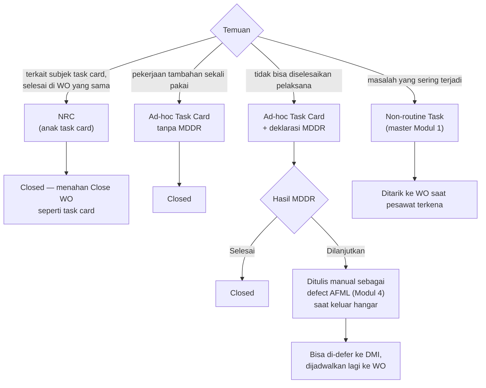

# M3 Temuan: NRC, Ad-hoc, dan MDDR

Temuan di hangar punya **dua jalur**: NRC untuk temuan terkait subjek task card yang diselesaikan di WO yang sama; Ad-hoc task card dengan MDDR untuk temuan yang tidak bisa diselesaikan pelaksana. **Task card tidak pernah di-defer ke DMI.**

## Jalur temuan

| Jenis temuan | Dicatat sebagai | Bila belum selesai saat keluar hangar | Status | Acuan |
|---|---|---|---|---|
| Terkait subjek task card, selesai di WO yang sama | NRC (baris di bawah induk) | Tidak berlaku; NRC menahan Close WO | Final | B-30–B-35 |
| Tidak bisa diselesaikan pelaksana | MDDR pada Ad-hoc task card | Ditulis manual sebagai defect AFML, lalu bisa ke DMI | Final | B-54–B-59, B-62 |
| Defect saat operasi di luar hangar | Defect AFML (M4) | Di-defer ke DMI; DMI dijadwalkan ke WO lewat forecast | Final | B-63, B-64 |
| Masalah yang sering terjadi | Non-routine Task (master M1) | Mengikuti task card biasa | Final | B-06 |

## Perbandingan

| | NRC | Ad-hoc tanpa MDDR | Ad-hoc dengan MDDR |
|---|---|---|---|
| Untuk | Temuan terkait subjek task card, selesai di WO yang sama | Pekerjaan tambahan sekali pakai yang tidak ada di master | Temuan yang tidak bisa diselesaikan pelaksana, tercatat di buku MDDR milik MRO |
| Dibuat dari | Baris task card induk | Tombol Tambah Ad-hoc Task Card | Tombol sama + deklarasi MDDR |
| Nomor | Nomor induk + "-NRC-01" | Nomor WO + "-AH-01" | Sama + nomor MDDR manual dari buku MRO |
| Isian khusus | Form sama dengan task card; tanpa marker Deferred/Repetitive | Work description & material diisi langsung | + nomor MDDR, finding, resolution |
| Proses | Sign-in, material, In Progress, Close | Sama | Sama; MDDR tidak punya status sendiri |
| Hasil saat Close | Closed | Closed; work performed berupa tahapan kerja | Closed + hasil MDDR: Selesai / Dilanjutkan ke defect AFML |
| Status | Final; format nomor Usulan (Q-09) | Final; nomor & pelaku Usulan (Q-23) | Final; aturan MDDR Usulan (Q-16, Q-17, Q-24, Q-33) |

## Aturan rinci

| Aturan | Status | Acuan |
|---|---|---|
| PPC menambah Ad-hoc saat WO Approved, Issued, atau WIP, tanpa approval ulang; tercatat di Riwayat Status; task card baru Open dan perlu sign-in | Usulan | Q-23 |
| Nama: "Ad-hoc Task Card" (sekali pakai di WO), "Non-routine Task" (master M1) | Usulan | Q-19, M2 no 98 |
| Nomor MDDR diinput manual dari buku MDDR milik MRO pemilik hangar, unik dalam satu WO | Usulan | Q-16 |
| Paling banyak satu MDDR per Ad-hoc; dijadikan wajib bila klien menyebut setiap Ad-hoc berasal dari MDDR | Usulan | Q-24 |
| Status MDDR mengikuti Ad-hoc-nya; resolution terisi dari work performed dan masih bisa diubah | Usulan | Q-17, Q-33 |
| Pembeda NRC vs MDDR: NRC bila terkait subjek dan selesai di WO yang sama; MDDR bila pelaksana tidak bisa menyelesaikan | Usulan | Q-21 |
| MDDR open saat Close WO: Ad-hoc ditutup dengan hasil "Dilanjutkan ke defect AFML" + referensi halaman/item AFML manual; syarat Close WO tetap satu | Usulan | Q-18 |
| **Tidak ada aksi convert**; item ditulis manual sebagai defect AFML saat keluar hangar | Final (B-62); redaksi Usulan (Q-42) | |
| Tab **Temuan** di Detail WO merekap NRC dan MDDR; Work Order List menampilkan jumlah MDDR open per WO | Usulan | Q-22 |
| STE Defect (M2) memilih NRC/MDDR dari M3: nomor, WO, registrasi, status | Usulan | M2-24 |
| NRC dari task card RII ikut menjadi RII | Usulan | Q-39; MP DHC6 2.10.1 a |
