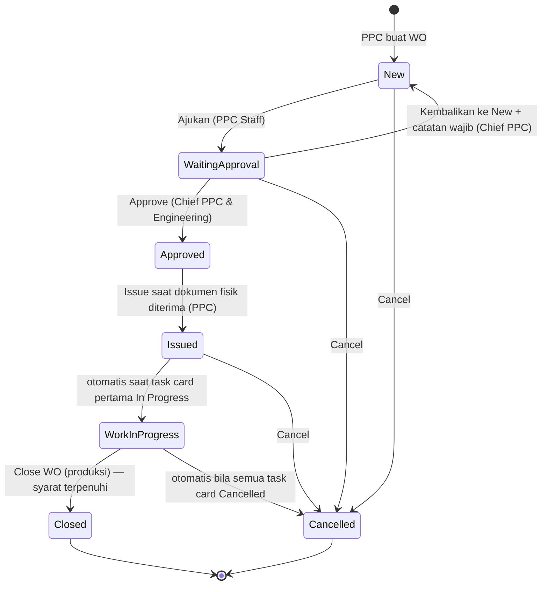

# M3 Work Order

## Status WO

Tujuh status: **New, Waiting Approval, Approved, Issued, Work in Progress, Closed, Cancelled**. Draft, Open, dan Rejected tidak dipakai lagi. Approve tidak langsung melepas WO; WO dilepas ke produksi lewat **Issue**.

**Syarat Close WO:** (1) semua task card dan NRC Closed atau Cancelled; (2) **Pending Install WO = 0**. Pending RTS tidak menahan Close WO.

## Alur 16 langkah

| No | Langkah | Pelaku | Status |
|---|---|---|---|
| 1 | Sumber terencana dari M2: Check Pack, task MP/EO/Non-routine, baris forecast DMI dan HT, task Out of Phase | — | — |
| 2 | DMI open (M4) masuk forecast, bisa dipilih di form WO; CML menunggu | — | — |
| 3 | Buat WO: registrasi, TSN/CSN, Asal WO, tarik Check Pack/task/DMI; isi master disalin, part 100% masuk Material Required | PPC | New |
| 4 | AFML per sektor (M4) menjadi sumber TSN/CSN WO | TR (M4) | — |
| 5 | Ajukan; WO terkunci | PPC | Waiting Approval |
| 6 | Approve, Kembalikan ke New, atau Cancel | Chief PPC & Engineering | — |
| 7 | Siapkan: sign-in engineer per task card, Book/RQ, Ad-hoc bila perlu | PPC | Approved |
| 8 | Issue: serah terima ke produksi; cetak WO, task card, Control Sheet, RTS kosong | PPC | Issued |
| 9 | Issue material dan Tool Loan; part ber-SN membuka Pending Install | Gudang (M5) | — |
| 10 | Kerjakan; WO otomatis Work in Progress; kerja dan stamp di kertas | Engineer | In Progress |
| 11 | Temuan dan perubahan: NRC, Ad-hoc dengan MDDR, Cancel, Pindah WO | PPC | — |
| 12 | Component Transaction (M4): Removal/Installation Scheduled; robbed/swap antar pesawat | Engineer | — |
| 13 | Close task card: tanggal, TSN/CSN, work performed, stamp; last done & compliance terkirim | Engineer, Inspector RII | Closed |
| 14 | Pending Install tertutup saat terpasang atau dikembalikan | Gudang | — |
| 15 | Close WO: tanggal wajib, rekonsiliasi Pending Install, konfirmasi DMI yang ikut ditutup | Produksi | Closed |
| 16 | Rekonsiliasi material: part tidak terpakai ke Pending RTS, return consumable sebelum Closed, tool kembali | Engineer, gudang | — |

Setelah pesawat keluar hangar, item MDDR yang belum selesai ditulis manual sebagai defect di AFML.

## Buat WO

| Aturan | Status | Acuan |
|---|---|---|
| Registrasi wajib. TSN/CSN diisi sejak WO dibuat, manual atau **Ambil dari AFML** per sektor yang sudah di-close TR, beserta tanggal as of | Final | B-14, LM-10, CT-11 |
| Default sektor: sektor terakhir yang di-close sebelum tanggal WO dibuat | Usulan | Q-37 |
| **Asal WO** = Planning (dari Forecast Dashboard / Detail Due baris DMI & HT, atau dari Check Pack) atau Manual. Asal "dari defect" tidak dipakai; defect terjadwal lewat DMI | Usulan | M2-01, M2-09, M3B-11, Q26-06 |
| Isi: Check Pack, task individual (termasuk Out of Phase), DMI open registrasi sama; beberapa DMI boleh satu WO | Final (DMI) | B-63 |
| Isi master disalin saat masuk WO, menyimpan referensi task dan revisi MP asal | Usulan | M2-33 |
| Part bertanda 100% otomatis masuk Material Required | Final | M2-20 |

## Aturan per tahap

| Tahap | Aturan | Status | Acuan |
|---|---|---|---|
| Waiting Approval | WO terkunci; Chief memilih Approve, Kembalikan ke New (catatan wajib), atau Cancel; tidak ada Rejected | Final (aksi), Usulan (terkunci) | B-10, B-11, Q-01 |
| Approved | Belum boleh dikerjakan; sign-in, Book/RQ, Tambah Ad-hoc sudah bisa | Final; sign-in sejak Approved Usulan | B-12, B-20, Q-10 |
| Issued | Serah terima setelah dokumen fisik diterima; tanggal & pelaku tercatat; task card menjadi Open; berlaku per WO | Final; per WO Usulan | B-12, Q-15 |
| Work in Progress | Otomatis saat task card pertama In Progress | Final | B-13, Q-03 |
| Ubah isi WO | Task card boleh dihapus saat New, Approved, Issued. Saat WIP hanya Cancel (alasan wajib) atau Pindah WO (pesawat sama). Tidak mengirim apa pun ke M2 | Final (Cancel, Pindah); Usulan (lainnya) | B-27, B-28, Q-05, M2-30 |
| Cancel WO | Dari New, Waiting Approval, Issued; otomatis bila semua task card Cancelled; DMI dilepas kembali ke forecast | Final; pelepasan DMI Usulan | B-16, Q-28 |
| Isi Close WO | Tanggal wajib (default hari ini); deskripsi & work performed opsional. Popup: sisa Pending Install dengan aksi *Catat Installation* / *Kembalikan ke gudang*, daftar DMI yang ikut ditutup untuk dikonfirmasi, peringatan tool masih dipinjam. Ditutup oleh produksi | Final (tanggal); Usulan (isi popup, pelaku) | B-15, Q-11, Q-26, Q-27, Q-32, Q-34, Q-38 |
| Setelah Closed | Read-only. Event ke M4 (DMI Closed by WO) dan M5 (return consumable ditutup) | Final (prinsip); Usulan (bentuk event) | B-64, LM-06, Q-36 |
| Progres | Hitungan progres = Closed + Cancelled | Usulan (review 1 Nov) | — |

## Cetak dan ekspor

| Dokumen | Isi | Status |
|---|---|---|
| WO | Ringkasan WO | Final (B-46–B-49) |
| Task card | Generate sistem (lihat [[M3 Task Card di WO#Cetak task card]]) | Final |
| Control Sheet | Ringkasan WO dengan kolom Engineer dan RII | Final (B-46) |
| RTS | Satu lembar per WO, dicetak kosong | Final (B-49) |
| Ekspor | Work Order List, Material Request List, Report WO ke PDF dan Excel sesuai filter | Usulan (Q-46) |

## Perbaikan desain utama (review hi-fi 1 Nov)

- Label status tidak valid ("Closed cancelled", "Approval"); tambahkan contoh Work in Progress.
- Kolom Type diganti **Asal WO** (Routine/Unscheduled tidak dipakai; bentrok dengan istilah Component Transaction).
- Popup Kembalikan ke New kehilangan kolom catatan wajib (mundur dari 19 Okt).
- Popup Cancel WO belum didesain; Closing Date harus isian wajib.
- Work Order Numbering: Document Type dijadikan pilihan (WO, NRC, MR/RQ, Ad-hoc) dengan pratinjau; lokasi menu menunggu C17.
- Frame lebih lebar dari 1440 px; data contoh bukan armada Rimbun Air; bahasa campur.
