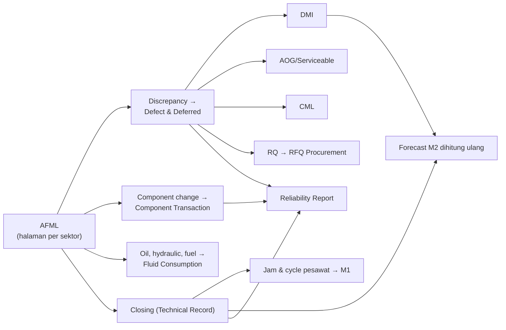

# M4 Flight Operations Interfacing — Overview

> [!abstract] Posisi 11 Nov 2026
> Acuan alur: **Flow Detail 3 Nov** (33 menu, 55 langkah A1–H4, 11 objek, 22 aliran data) **dikoreksi** oleh keputusan 4–6 Nov (AF-01–11, FL-01–05, K5-01–09, K6-01–04), yang sudah masuk Design Brief UI/UX Modul 4 v2. Review desain 3 Nov atas 268 frame: 78 sesuai, 135 perlu penyesuaian, 49 revisi besar, 6 dihapus, ditambah 12 layar baru. Klien mensyaratkan **desain report direview dan disetujui** sebelum development difinalkan.

## Tujuan

Modul 4 menghubungkan operasi penerbangan dengan maintenance. **Semua proses berawal dari halaman AFML**: defect bercabang ke DMI, AOG, atau CML; component change menjadi transaksi komponen; closing halaman memperbarui jam pesawat dan menjadi sumber forecast Modul 2 serta reliability.

## Sub-modul dan menu

| Sub-modul | Menu | Catatan |
|---|---|---|
| [[M4 SM1 AFML & Flight Log]] | 1.1 Flight Log (AFML), 1.2 Closing AFML, 1.3 Correct Flight Log, 1.4 Flight Hour Report | Sumber semua data |
| [[M4 SM2 Defect & Deferred]] | 2.1 Defect, 2.2 DMI, 2.3 DMI Extension, 2.4 Monitor DMI Jatuh Tempo, 2.5 AOG & Serviceable Declaration, 2.6 Fleet Status, 2.7 Defect & Deferred Report, 2.8 Rekap PIREP/MAREP | Paling siap secara desain |
| [[M4 SM3 Component Transaction]] | 3.1 Removal & Installation, 3.2 Robbed Part, 3.3 Component Installed Report, 3.4 Component Removal Report (kandidat dihapus), 3.5 Master Reason of Removal, **3.6 Swap** (baru) | M4 penulis tunggal transaksi komponen |
| [[M4 SM4 Fluid Consumption]] | 4.1 Fuel Uplift, 4.2 Oil Consumption, 4.3 Hydraulic Fluid Consumption | Struktur baru FL-01 (4 Nov) |
| [[M4 SM5 Reliability & Repetitive]] | 5.1 Reliability Report, 5.2 Alert Level, 5.3 Repetitive (pindah jadi tab 5.1) | Format laporan klien Q2 2026 |
| [[M4 SM6 RQ]] | 6.1 Request Part, 6.2 RQ Status Report, 6.3 Master Tipe RQ | RQ di M4, RFQ di Procurement |
| [[M4 SM7 CML & Lintas]] | 7.1 CML; 8.1 Approval Inbox, 8.2 Pengaturan Notifikasi, 8.3 Template Form & Penomoran, 8.4 Riwayat Dokumen Cetak | 8.x diusulkan dipusatkan di SSG |

Pendukung: [[M4 Status Objek & Integrasi]] · [[M4 Decision Register]] · [[M4 Open Questions]]

## Ritme kerja harian

| Waktu | Kegiatan | Pelaku | Menu |
|---|---|---|---|
| Sepanjang hari | Isi halaman AFML per sektor, discrepancy, oli, component change; Submit | Engineer, EOB | 1.1 |
| Saat defect muncul | Pilih jalur: Rectified, Deferred (DMI), Declare AOG, Transfer to CML; buat RQ bila perlu part | Engineer, Engineer in Charge | 2.1, 2.2, 2.5, 6.1, 7.1 |
| Setelah submit | Verifikasi dengan foto dan **Close satu per satu, berurutan per registrasi** | Staf Technical Record | 1.2 |
| Sesudah closing | Jam & cycle pesawat ke M1; forecast M2 dihitung ulang | Sistem | — |
| Harian | Pantau DMI jatuh tempo dan approval menunggu | Chief LM, Chief Inspector, approver RQ | 2.4, 8.1 |
| Bebas (umumnya triwulan) | Jalankan dan ekspor Reliability Report per fleet | Engineering | 5.1 |

> [!note] Istilah EOB
> "EOB" dipakai di dokumen sebagai pelaku input AFML dan defect; kepanjangannya belum tercatat di vault. Konfirmasi dan tambahkan ke [[Glosarium]].

## Keputusan lintas modul yang membentuk M4

- **8 Okt:** M4 penulis tunggal transaksi pasang-lepas komponen (M3 hanya menautkan, M1 read-only) dan pemegang siklus hidup DMI (forecast M2 hanya membaca); penomoran dokumen M4 mengikuti format form klien.
- **9 Okt:** RQ tetap di M4; Procurement memegang RFQ.
- **Okt:** LLP & OC/CM dihitung di M1; HT master di M2.

## Rencana revisi desain (3 gelombang)

| Gelombang | Cakupan | Butir yang perlu dijawab dulu |
|---|---|---|
| 1. Fondasi AFML dan turunannya | SM1, SM2, SM3 (117 frame) + Declare AOG, Record Swap | M4-28, Q26-04, FQ-02/03 |
| 2. Laporan, RQ, Fluid | SM4, SM5, SM6 (60 frame) + 4.1–4.3, tab Defect & PIREP dan Repetitive, Cetak RQ | RL-01–09, Q28-05/06/09, P-02 |
| 3. Pelengkap & Lintas | SM7 + data contoh + 8.1–8.4 | Q26-07–09, CML-08; keputusan SSG |

Butir yang belum dijawab tidak menahan gelombang: layar digambar dengan usulan sementara berlabel *Belum final*.

## Langkah berikutnya

1. Tutup butir terbuka Reliability (RL-01–RL-09) dan approver RQ (P-02) ke Rimbun Air.
2. Selesaikan konfirmasi Procurement (RQ Status Report) dengan PM Wisnu.
3. Sepakati dengan SSG apakah 8.1–8.4 dibangun di M4 atau di SSG ([[Isu Harmonisasi Lintas Modul]]).
4. Siapkan daftar sambungan M4 ke M1, M2, M3, M5, M6 yang final untuk cek silang Mas Bobi.
