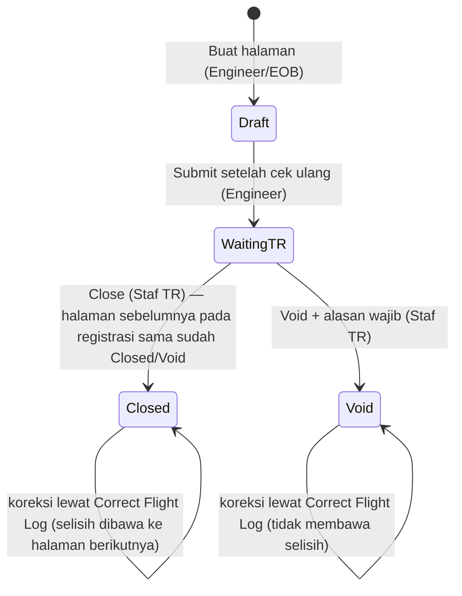

# M4 SM1 AFML & Flight Log

Engineer mengisi halaman sepanjang hari lalu menyerahkannya ke Technical Record (TR). Data menjadi **resmi saat halaman Closed**.

> [!important] Koreksi atas Flow Detail 3 Nov
> - Status setelah submit bernama **Waiting TR** (bukan Waiting Approval) — AF-09.
> - **Tidak ada Closing Harian**; closing satu per satu, berurutan per registrasi — AF-01, AF-02.
> - AFML **tidak** memakai panel Sync Status per tujuan; AFML hanya sync jam & cycle pesawat ke M1. Status kirim ke M1/M5/M6 ada di Component Transaction — AF-04.
> - AFML hanya mencatat **discrepancy & rectification**; jalur penyelesaian dipilih di Menu 2.1 — AF-11, K5-03.

## Status halaman

| Status | Siapa bisa mengubah | Aturan | Acuan |
|---|---|---|---|
| Draft | Engineer, EOB, Staf TR (atas nama engineer) | Halaman bisa diubah | AF-09 |
| Waiting TR | Staf TR, **hanya Tab Flight Data** | Engineer tidak bisa mengubah lagi | AF-09, AFR-04 |
| Closed | Tidak bisa diubah | Koreksi hanya lewat Correct Flight Log | LM-11, K5-08 |
| Void | Lewat Correct Flight Log | Tidak masuk daftar closing; dilewati dalam urutan; tetap Void | AF-03, K5-01 |

## 1.1 Flight Log (AFML)

Input halaman per **tipe pesawat** dan per **sektor** (86 field Master Field): header, crew, sektor, fuel, oli, hydraulic, discrepancy & rectification, component change, release, captain acceptance, engine parameter.

| Langkah | Aturan | Status | Acuan |
|---|---|---|---|
| A1 Buat halaman | Pilih registrasi & entry type (Flight/Maintenance); field mengikuti tipe pesawat dari registrasi; nomor halaman divalidasi duplikat; Prev. page terisi dari halaman terakhir | Final | AFR-06, AFR-19, AFR-22, M4-01 |
| A2 Crew & sektor | Crew dari Employee Master. ATR 1 sektor, B737 sampai 6; **nomor sektor = nomor halaman + urutan** (mis. 1001-2) | Final | AFR-07, AFR-20 |
| A2 TSN/CSN | **Brought forward** = TSN/CSN sektor terakhir halaman non-void sebelumnya. Tiap sektor: TSN + flight time, CSN + cycle (default 1). Total halaman = jumlah sektor; TSN/CSN akhir = sektor terakhir. Nilai sementara sampai Closed | Final | LM-10, WB-01–WB-05, AF-03 |
| A3 Fuel, oli, hydraulic | Diisi di **Tab Oil & Fuel**. Uplift fuel liter. Oli per engine per sektor dalam QT, qty desimal; PN oli/hydraulic hanya dari yang **di-issue ke WO pesawat itu**, satuan read-only dari PN. B737 mencatat sisa fuel akhir | Final | AFR-10–AFR-15, AFR-23, K5-09 |
| A3 QT/FH | Informasi setelah simpan; rumus di [[M4 SM4 Fluid Consumption]] | Final | REL-18, WB-07, WB-08 |
| A4 Discrepancy | Discrepancy & corrective action berurutan, sumber PIREP/MAREP. Setiap baris berlabel **"Discrepancy, sent to Defect & Deferred"**; tanpa pilihan jalur & isian DMI di AFML | Final | AF-11, K5-03, M4-02, M4-30 |
| A4 Nomor defect | No. Halaman + No. Item + urut 7 digit | Final; global/per registrasi Menunggu (Q26-04) | M4-24 |
| A5 Component change | Baris membuka Record Removal/Installation (M4 3.1) dengan halaman, sektor, defect terisi. **Tidak ada field jam** di tabel ini; waktu penggantian dari Event Date & Time di Component Transaction | Final | AF-06, AFR-27 |
| A5 Wheel assy | Outer sebagai induk "Wheel Assy / Outer" dengan PN & SN sendiri | Final | K5-02 |
| A6 Release | Auth No, AMO No, RII stamp dari Employee Master; tanggal return to service boleh lewat sehari; tanda tangan tetap di kertas | Final | AFR-16, AFR-28, AFR-29 |
| Engine Parameter | Disertakan; seluruh field Master Field per tipe (B737 ENG-03, ATR ENG-01/02) | Final | AF-07 |
| DHC-6 | Tidak ada contoh fisik; form mengikuti Master Field; tidak ada frame khusus | Final; field aktif Menunggu (DHC-a, DHC-b) | AF-10 |
| Foto | Foto halaman wajib sebelum closing | Final | review 22–26 Okt |
| A7 Submit | Engineer cek ulang lalu Submit (popup konfirmasi) → **Waiting TR**; belum memengaruhi data lain | Final | AF-09 |
| Format jam | Input, detail, Verify, Correct Flight Log memakai **jam:menit** seperti kertas | Usulan | WQ-01 |

## 1.2 Closing AFML

| Aturan | Status | Acuan |
|---|---|---|
| Daftar Waiting TR per registrasi, urut tanggal terbang lalu nomor halaman; TR bisa memverifikasi lebih dulu | Final | AFR-01 |
| **Close berurutan per registrasi**: halaman bisa di-Close bila halaman sebelumnya (registrasi sama) Closed; registrasi lain tidak tertahan. Baris tertahan: ikon gembok + "Menunggu AFML-xxxx"; Verify Page: tombol Close nonaktif + banner | Final | AF-01 |
| Closing **satu per satu**; tidak ada Closing Harian | Final | AF-02 |
| Halaman Void tidak masuk daftar closing dan tidak menahan halaman sesudahnya (contoh: 0411 Closed, 0412 Void, 0413 langsung bisa Close dengan brought forward dari 0411) | Final | AF-03 |
| Verify Page: foto berdampingan dengan data; semua sektor dengan TSN/CSN; Previous/Next | Final (desain) | AFR-04 |
| Cek sebelum Close: foto ada; baris component change sudah punya transaksi | Foto Final; transaksi Usulan | FC4 |
| Saat Closed: jam & cycle pesawat per sektor dikirim ke **Modul 1**; forecast M2 dihitung ulang (M2 no 55) | Final (M1); pemicu M2 Usulan | AF-04, AFR-03, FQ-04 |
| Jam & cycle **komponen terpasang** per sektor bertambah saat closing; penggantian di tengah halaman dibagi menurut waktu | Usulan | FQ-02, FQ-03, AF-06 |
| Gagal kirim: halaman tetap Closed, tujuan gagal dikirim ulang | Usulan | FC5, FC6 |

## 1.3 Correct Flight Log

| Aturan | Status | Acuan |
|---|---|---|
| Halaman Closed **tidak pernah diubah**. Staf TR mencatat koreksi flight time, block time, atau cycle: halaman asal, sektor, nilai tercatat, nilai seharusnya, selisih, **alasan wajib** | Final | K5-08 |
| Selisih dibawa ke halaman berikutnya registrasi sama yang belum Closed (Draft/Waiting TR); bila belum ada, menempel ke halaman berikutnya yang dibuat | Final | K5-08 |
| Di halaman tujuan tampil read-only **Corrected Hours** dan **Corrected Cycle** + nomor halaman asal; Total = brought forward + total this page + corrected | Final | K5-08 |
| Status koreksi **Pending** sampai halaman tujuan Closed, lalu **Applied** saat selisih terkirim ke M1; Pending boleh diubah/dibatalkan, Applied read-only | Final | K5-08 |
| Halaman asal: banner "Dikoreksi di halaman [No.]"; Log History di halaman asal dan tujuan | Final | K5-08 |
| Halaman Void boleh dikoreksi lewat Correct Flight Log; tetap Void, tidak membawa selisih | Final | K5-01 |
| TSN/CSN sektor sesudahnya dan QT/FH terkait dihitung ulang | Final | LM-11 |
| Periode laporan selisih; perlu approval koreksi | Menunggu (usulan: tanggal halaman tujuan; tanpa approval, alasan wajib) | K5-08 lanjutan |

## 1.4 Flight Hour Report

FH dan FC per registrasi per periode **hanya dari halaman Closed**; halaman belum Closed tidak dihitung dan ditandai banner. Total Flight Time dan Block Time tampil **jam:menit dan desimal** (mis. 148:35 (148,58)); ekspor memuat keduanya (AF-08). Sumber sama dengan tab Utilization di Reliability.

## Butir terbuka AFML

H-02 (defect dari halaman Void; usulan tetap berlaku), DHC-a/DHC-b, Q26-04, WQ-02 (TSN jam:menit atau desimal), WQ-05 & FQ-08 (WO di antara penerbangan), FQ-01/06/07 (kapan jam dikirim, perlakuan sync gagal). Rincian: [[M4 Open Questions]].
