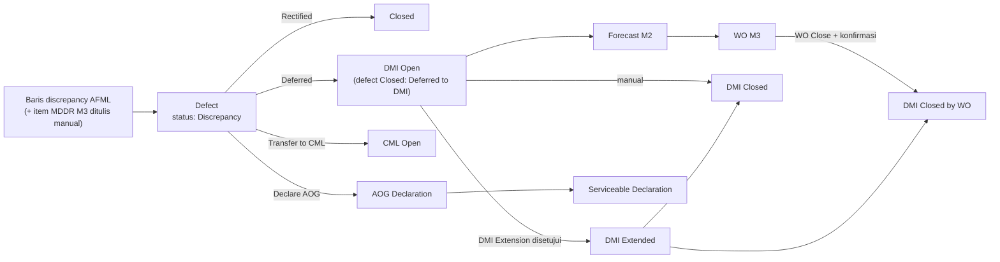

# M4 SM2 Defect & Deferred

Setiap defect **ditutup lewat satu jalur**. Yang tetap terbuka dan dipantau adalah turunannya: DMI sampai ditutup, AOG sampai Serviceable, CML sampai diperbaiki.

## Status defect

| Status | Arti | Acuan |
|---|---|---|
| **Discrepancy** | Entri dari AFML yang belum dipilih jalurnya | K5-03 |
| Closed – Rectified | Diperbaiki | M4-25 |
| Closed – Deferred to DMI | Perlu proses lanjut; label "Deferred" hanya untuk yang masuk DMI | K5-03 |
| Closed – Transferred CML | Item kabin | M4-25 |
| Closed – AOG Declared | Memengaruhi flight berikutnya | M4-18, M4-25 |

Tidak ada defect berstatus **Open** di daftar maupun report (M4-25). Jalur WO Unscheduled langsung dari defect tidak disebut klien (Menunggu, M4-28).

## Menu

| Menu | Fungsi | Pelaku | Acuan |
|---|---|---|---|
| 2.1 Defect | Daftar dan detail defect; pilih jalur. Dari detail: Buat RQ, catat penggantian komponen, buat declaration | Engineer, EOB, Staf TR | M4-03, M4-25 |
| 2.2 DMI | DMI dari Deferred, **satu defect satu DMI**; nomor dari master (mis. `045/RAA/DMI/10/26`); due date dari kategori MEL (boleh override; Non-MEL manual); ditutup manual atau lewat WO | Engineer, EOB | M4-03–M4-11, K6-01 |
| 2.3 DMI Extension | Perpanjangan **sekali per DMI**; approval berurutan **Chief Inspector → Director of Operation**; tanggal order & kedatangan dari RQ | Chief LM; approver | M4-12, M4-13 |
| 2.4 Monitor DMI Jatuh Tempo | Sisa hari per DMI dengan warna ambang 8.2; hanya DMI Open/Extended dengan **Monitor Request = Yes** | Engineer, Chief LM, PPC | M4-07, K6-03 |
| 2.5 AOG & Serviceable Declaration | Dibuat dari defect (bukan dari DMI), berpasangan AOG → Serviceable; cetak Draft/Printed/Signed Uploaded | Engineer in Charge; diketahui Chief LM | M4-17, M4-18, M4-21–M4-23 |
| 2.6 Fleet Status | Status dari declaration terakhir; kosong bila belum ada; **terpisah** dari status pesawat M1 (diubah manual di M1) | Management, Flight Ops (lihat) | M4-19, M4-20 |
| 2.7 Defect & Deferred Report | Closed, Deferred, Transferred CML, Total (tanpa Open); tab DMI/MEL Summary RAA-TLM-006; ekspor PDF & Excel | Chief Inspector, Engineering | M4-25, M4-31, K6 |
| 2.8 Rekap PIREP/MAREP | Jumlah PIREP & MAREP per registrasi per bulan; rate per FH disembunyikan sampai rumus disepakati | Chief Inspector, Engineering | M4-27, M4-29 |

## DMI: isian dan pemetaan form klien

Form acuan: **RAA-TLM-007** Deferred Maintenance Item Log (per DMI) dan **RAA-TLM-006** Maintenance Control DMI/MEL Summary (rekap per registrasi), R0 Des 2025.

| Bagian form | Field | Layar |
|---|---|---|
| TLM-007 kotak defect | Station, date, time, TFLB page, ATA, defect description | Header 2.2.2 read-only dari defect |
| TLM-007 Defect Deferral | MEL/CDL kategori A–D, Non-MEL, reference, **time limit (tanggal, FH, atau FC)**, reason (Time Request, Troubleshooting, No Spare Part), A/C Serviceable For (ETOPS, RVSM, CAT II/IIIA), **Monitor Request (wajib)** | Tab Deferral Basis & Time Limit 2.2.2 |
| TLM-007 Defect Deferral | Required (MEL) Action Performed, Limitation | Tab Actions & Restrictions; Limitation tampil di Fleet Status & Monitor DMI |
| TLM-007 Defect Deferral | Time (UTC), name, auth/stamp | Tercatat saat Save dari login & stamp |
| TLM-007 Extension | Reference, expiration, name, auth/stamp | 2.3; satu extension per DMI |
| TLM-007 Rectification Action | Station, date, time, TFLB page, ATA, doc ref, deskripsi, rectified by, auth | Popup Close DMI 2.2.3 |
| TLM-007 Component Change | Description, POS, P/N & S/N off/on | Tab Components 2.2.3 |
| TLM-007 Intermediate Action | — | **Belum dikelola sistem**; tercetak kosong (K6-02) |
| TLM-006 | Registrasi, tipe; Deferred Defect (No, Flight Log No, Discrepancy, Period & Reason, Engineer & Auth No, Due Date); Defect Cleared (Flight Log No, Station, Engineer & Auth No, Date) | Tab DMI/MEL Summary 2.7.1 |

## Status DMI dan turunannya

| Objek | Status | Pemicu | Acuan |
|---|---|---|---|
| DMI | Open → Extended → Closed | Deferred; Extension Approved; ditutup manual atau lewat WO ("Closed by WO [nomor]"); selama di WO berlabel "Dalam WO [nomor]" (usulan M3) | M4-03, M4-13, M4-26 |
| DMI Extension | Draft, Submitted, Approved, Rejected | Chief LM mengajukan; CI lalu DirOps memutuskan | M4-13 |
| Declaration | AOG, Serviceable; dokumen Draft, Printed, Signed Uploaded | Engineer in Charge dari defect | M4-17, M4-19, M4-23 |

## Aturan lain

- Tutup DMI manual: tanggal, station, engineer, auth no dari stamp, halaman AFML, document reference, deskripsi (M4-16).
- DMI masuk forecast Modul 2 berdasarkan due date (M4-26; M2 no 53–54).
- **Limit Type DMI = tanggal, flight hours, atau flight cycles** (K6-04, 6 Nov, dari catatan form RAA-TLM-007; menjawab FQ-05). DMI Detail sudah punya Limit Type, Due FH, Due FC; sisa FH/FC diperbarui saat closing AFML.

> [!warning] Perlu diselaraskan dengan Modul 2
> Keputusan M2 no 54 (23 Okt) menyebut batas DMI hanya due date tanpa FH/FC, sedangkan K6-04 (6 Nov) menetapkan time limit bisa FH atau FC. Forecast M2 perlu membaca Limit Type DMI. Dicatat sebagai LX-01 di [[Isu Harmonisasi Lintas Modul]].
- Form AOG: RAA-TLM-001; Serviceable: RAA-TLM-002. Pesawat tetap AOG sampai Serviceable dibuat.
- Daftar defect untuk Reliability Report memakai kolom laporan klien: date, A/C type, reg, ATA 4 digit, problem, rectification, location.

## Butir terbuka

M4-28 & Q26-06 (jalur WO Unscheduled, kolom In WO), Q26-02/03 (satu AOG beberapa defect), Q26-04 (nomor 7 digit), Q26-05 (DMI tertutup otomatis/konfirmasi), M4-11/M4-12/M4-32 (defect ditulis ulang, STE, nama menu DMI Extension), Q26-01/Q26-10, H-02. Lihat [[M4 Open Questions]].
