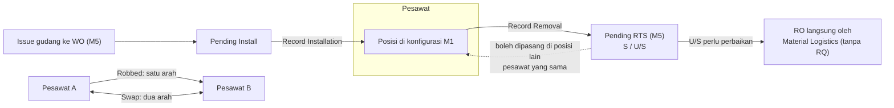

# M4 SM3 Component Transaction

Modul 4 adalah **penulis tunggal** transaksi pasang-lepas komponen (keputusan 8 Okt): Modul 3 hanya menautkan dari task card, Modul 1 menerima konfigurasi read-only. Removal dan installation dicatat **terpisah**; robbed dan swap langsung antar pesawat tanpa gudang.

## Menu

| Menu | Fungsi | Pelaku | Status | Acuan |
|---|---|---|---|---|
| 3.1 Penggantian Komponen | **Record Removal** dan **Record Installation** terpisah (dua tombol masuk); dibuka dari menu, baris component change AFML, atau task card WO M3 | Engineer | Berubah | CT-01 |
| 3.2 Robbed Part | Hanya Robbed: donor → penerima, langsung terpasang; Print Robbed Part Form & Upload Scan | Line Engineer / Chief LM; **DoM menyetujui** | Berubah | CT-08 |
| **3.6 Swap** | Proses tersendiri (bukan bagian Robbed), dua arah, hanya antar pesawat; Record Swap & Swap Detail | Line Engineer / Chief LM; approval DoM perlu dipastikan | **Baru** (nomor sementara) | K5-04 |
| 3.3 Component Installed Report | Komponen terpasang per registrasi dengan TSN, CSN, as of; umur dari M1 | PPC, Engineering | Berubah | CT-11; kolom Q27-08 |
| 3.4 Component Removal Report | Tercakup tab Component di Reliability | — | Kandidat dihapus | Q27-07 |
| 3.5 Master Reason of Removal | Kode, nama, aktif; **tanpa** kelompok Scheduled/Unscheduled; kolom Failure ditinjau ulang | Admin, Engineering | Berubah | CT-03, REL-10 |

## Aturan transaksi

| Aturan | Status | Acuan |
|---|---|---|
| **Scheduled otomatis bila WO terisi**, Unscheduled bila tidak; tidak dipilih manual | Final | CT-02 |
| Removal untuk WO DMI/defect: Scheduled hanya bila Asal WO Planning | Menunggu | Q27-03 |
| Pilih satu SN dari konfigurasi; **SN parent membawa child** (mis. main wheel assy + inner, outer, tire) | Final | CT-04, CT-05 |
| Wheel assy: bagian **outer sebagai induk** berketerangan "Wheel Assy / Outer", PN & SN sendiri | Final | K5-02 |
| Reason dari Master Reason of Removal | Final | CT-03 |
| **Event Date & Time wajib**; menjadi waktu penggantian untuk alokasi jam komponen; peringatan bila jatuh di tengah sektor (antara block off dan block on) | Final | AF-06 |
| Field WO No. dan halaman AFML + sektor; TSN/CSN diambil dari sektor AFML | Final | LM-10 |
| Umur saat removal: TSN, CSN, TSO, CSO; kondisi Serviceable/Unserviceable; U/S Tag | Final (desain) | — |
| Part yang dilepas masuk **Pending RTS** sampai gudang menerima | Final | CT-06 |
| Installation mengambil part dari **issue gudang (Pending Install)**; PN divalidasi ke PN Master; SN dibaca dari konfigurasi | Final | CT-06, CT-09 |
| Part dari Pending RTS boleh dipasang di posisi lain pesawat yang sama | Usulan | Q27-06 |
| Consumable/expendable tanpa SN **tidak** lewat Component Transaction; di-issue dan dibebankan ke WO | Final | CT-10 |
| Unserviceable yang perlu perbaikan: **RO langsung** oleh Material Logistics dari unserviceable inventory, tanpa RQ; core exchange lewat shipping atas pemicu Procurement | Final | P-01, konfirmasi PM 30 Okt |

## Robbed vs Swap

| | Robbed (3.2) | Swap (3.6) |
|---|---|---|
| Arah | Donor → penerima, satu arah | Dua arah antar dua pesawat |
| Dengan gudang | Tidak | Tidak (bukan dengan gudang) |
| Form | Robbed Part Form | Pola sama: di tiap pesawat ada sisi part keluar & masuk |
| Approval | Director of Maintenance (boleh didelegasikan ke Chief LM, SSG WF-ROB) | Perlu dipastikan (CT-08) |
| Di Approval Inbox | Jenis pengajuan sendiri | Jenis pengajuan sendiri |
| Cetak | Robbed Part Form, tercatat di 8.4 | Perlu dipastikan |

## Sinkronisasi

| Tujuan | Data | Status | Acuan |
|---|---|---|---|
| Modul 1 | Konfigurasi dan umur part | Final | CT-04, CT-07 |
| Modul 5 | Pending RTS | Final | CT-06, CT-07 |
| Modul 6 | **Leg type** per PN & SN (asal part: aircraft atau receiving store) | Final | Konfirmasi PM 30 Okt |

Detail transaksi menampilkan status kirim **Modul 1, Modul 5, Modul 6** dengan tombol **Resend** (AF-04); status Pending RTS ditutup saat gudang menerima. Gagal sync disesuaikan lalu dikirim ulang.

## Jam komponen

Setiap SN yang terpasang saat sektor berangkat mendapat jam dan cycle sektor saat closing AFML; penggantian di tengah halaman dibagi menurut waktu (Usulan FQ-02, FQ-03; waktu dari Event Date/Time AF-06). Jam engine dari flight time atau block time, dan jam APU, masih Menunggu.

## Perbaikan desain (review 3 Nov)

Schedule masih dipilih manual; reason masih dikelompokkan; status M6 dan Pending RTS belum ada; form Swap belum ada; tombol masuk perlu dipisah Record Removal / Record Installation.
