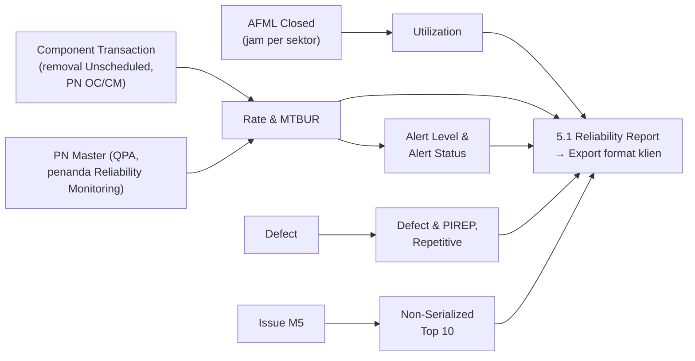

# M4 SM5 Reliability & Repetitive

Reliability **tidak punya input sendiri**. Engineering memilih fleet dan periode, lalu sistem menghitung dari halaman AFML Closed, removal komponen, defect, issue Modul 5, dan master. Format ekspor mengikuti **Reliability Report Boeing Fleet Q2 2026** milik klien.

## Menu

| Menu | Fungsi | Status | Acuan |
|---|---|---|---|
| 5.1 Reliability Report | Per **satu fleet** (tipe varian), rentang tanggal bebas + pilihan cepat triwulan. Tab: **Utilization, Component, Non-Serialized, Defect & PIREP, Repetitive**. Ekspor PDF/Excel format klien. **Tanpa arsip** (Save to Archive, Report Archive, toggle data tidak memadai dihapus) | Revisi besar | REL-02, REL-20, REL-21, FL-03 |
| 5.2 Alert Level | Menampilkan parameter (2,5; SD populasi; 12 bulan) dan riwayat hasil hitung per PN per fleet; bukan input manual | Revisi besar | REL-08, RL-03 |
| 5.3 Repetitive Defect | Pindah menjadi tab Repetitive di 5.1, tanpa kolom registrasi & aturan; layar Rule Settings kandidat dihapus | Pindah | REL-13–REL-16, Q28-06 |

Tab Oil Consumption **tidak lagi** di 5.1; pindah ke [[M4 SM4 Fluid Consumption|menu 4.2]] (FL-03).

## Rumus dan langkah

| No | Langkah | Aturan | Status | Acuan |
|---|---|---|---|---|
| E1 | Jam terbang | Jam per sektor halaman Closed dijumlah per registrasi per bulan (desimal 2 angka). Jam fleet = jumlah semua registrasi termasuk pesawat 0 jam | Final | REL-21 |
| E2 | Removal | Hanya removal **Unscheduled** untuk PN bertanda **Reliability Monitoring** (OC/CM), per PN per fleet per bulan | Final | REL-03, REL-10 |
| E3 | Rate & MTBUR | **Rate = removal × 1.000 ÷ (QPA × jam fleet)**; **MTBUR = QPA × jam fleet ÷ removal**; kolom keseluruhan, per bulan, tiga bulan terakhir. Terbukti cocok di 18 baris laporan | Final (rumus); basis jam Menunggu (RL-01, RL-02) | REL-05, REL-07 |
| E4 | Alert level | **AL = rata-rata + 2,5 × SD populasi dari 12 rate bulanan**, per PN per fleet. Bulan yang melewati AL ditandai (warna di layar, bintang di ekspor) | Final; jendela 12 bulan Menunggu (RL-03) | REL-08 |
| E4 | Alert Status | **Alert 1**: bulan ketiga melewati; **Alert 2**: bulan kedua & ketiga; **Alert 3**: ketiganya | Final; di sistem & notifikasi Menunggu (RL-04) | Laporan hal. 4 |
| E5 | Defect & repetitive | Daftar defect periode (kolom laporan klien), jumlah per ATA 4 digit per registrasi, Top 10. **Repetitive**: ATA 4 digit sama, pesawat sama, dalam 3 bulan; urut occurrence lalu ATA | Final; rate & alert defect Menunggu (RL-07) | REL-13–REL-16 |
| E6 | Non-Serialized | Top 10 issue part per fleet | Usulan (Q28-09) | REL-04 |
| E7 | Tampilkan & ekspor | Ekspor: definisi, abstract, daftar pesawat, utilization, component per fleet + Top 10 Removals, defect per fleet + Top 10 ATA | Final | REL-09, REL-12, REL-20 |
| E8 | Tindak lanjut | PN dengan Alert Status ditinjau Engineering/Reliability Review; notifikasi Alert 2 & 3 | Usulan (RL-04) | Laporan hal. 3 |

## Kolom tab Component

ATA, Description, PN, **QPA**, MTBUR Rimbun & Worldwide, Rmv, Rate, Alert Level, Rmv & Rate per bulan, tiga bulan terakhir, **Alert Status**, + grafik Top 10 Removals.

## Data dari modul lain

| Data | Dari | Status |
|---|---|---|
| Penanda PN: Reliability Monitoring (OC/CM), wheel assy, sub-major assembly, kategori part, oli; **QPA per tipe varian** | M1 PN Master | Final; kategori part perlu konfirmasi |
| MTBUR Worldwide per PN | M1 PN Master | Usulan (RL-05) |
| MSN, delivery date, manufacture date, tipe varian | M1 | Final |

## Butir terbuka

RL-01–RL-09 (basis jam, jendela 12 bulan, Alert Status di sistem, MTBUR Worldwide, Top 10 gabung PN pengganti, rate & alert defect, FC di Utilization, laporan ATR & DHC-6), Q28-05 (minimum kemunculan repetitive), Q28-06 (layar Rule Settings), Q28-09 (isi Non-Serialized).
