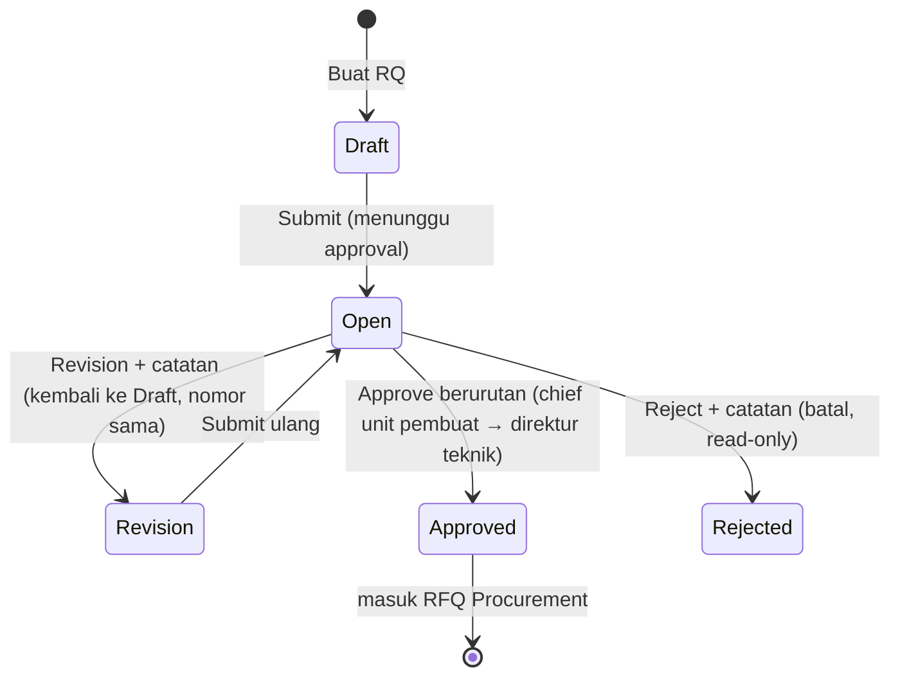

# M4 SM6 RQ (Request Part)

RQ adalah **permintaan part**: PN, qty, dan kapan dibutuhkan. RQ tetap di Modul 4; **Procurement memegang RFQ** (keputusan 9 Okt). Setelah disetujui berurutan, RQ langsung masuk RFQ; order type ditentukan saat order. Repair part unserviceable **tidak** lewat RQ (langsung RO).

## Status

Status item: **Open → Order → Closed** (Closed saat barang diterima, tanggal received tampil). Nomor dan type order (PO, EXO, RO) tampil per item.

## Menu

| Menu | Isi | Pelaku | Acuan |
|---|---|---|---|
| 6.1 Request Part | List, form, detail. **Satu tipe per RQ**: MEL (dengan kategori A–D), AOG, Critical, Routine, Finding. Header: tanggal dibutuhkan, **Description** dan **Reason** wajib, referensi. Item: nomor item, PN (boleh berulang), alternate PN & UOM dari PN Master (read-only), qty, kondisi opsional, recent part condition, **foto wajib** (atau gambar IPC bila part tersembunyi). Tanpa field order type. **Cetak RQ** dengan approval & tanda tangan | PPC, Engineering, Material Planning, Engineer line | RQ-01–RQ-15, RQ-19, P-04, P-05, K5-07 |
| 6.2 RQ Status Report | Sama dengan monitoring RQ/PO Procurement: tab **By RQ Number** dan **By Part Number** | Engineer, PPC | RQ-21, K5-06 |
| 6.3 Master Tipe RQ | MEL, AOG, Critical, Routine, Finding dengan urutan prioritas & penanda butuh kategori MEL; **SLA tidak ditampilkan**; tambah/ubah hanya role yang diberi izin | Aktor tertentu (diatur role) | RQ-09, RQ-13, RQ-14, P-05 |

## Langkah

| No | Langkah | Aturan | Acuan |
|---|---|---|---|
| F1 | Buat RQ dari detail defect, task card WO M3, atau langsung | Tipe **Finding** untuk temuan dari mana pun | RQ-01–RQ-15 |
| F2 | Ajukan → **Open** (menunggu approval) | Field wajib divalidasi saat submit | RQ-16, P-03 |
| F3 | Approval berurutan di **Approval Inbox (8.1)** dengan tanda tangan digital dari Employee Master | Revision kembali ke Draft (nomor sama); Rejected batal; target waktu per tipe tidak ditampilkan | RQ-13, RQ-17, RQ-18 |
| F4 | Cetak RQ | Termasuk approval & tanda tangan; lampiran approval PO; tercatat di 8.4 | RQ-19 |
| F5 | Masuk RFQ dan order (M6) | Order type apa pun; qty order ≤ qty RQ; baris order merujuk nomor RQ & nomor item | RQ-20, RQ-22, PC-02, PC-04 |
| F6 | Barang diterima | Item Closed + tanggal received; tanggal order & kedatangan dipakai di DMI Extension | RQ-20 |
| F7 | Repair part unserviceable | RO langsung dari unserviceable inventory oleh Material Logistics, tanpa RQ | RQ-23, PC-06, P-01 |

## Tampilan status di RQ Status Report (K5-06, Final)

| Tab | Status tetap | Keterangan di bawah badge |
|---|---|---|
| By RQ Number | Open, Revision, Approved, Rejected | Di bawah **Approved**: No item ordered yet · Quotation in progress · n of m items ordered · All items ordered · All items received |
| By Part Number | Item Open, Order, Closed | Di bawah **Open**: Waiting approval · RQ returned for revision · Approved not ordered · Approved quotation in progress · RQ rejected |

Tidak ada status baru.

## Butir terbuka

| Kode | Butir | Usulan sementara |
|---|---|---|
| P-02, RQ-18 | Siapa "direktur teknik" dan apakah dua langkah berlaku untuk semua tipe termasuk AOG | Director of Maintenance; dua langkah semua tipe |
| P-07 | Credit note | — |
| P-08, Q-47 M3 | Penyelarasan RQ dari task card WO (approver Chief PPC & Engineering) | Dikerjakan saat revisi Modul 3 |
| Konfirmasi Procurement | List acuan, Category, Source, No. item, Required By, keterangan status (ke PM Wisnu) | — |
