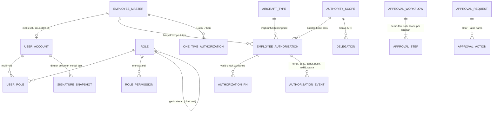
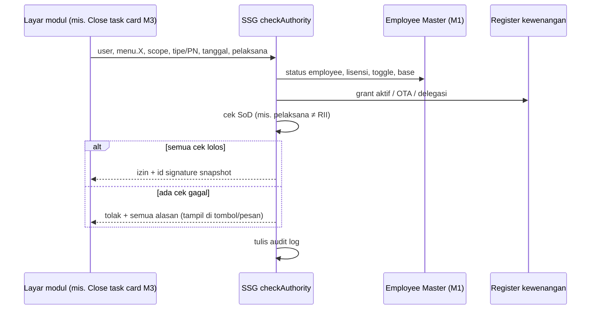

# SSG Data, Integrasi & PoC

## Entitas dan kardinalitas

SSG memiliki **26 entitas** dan membaca **5 entitas** dari Modul 1 dan Modul 2. 20 entitas inti (+3 tabel bayangan eksternal) sudah dibangun dan diuji di SQLite (`schema.sql`). Kolom, tipe data, dan kardinalitas lengkap ada di workbook (format sama dengan rancangan ERD Modul 2).

Entitas pendukung yang baru ada di rancangan ERD (belum di PoC): `sod_rule`, `login_log`, format & sequence penomoran, `notification_rule`, `security_policy`.

## Integrasi dengan modul lain

| Modul | Mengambil dari SSG | Mengirim ke SSG | Perubahan pada rancangan modul |
|---|---|---|---|
| M1 EC | Daftar role (pengganti enum), katalog scope | Employee (termasuk base kerja), lisensi, toggle, tanda tangan & stempel | `employee_authorization` diperluas dan dikelola dari SSG-04; tab Kewenangan Approval EC Menu 7 menjadi tampilan baca |
| **M2 MPP** | `checkAccess`, `approve` (MP, STE), notifikasi due | Permintaan approval | Pengaturan Role STE dan Notifikasi Due diganti SSG-06 & SSG-11; Format Nomor (R36) memakai SSG-10 |
| **M3 P&E** | `checkAuthority` (closing task card, RII), `approve` (WO) | Snapshot tanda tangan di task card | WO Number Setup → SSG-10; OTA Record → SSG-05 *(bertabrakan dengan keputusan OTA di M1, LX-03)*; CRS sudah pindah ke Workshop |
| **M4 FOI** | `checkAuthority` (AFML release, defect, CML closing, komponen), `approve` (DMI Extension, robbed, swap, RQ) | Permintaan approval | Menu 8.1–8.4 diganti SSG-07, SSG-11, SSG-10, SSG-12 |
| M5–M11 | `checkAccess`, `checkAuthority` (receiving, serviceable tag, scrap), `approve` (AVL, payment, shop WO) | Permintaan approval | Disepakati dengan PM masing-masing |

## Alur data saat tanda tangan

1. Modul pemanggil mengirim user, `menu.X`, scope, tipe pesawat/PN, tanggal, jenis maintenance, pelaksana ke `checkAuthority`.
2. Layanan membaca role, data employee di EC (status, lisensi, toggle), grant, OTA, delegasi.
3. Mengembalikan keputusan + daftar cek; bila lolos menyimpan snapshot dan mengembalikan id snapshot.
4. Modul menyimpan id snapshot di dokumennya (task card, AFML, serviceable tag, receiving), sehingga dokumen lama tetap menunjukkan kewenangan saat ditandatangani walau kartu kemudian dicabut.

## Proof of Concept

PoC membuktikan aturan bisa dijalankan sistem. Paket: `rbac_data.py` (sumber tunggal role, menu, scope, workflow, data Roster), `gov_meta.py`, `schema.sql`, `authz.py` (mesin otorisasi), `run_poc.py` (69 skenario), `build_workbook.py`, `hasil_poc.md/json`, `poc_rbac.db`. Data: 104 menu, 46 scope, 15 workflow, 8 SoD, Roster Rev 02 (37 personel, 138 grant CERT).

**Eksekusi ulang 5 Nov 2026: 69/69 lulus** (tanggal acuan skenario 16 Okt 2026).

| Kelompok | Skenario | Izin | Tolak | Yang dibuktikan |
|---|---|---|---|---|
| Identitas | 4 | 1 | 3 | Akun hanya dari employee aktif; admin tidak memberi role ke diri sendiri |
| Akses | 8 | 5 | 3 | Menu per role; cakupan station & status WO |
| Kewenangan | 20 | 10 | 10 | Tipe, PN, metode NDT, keluarga pesawat; RII bukan pelaksana; multi-role |
| Siklus | 14 | 4 | 10 | Lisensi lewat, 1 tahun lewat, bekukan & pulihkan, self-grant, toggle |
| OTA | 6 | 2 | 4 | Durasi, pengalaman, hanya unscheduled, periode |
| Workflow | 17 | 8 | 9 | Pengaju ≠ penyetuju, urutan, chief unit pembuat, delegasi APR |
| **Total** | **69** | **30** | **39** | |

**Skenario penentu:** S12/S13 (rating per tipe, bukan AMEL), S15 (Mechanic tanda tangan RTS ditolak tiga cek), S18 (RII oleh pelaksana ditolak), S21 (WI di B737-800 ditolak), S26 (PN di luar daftar WBS-01), S33 (lewat 1 tahun), S41/S67 (toggle hanya CI/Inspector, tanpa riwayat), S48 (OTA tanpa tipe serupa untuk scheduled ditolak), S53 (DirOps sebelum CI ditolak), S56/S57 (chief unit pengaju), S60/S66 (delegasi hanya APR).

**Bukti tambahan:** 54 baris audit log, 13 snapshot tanda tangan, 171 baris `authorization_event`, fungsi `ndt_status` (Suspended/Revoked/Active).

**Batasan:** tanggal kartu diasumsikan 6 Jul 2026 + 1 tahun; level NDT diasumsikan Level 2; station placeholder STN-A/STN-B; tampilan, PIN, sesi, notifikasi, penomoran belum diuji.

**Menjalankan ulang:** `python run_poc.py` (tambah `--file` untuk menyimpan `poc_rbac.db`); `python build_workbook.py` membangun ulang workbook. Setiap jawaban klarifikasi diubah di `rbac_data.py`, lalu keduanya dijalankan ulang agar PRD, matriks, dan bukti selaras — **setelah itu perbarui catatan SSG di vault**.
