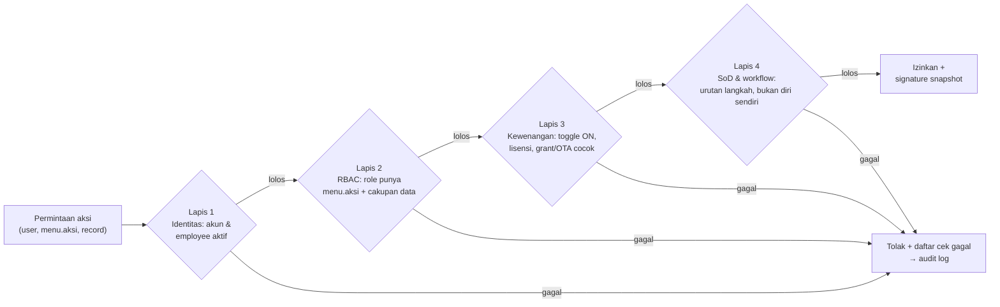
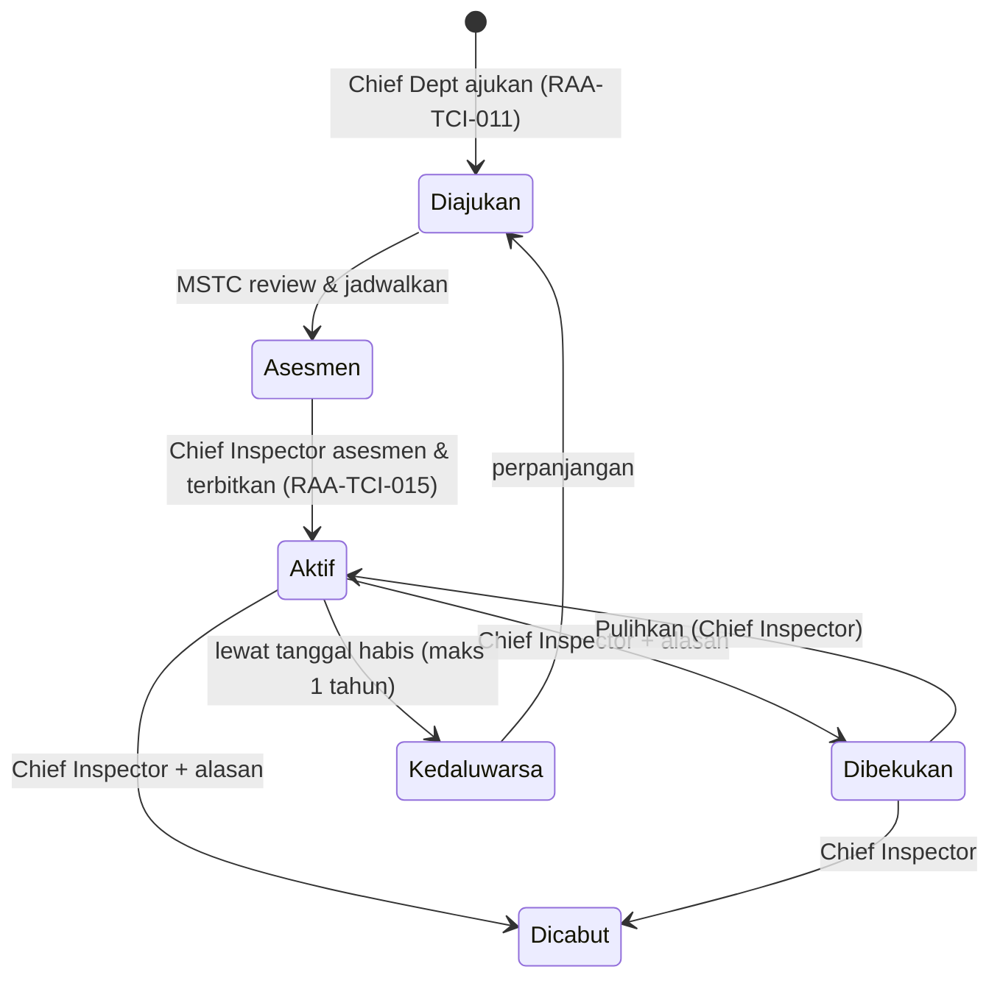

# SSG Model Governance & Kewenangan

Dokumen klien sudah mengatur siapa boleh menandatangani apa secara rinci; sistem cukup **menegakkan** aturan itu, bukan menciptakan aturan baru.

## Model 4 lapis

Setiap permintaan aksi dari modul mana pun melewati empat lapis berurutan. Aksi tanda tangan (A dan X) sah hanya bila keempatnya lolos. Setiap lapis yang gagal menghentikan proses dan mencatat alasannya.

Lapis 3 hanya berlaku untuk aksi **A** (approve) dan **X** (sign/certify). Aksi V, C, D, S, P, K cukup lolos lapis 1, 2, dan 4.

**Mengapa akses dipisah dari kewenangan**
- Satu role berisi banyak orang dengan kewenangan berbeda: Kevin Khadafhi (RAA-35) hanya sah untuk B737-300, Herry Fitri Purwanto (RAA-33) untuk B737-800, padahal keduanya Line Engineer.
- Kewenangan berubah lebih sering daripada role: dibekukan, dicabut, kedaluwarsa tiap 1 tahun, atau sementara lewat OTA.
- Spesialis melekat ke orang: Agus Sutiadi adalah Line Engineer yang juga memegang RII-10 dan BSI-01.

## Kontrak layanan untuk modul lain

| Layanan | Masukan | Keluaran | Dipakai oleh |
|---|---|---|---|
| `checkAccess` | user, `menu.aksi`, atribut record (station, status, pemilik) | izinkan/tolak + daftar cek | Semua layar: tampil/sembunyi tombol, filter data |
| `checkAuthority` | user, scope, tipe pesawat atau PN, tanggal, jenis maintenance, pelaksana | izinkan/tolak + daftar cek + jalur (grant, OTA, delegasi) | Closing task card, CRS, AFML, defect, serviceable tag, receiving |
| `approve` | user, id permintaan, keputusan, catatan | status langkah berikutnya | Approval Inbox dan tombol approval di tiap modul |
| `signatureSnapshot` | hasil `checkAuthority` yang lolos | id snapshot (nama, nomor otorisasi, scope, masa berlaku saat itu) | Dokumen cetak dan audit DGCA |

Semua keputusan, termasuk penolakan, ditulis ke audit log dengan alasan per cek.

## Urutan validasi tanda tangan checkAuthority

1. Akun dan employee aktif.
2. Role user memiliki aksi X atau A pada menu tersebut.
3. **Toggle Fungsi Approval** personel ON (berlaku universal per orang).
4. Bila scope wajib lisensi: `license_expiry_date` belum lewat.
5. Scope berlaku untuk keluarga pesawat (contoh: WI hanya ATR72).
6. Ada grant **Aktif** dengan tanggal terbit ≤ hari ini ≤ tanggal habis, cocok dengan tipe pesawat, PN, atau metode/level NDT.
7. Bila tidak ada grant: OTA aktif untuk scope dan tipe yang sama, dalam periode, jenis maintenance sesuai.
8. Aturan SoD terkait (mis. penanda tangan RII bukan pelaksana task).
9. Lolos → simpan snapshot penanda tangan; gagal → tampilkan **semua** cek yang gagal.

Butir 1–3 dan 6 adalah kontrak yang **sudah disetujui klien** (M3-QA no 1). Butir 5, 7, 8, 9 perluasan dari MSPM 3.2, 3.5, M3-SITEMAP, KO-2d.

## Aturan Company Authorization (dokumen klien)

| Aturan | Isi | Sumber |
|---|---|---|
| Syarat tanda tangan | Tidak seorang pun boleh menandatangani maintenance release tanpa ditugaskan dan di-authorize untuk task tersebut | MSPM 3.1 #1 |
| Bukti | Company Authorization Card RAA-TCI-015: nama, AMEL/COMA, nomor otorisasi, tanggal terbit, masa berlaku, kategori, scope | MSPM 3.1 |
| Kategori scope | Aircraft Maintenance (DI, TC Boeing, WI ATR72, A Phase Check, EMMA, PF, RTS, RII, EGR, CPCP); Special Process (NDT, Borescope, W&B, Swing Compass); Workshop (Main/Nose Wheel per PN); General (release certificate part, serviceable tool) | MSPM 3.2 |
| Penerbitan | Chief Dept ajukan RAA-TCI-011 → MSTC review & jadwalkan asesmen → Chief Inspector asesmen RAA-TCI-013 lalu terbitkan RAA-TCI-015 | MSPM 3.4.1–3.4.3 |
| Masa berlaku | Maks 1 tahun (boleh dikaitkan masa AMEL/COMA); perpanjangan diajukan 1 bulan sebelum habis | MSPM 3.4.4 |
| Bekukan/cabut/pulihkan | Hanya Chief Inspector | MSPM 3.4.5; CMM 2.3.4 #16 |
| Mechanic | Non-certified, bekerja di bawah supervisi pemegang AMEL | MSPM 2.2.4; MTPM 2.2 |
| NDT | Kartu 1 tahun atas rekomendasi Level 3; ditangguhkan bila tes mata lewat atau 12 bulan tidak praktik; dicabut bila 24 bulan; Trainee tidak boleh accept/reject | NDTPM 2.1.1, 2.3, 2.5 |

## Siklus hidup kewenangan

Rekonstruksi dari teks PRD (6 status); bandingkan dengan diagram di artifact PRD. Semua perpindahan dicatat di `authorization_event` (pelaku, alasan, tanggal efektif) karena EC tidak menyimpan riwayat. **Toggle** tidak menambah riwayat (D8).

## One Time Authorization (OTA)

| Kondisi | Durasi maks | Batasan | Pengusul | Penerbit |
|---|---|---|---|---|
| Belum punya otorisasi tipe serupa | 1 hari | Hanya unscheduled maintenance | Chief Line Maintenance | Chief Inspector |
| Sudah punya otorisasi tipe serupa | 7 hari | Sesuai tipe OTA | Chief Line Maintenance | Chief Inspector |
| Syarat kandidat | — | Pengalaman ≥ 5 tahun, type training level 3 pada AMEL | — | — |

Sumber MSPM 3.5. PRD mengusulkan OTA Record (M3 Menu 11) pindah ke **SSG-05**, sedangkan review klien 19 Okt menempatkan OTA di **Modul 1** — lihat LX-03 di [[Isu Harmonisasi Lintas Modul]].

## Katalog scope (46 kode)

| Jenis | Kategori | Jumlah | Contoh kode | Terikat pada | Wajib lisensi |
|---|---|---|---|---|---|
| CERT | Aircraft Maintenance | 11 | AC-DI, AC-TC, AC-WI, AC-A, AC-C, AC-EMMA, AC-PF, AC-RTS, AC-RII, AC-EGR, AC-CPCP | Tipe pesawat (TC Boeing, WI ATR72, EMMA DHC6) | Ya (AMEL) |
| CERT | Special Process | 7 | SP-NDT-MT/PT/ET/UT, SP-BSI, SP-WB, SP-CS | Metode & level NDT; tipe untuk W&B, CS | Tidak (COMA untuk NDT) |
| CERT | Workshop | 3 | WS-MW, WS-NW, WS-BR | Daftar PN | Tidak |
| CERT | General | 2 | GM-RCV, GM-TOOL | — | Tidak |
| APR | Approval | 20 | APR-MP, APR-STE, APR-MEL-1/2, APR-ROBBING, APR-RQ, APR-VENDOR, APR-PAYMENT | Posisi; dapat didelegasikan | Tidak |
| GOV | Governance | 3 | GOV-AUTH, GOV-OTA, GOV-SCOPE-CAT | Chief Inspector | Tidak |

Menggantikan `approval_scope` teks bebas di EC; memenuhi syarat klien bahwa kategori dibuat setelah seluruh approval didefinisikan (M3-QA no 2).

## Data Roster RAA-MNT-03.02 Rev 02

| Daftar | Personel | Contoh |
|---|---|---|
| Line Engineer (2.3) | 27 | Kevin Khadafhi RAA-35: B737-300, DI & PF |
| Line Mechanic (2.4) | 6 | Tanpa nomor otorisasi |
| RII (2.5) | 8 | Agus Sutiadi RII-10: ATR72-212A |
| Receiving Inspection (2.1) | 3 | Release certificate part/material/komponen |
| Tool & Equipment Inspection (2.2) | 5 | Released for use in serviceable condition |
| Borescope (2.6), NDT (2.7) | 1, 1 | BSI-01; NDT-01 (MT, PT, ET) |
| Workshop Engineer (2.8), Mechanic (2.9) | 2, 1 | WBS-02: Nose Wheel PN C2058900 |

37 personel unik; 9 memegang lebih dari satu kategori (contoh Sandi Heri Saputra: Chief Inspector, RAA-08, RII-06, RECEIVING-01, INSPECTOR-01). Rating tipe mengikuti company authorization, **bukan AMEL** — sistem tidak boleh menyimpulkan kewenangan dari lisensi saja.

**Normalisasi sebelum migrasi** (konfirmasi MSTC): PFDI (RAA-34) → PF + DI; FP (RAA-11) = PF?; "C Chek" (RAA-29) → C Check; WI untuk B737-800 (RAA-32, RAA-33) ditolak karena WI hanya ATR72; PN 261231.2-1 vs 2612312-1 (WBS-01); ATR72-600 vs armada ATR72-212A. Teks asli Roster disimpan di `raw_scope_text`.
