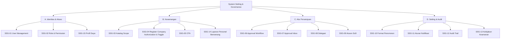

# SSG Sitemap & Menu

15 menu dalam 4 submodul. Tujuh menu mengambil alih pengaturan yang sebelumnya dirancang terpisah di Modul 2, 3, 4, dan EC. Acceptance criteria ditulis **per menu** (konvensi Design Brief Modul 2).

## A. Identitas dan Akses

**SSG-01 User Management** — Daftar User; Buat User dari Employee; Detail User (Info, Role & Cakupan, Riwayat Login, Riwayat Perubahan). Pengguna: SYS-ADM.
1. Pilihan employee hanya Active yang belum punya akun; satu employee satu akun.
2. Employee berubah Inactive di EC → akun otomatis Disabled, sesi aktif berakhir.
3. Admin tidak dapat memberi role ke akunnya sendiri; role privileged (DIR-MNT, CHF-INS, SYS-ADM) menunggu persetujuan DIR-MNT.
4. Reset password memaksa ganti password pada login berikutnya.

**SSG-02 Role & Permission** — Daftar Role; Detail Role (matriks menu × aksi, cakupan data, jumlah user); Bandingkan Role; Riwayat. SYS-ADM menyiapkan, DIR-MNT menyetujui.
1. Perubahan permission tersimpan draft, berlaku setelah disetujui (BR-20); layar persetujuan menampilkan diff.
2. Role Final (posisi CMM) tidak dapat dihapus; role tanpa user dapat dinonaktifkan.
3. Matriks dapat diekspor ke Excel dengan format workbook.

**SSG-15 Profil Saya** — Semua user: role, kewenangan aktif + nomor + masa berlaku, delegasi, ganti password, PIN tanda tangan. Kewenangan yang habis ≤ 30 hari ditandai.

## B. Kewenangan

**SSG-03 Katalog Scope** — Form: kode, jenis CERT/APR/GOV, kategori, wajib lisensi, terikat pada, keluarga pesawat, masa berlaku maks, sumber dokumen. MSTC menyiapkan, CHF-INS menyetujui.
1. Kode unik, terkunci setelah dipakai grant. 2. Scope yang dipakai grant aktif tidak dapat dinonaktifkan. 3. Scope APR menyebut posisi pemegang default.

**SSG-04 Register Company Authorization & Toggle Approval** — Daftar Personel Berwenang (filter scope, tipe, status, kedaluwarsa ≤ 30 hari); Pengajuan RAA-TCI-011 (chief departemen); Review & jadwal asesmen (MSTC); Asesmen RAA-TCI-013 & terbit RAA-TCI-015 (CHF-INS); Detail Personel (Kewenangan, Toggle, Riwayat); Bekukan, Cabut, Pulihkan.
1. Grant CERT wajib menyebut tipe pesawat, daftar PN, atau metode & level NDT sesuai binding.
2. Tanggal habis maks 12 bulan dari terbit.
3. CHF-INS tidak menerbitkan untuk dirinya; grant untuk CHF-INS disetujui DIR-MNT.
4. Bekukan/cabut/pulihkan hanya CHF-INS, alasan wajib, tercatat. **Toggle diubah CHF-INS atau INSP-AC**, tidak untuk toggle miliknya (SOD-08), hanya menyimpan status terakhir.
5. Pengingat H-30 ke chief departemen. 6. Bukti kartu & hasil asesmen wajib dilampirkan.

**SSG-05 One Time Authorization** — Daftar; Form Pengajuan (CHF-LM); Penerbitan (CHF-INS). Validasi durasi 1/7 hari, batas unscheduled, pengalaman ≥ 5 tahun; berakhir otomatis; terbaca di `checkAuthority` sebagai jalur OTA. *(Lokasi bertabrakan dengan keputusan OTA di Modul 1 — LX-03.)*

**SSG-14 Laporan Personel Berwenang** [KONFIRMASI] — Per kategori mengikuti Roster 2.1–2.9, filter tipe, ekspor; bukan pengganti dokumen Roster.

## C. Alur Persetujuan

**SSG-06 Konfigurasi Approval Workflow** — Daftar Jenis Dokumen (15 workflow awal); Detail Langkah (urutan, aktor role/scope/chief unit, reject wajib alasan, batas waktu); Versi.
1. Perubahan berlaku untuk pengajuan baru; pengajuan berjalan memakai versi saat diajukan.
2. Setiap langkah menunjuk satu scope APR atau GOV.
3. Menggantikan Pengaturan Role STE (M2 layar 13.3/13.4).

**SSG-07 Approval Inbox** — Semua role: Menunggu Saya; Detail & Keputusan; Riwayat. Item dari semua modul termasuk atas nama pemberi delegasi; keputusan setara tombol di modul; tombol nonaktif bila SoD gagal. *(Menggantikan M4 8.1.)*

**SSG-08 Delegasi Wewenang** — Pemegang APR: hanya scope APR milik pemberi, berbatas periode; keputusan tercatat "atas nama"; penerima tetap tidak boleh menyetujui pengajuannya sendiri.

**SSG-09 Aturan SoD** — SYS-ADM menyiapkan, DIR-MNT menyetujui; aturan dari dokumen (SOD-02, SOD-06, SOD-07) tidak dapat dinonaktifkan.

## D. Setting dan Audit

**SSG-10 Master Format Penomoran Dokumen** — SYS-ADM & CHF-PPC: Daftar, Form (segmen, pemisah, reset tahunan/bulanan), Pratinjau. Nomor dibuat saat simpan pertama, tidak mundur, tidak dipakai ulang; format terpakai hanya dinonaktifkan lalu diganti versi baru. *(Menggantikan M2 Format Nomor, M3 WO Number Setup, M4 8.3 — C17.)*

**SSG-11 Aturan Notifikasi** — Event awal: due 10% (M2), kewenangan H-30, OTA berakhir, approval menunggu, perubahan status kewenangan. Kanal menunggu K9. *(Menggantikan M2 Menu 14, M4 8.2.)*

**SSG-12 Audit Trail & Log Akses** — Log perubahan governance, keputusan akses & tanda tangan, login, cetak dokumen. Read-only, tidak bisa dihapus, filter per user/modul/entitas/periode, ekspor untuk audit DGCA. *(Menggantikan M4 8.4.)*

**SSG-13 Kebijakan Keamanan** — Password, percobaan gagal, batas sesi, PIN tanda tangan (K38); perubahan maker-checker.
