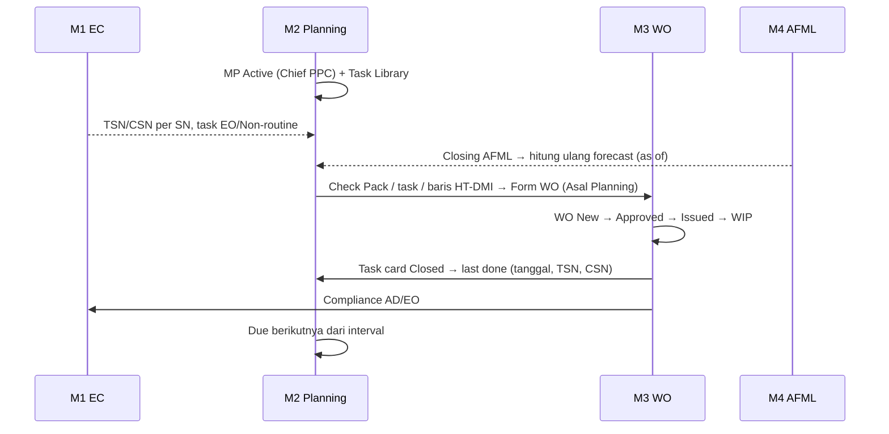
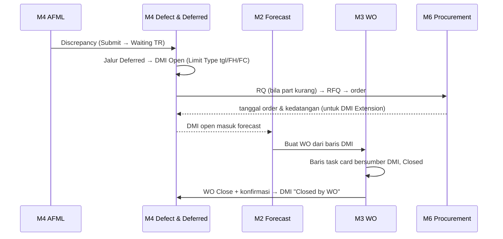
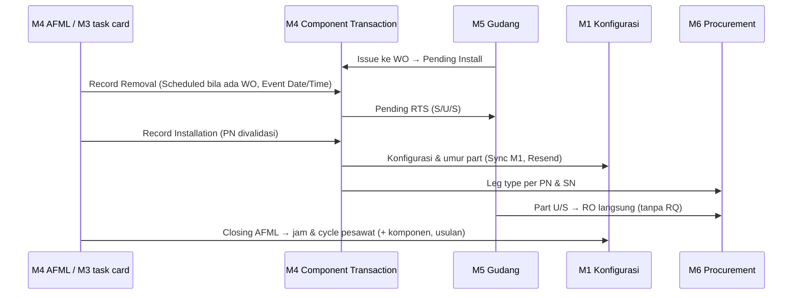
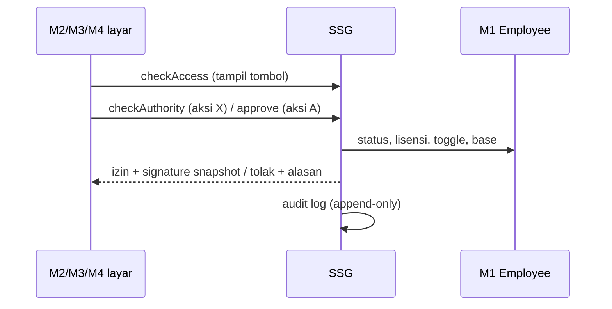

# Integrasi End-to-End

Empat cerita data yang menghubungkan Modul 2, 3, 4 dan modul lain. Dipakai untuk menguji kelengkapan desain dan menyiapkan cek silang klien (Mas Bobi) atas sambungan antarmodul. Tabel aliran rinci ada di [[M3 Integrasi & DMI]] dan [[M4 Status Objek & Integrasi]].

## 1. Dari Maintenance Program sampai last done

## 2. Dari defect sampai DMI ditutup

## 3. Dari component change sampai konfigurasi

## 4. Dari tanda tangan sampai audit

## Titik integrasi yang belum final

| Titik | Kode | Register |
|---|---|---|
| Pemicu last done (task card vs WO Closed) | M2 no 105, Q-M2-08 | [[M2 Open Questions]], [[M3 Open Questions]] |
| DMI tertutup otomatis atau konfirmasi | Q26-05, Q-27, M2 no 106 | [[M4 Open Questions]] |
| Jam komponen saat closing AFML | FQ-02, FQ-03 | [[M4 Open Questions]] |
| Hitung ulang forecast langsung setelah closing | FQ-04 | [[M4 Open Questions]] |
| Limit Type DMI di forecast | LX-01 | [[Isu Harmonisasi Lintas Modul]] |
| CML masuk forecast dan WO | CML-08, Q26-09, Q-43, M2 no 103 | M2, M3, M4 |
| Event WO Closed ke M5 | Q-36, LX-11 | [[M3 Open Questions]] |
| Pengaturan terpusat di SSG | LX-02 | [[Isu Harmonisasi Lintas Modul]] |
