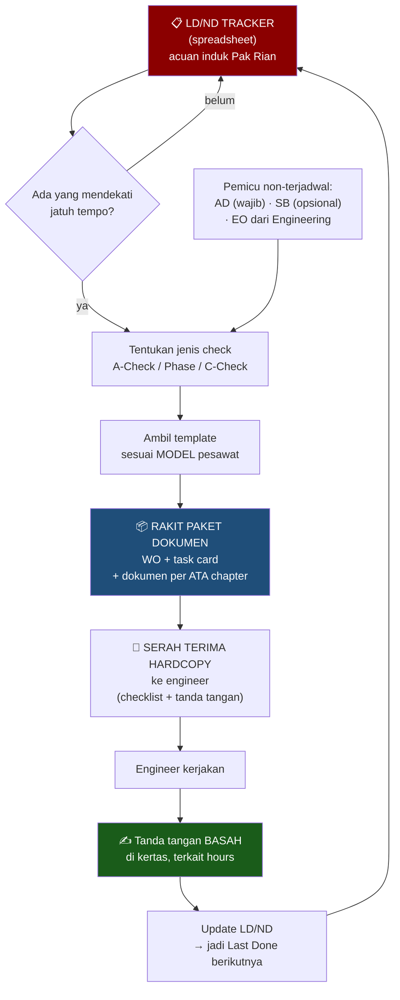

# PPC — Day-to-day & Alur Dokumen Work Order

**Audiens:** 🔴 Internal saja — MoM internal, berisi penilaian risiko. **Jangan dibagikan ke narasumber.**

Peserta: **Pak Rian** — satu-satunya staff PPC + Eza (Nodewave). Disebut tapi tidak hadir: **Pak Heri** (Inspector), **Mas Bobi** (pembuat MSS).

> **Isi note ini:** rekaman apa yang dibicarakan di sesi ini — arsip, bukan daftar tugas.
> Pemahaman proses yang berlaku sekarang ada di [[Proses Manual Maintenance - DRAFT]]. Risiko yang dipantau ada di [[Overview]].

> ⚠️ **Status.** Yang masih berupa dugaan ditandai **(asumsi)**; yang belum terjawab ada di [Masih terbuka](#masih-terbuka). Riwayat koreksi ada di [[Riwayat Koreksi]], bukan di badan note ini.
>
> Alur prosesnya sendiri sudah dipindah ke note tersendiri: **[[Proses Manual Maintenance - DRAFT]]** — itu yang dipakai untuk BPMN dan validasi ke Pak Rian. Note ini menyimpan konteks wawancaranya.

## Konteks

Wawancara requirement gathering dengan **PPC (Production, Planning & Control)** untuk memahami pekerjaan sehari-hari. PPC adalah pemilik proses modul **02 Program & Planning** dan **03 Production & Execution**, dan ternyata bersinggungan kuat dengan modul **07 Publication**.

Wawancara process-owner pertama yang terlaksana.

---

## 1. Inti pekerjaan PPC: produksi & serah-terima dokumen

> **PPC bukan penjadwal pekerjaan — PPC adalah fungsi pengurus dokumen.** Menyiapkan dan menerbitkan dokumen kerja, lalu **menyerahkannya ke engineer** untuk dikerjakan.

Kalimat kunci dari catatan: *"Pak Rian hanya deploy aja, EO engineer…"* PPC **tidak mengarang isi teknis** pekerjaan. PPC yang menyusun, menerbitkan, dan mendistribusikan paket dokumennya.

> ⚠️ Kata terakhir di catatan tangan itu sempat dibaca sebagai nama orang, **"Erod"**. Terkonfirmasi 3 Agu: itu bukan nama siapa pun. Siapa penyusun EO **masih belum diketahui**. Lihat [[Riwayat Koreksi]] #10.

|                     | PPC                                             | Engineering                              |
| ------------------- | ----------------------------------------------- | ---------------------------------------- |
| **Orang**           | Pak Rian — **satu-satunya staff**               | -                                        |
| **Sifat pekerjaan** | Mengurus & menerbitkan dokumen (*"deploy"*)     | Menerima informasi dari PPC              |
| **Acuan induk**     | **[[Glosarium#L\|LD/ND]]** — tracker                             | Maintenance Program, AMM, dsb.           |
| **Output**          | Paket dokumen hardcopy → diserahkan ke engineer | Engineering Order, Service Letter        |
| **Tidak melakukan** | Menentukan isi teknis task                      | Menerbitkan/mendistribusikan paket kerja |

Dikonfirmasi: **PPC dan Engineering adalah dua role terpisah.**

### 🔴 PPC hanya satu orang

Seluruh produksi dokumen kerja untuk **tiga model pesawat** ditangani **satu orang**: Pak Rian. Ini fakta paling penting dari wawancar, dan berdampak ke banyak arah:

- **Potensi nilai sistem sangat tinggi** — otomasi perakitan dokumen langsung mengurangi beban satu orang yang jelas kelebihan muatan.
- **Risiko adopsi terkonsentrasi.** Kalau Pak Rian tidak cocok dengan sistemnya, tidak ada pengguna lain yang bisa menyelamatkan adopsi modul ini.
- **Bus factor requirement gathering = 1.** Seluruh pengetahuan proses PPC ada di satu kepala, tanpa pembanding. Tidak ada orang kedua untuk cross-check kalau ada yang keliru tertangkap.
- **UAT dan training** untuk modul 02/03 praktis hanya melibatkan satu orang — perlu dicek apakah asumsi "role-based user training" di deck kickoff masih relevan untuk modul ini.

**Implikasi desain:** modul yang dipakai PPC bukan modul penjadwalan, melainkan **generator dan pengelola dokumen**. Alurnya: tracker LD/ND → rakit paket dokumen → serahkan ke engineer → rekam serah-terima.

## 2. MSS — sistem lama (referensi saja)

**MSS dibangun internal oleh Mas Bobi, dan aslinya dirancang untuk Store/Inventory — bukan Maintenance Planning.** Saat dipaksa mengakomodasi alur maintenance yang kompleks, banyak yang tidak cocok dan bermunculan bug.

Ini penjelasan yang jauh lebih berguna daripada "project gagal": bukan sistemnya buruk, tapi **dipakai di luar peruntukannya**. Dan itu memberi dua pelajaran untuk sistem baru:

- Modul maintenance planning punya kebutuhan struktural yang berbeda dari inventory — tidak bisa ditumpangkan.
- Kalau nanti ada integrasi dengan MSS untuk sisi material, batasnya harus jelas sejak awal.

Karena tidak dipakai sebagai acuan proses, yang berlaku adalah alur manual di [[Proses Manual Maintenance - DRAFT]].

> 📌 **Konsekuensi untuk migrasi.** Sumber data yang sebenarnya adalah **spreadsheet dan kertas** — persis kategori yang **dikecualikan** dari scope migrasi di SoW. Lihat T1.

## 3. LD/ND — dokumen acuan induk

**LD/ND = Last Done / Next Due.** Sebuah **dokumen tracker**, bukan status di sistem: catatan kapan tiap task terakhir dikerjakan dan kapan jatuh temponya. Saat ini **berupa spreadsheet** (*"via sheets"*).

Fungsinya: **acuan Pak Rian untuk membuat dokumen-dokumen lain.** Semua produksi dokumen PPC bermula dari sini. Kalau LD/ND salah, seluruh paket dokumen yang lahir darinya ikut salah.

Isinya minimal tiga satuan jatuh tempo — dari catatan *"cycle berapa, tanggal"*:

| Satuan | Contoh pemakaian |
|---|---|
| Flight hours | A-Check 730 FH |
| Cycle | Interval berbasis siklus |
| Tanggal/kalender | Task berbasis waktu |

> 📌 **Catatan istilah.** Catatan mentah menulis tiga varian: `LDND`, `LNDN`, `dnd`. Vault ini pakai **LD/ND (Last Done / Next Due)**. Perlu dikonfirmasi istilah mana yang Pak Rian pakai sehari-hari — UI sebaiknya ikut bahasanya.

## 4. Alur kerja: dari tracker ke meja engineer

> Merah = acuan induk, masih di spreadsheet. Biru = inti pekerjaan PPC. Hijau = gerbang legal.

**Serah-terima sudah terkonfirmasi bentuknya:** paket **hardcopy**, diserahkan ke engineer, dicatat lewat **checklist + tanda tangan**. Jadi sudah ada mekanisme rekam-jejak manual yang bisa dipetakan langsung jadi transaksi handover di sistem — tidak perlu menciptakan proses baru, cukup memindahkan yang sudah jalan.

## 5. Isi paket dokumen

Yang diserahkan ke engineer: **WO + task card + dokumen per ATA chapter**, dalam bentuk hardcopy.

> ⚠️ **Satu hal perlu diluruskan.** Dari jawaban klarifikasi tercatat *"ATA itu model pesawat, jadi untuk existing tiap pesawat beda model"*. Secara standar industri, **ATA chapter bukan model pesawat** — itu penomoran sistem yang berlaku universal lintas tipe (ATA 32 = Landing Gear, di pesawat apa pun). Lihat [[Glosarium]].
>
> Yang kemungkinan besar dimaksud **(asumsi)**: tiap model pesawat punya **AMM/IPC sendiri**, dan masing-masing manual itu dibagi per ATA chapter. Jadi yang berbeda per model adalah **isi manualnya**, bukan sistem penomorannya.
>
> Ini bukan soal istilah semata — kalau skema DB dibangun dengan "ATA = model pesawat", relasi antar entitas akan salah sejak awal. Perlu dipastikan ke Pak Rian mana yang dia maksud.

## 6. Daftar dokumen

### 6a. Dokumen pemicu — menciptakan pekerjaan

| Dokumen | Sifat | Catatan |
|---|---|---|
| **[[Glosarium#A\|AD]]** (Airworthiness Directive) | **Wajib** | Cocok dengan [[Regulasi & Kepatuhan CASR Indonesia]]: mandatori, terekam permanen, sistem harus mengunci rilis bila lewat tenggat |
| **[[Glosarium#S\|SB]]** (Service Bulletin) | **Opsional** | Cocok dengan vault: dari OEM, baru wajib bila diangkat jadi AD |
| **EO** (Engineering Order) | — | Bukan PPC yang menerbitkan. Penerbitnya belum diketahui |
| **Service Letter** | **Informatif** | Dikonfirmasi tidak menciptakan pekerjaan wajib |
| **ADSB** | Dokumen | **(asumsi, keyakinan tinggi)** ini bukan ADS-B avionik, melainkan singkatan **AD + SB** — di [[Scope]] muncul sebagai "Forecast ADSB" dan "ADSB report", persis setelah daftar AD/SB/SL/EO. Perlu satu kalimat konfirmasi |

### 6b. Dokumen acuan

| Dokumen | Peran |
|---|---|
| **Maintenance Program** (buku panduan) | **Patokan referensi untuk mengisi WO dan dokumen lain** — sumber kode-kode dan isian baku. Diupdate setahun sekali. Bukan dokumen keluaran, melainkan rujukan. **(asumsi)** ini [[Glosarium#A\|AMP/CAMP]] yang disetujui [[Glosarium#D\|DGCA]] |
| **LD/ND** | Tracker induk — lihat bagian 3 |

Peran Maintenance Program ini menjelaskan kenapa ia muncul di dua daftar sekaligus: dipakai PPC **dan** Engineering, karena sifatnya rujukan bersama.

### 6c. Manual teknis rujukan

**Aircraft Manual · Task Manual · AMM** (Aircraft Maintenance Manual) · **IPC** (Illustrated Parts Catalog) · **Manufacturer Manual** — dibagi per **ATA chapter**, dan berbeda isinya per model pesawat.

### 6d. Dokumen keluaran

| Dokumen | Catatan |
|---|---|
| **Work Order** | Nomor **berurutan**, merujuk ke LD/ND. Format penomoran belum diketahui |
| **Task card** | Ikut dalam paket serah-terima |

## 7. Jenis pemeriksaan & interval

Semua satuan dikonfirmasi **flight hours**.

| Jenis check     | Interval                                               |
| --------------- | ------------------------------------------------------ |
| A-Check         | ==730 FH==                                                 |
| **Phase Check** | ==Dikonfirmasi — inilah yang tercatat sebagai "PASCHECK"== |
| C-Check         | ==*"tingkat berat"* — interval belum diketahui==           |

**Interval per model pesawat**

| Model    | Interval |
| -------- | -------- |
| "klasik" | 500 FH   |
| ATR      | 1500 FH  |
| "eng"    | 10000 FH |

Dua catatan:
- **Nama tipe resminya belum diketahui.** Pak Rian hanya menyebut *"model klasik"* tanpa tipe spesifik. Perlu fleet register (butir B1).
- **10.000 FH layak dicek ulang** saat fleet register masuk — angka itu tidak lazim untuk interval pemeriksaan rutin, lebih mendekati angka overhaul. Bukan berarti salah, tapi murah untuk diverifikasi sekalian.

**Yang sudah pasti:** *"per model ada template masing-masing"* — paket dokumen tidak seragam. Template harus jadi entitas yang bisa dikonfigurasi per tipe, bukan hard-coded.

## 8. Tanda tangan

**Masih basah di kertas.** Belum ada tanda tangan elektronik di mana pun dalam alur ini.

Ini kabar penting untuk [[Decision - E-Signature & Electronic Recordkeeping]]: pendekatan *"sign-ready PDF"* di deck kickoff ternyata **sejalan dengan praktik yang berjalan**, bukan gap. Lihat pembaruan K3 di [[Rekonsiliasi Scope - Riset vs Kontrak]].

## 9. Ekspektasi tim terhadap sistem

Requirement langsung dari user, bukan tafsiran:

1. **LD/ND bisa dilihat di sistem, jam sudah terdeteksi otomatis** — bukan diinput manual
2. **Nomor WO berurutan**, merujuk ke LD/ND terkait
3. **Penandatanganan dokumen oleh engineer**, terkait hours

Ketiga butir pertama sebenarnya satu kebutuhan utuh: **LD/ND naik dari spreadsheet ke sistem, jam terisi otomatis, lalu paket dokumen dihasilkan dari situ.** Itu inti produk untuk PPC.

Butir 3 penting secara arsitektur: *"sudah ke detect hoursnya"* berarti jam terbang harus mengalir otomatis dari flight ops ke LD/ND — persis handoff **modul 04 → modul 02**, dan persis failure point paling berbahaya — lihat [[Tech Log, Defect & Reliability Analysis]]. Terkait [[Decision - Single Source of Truth Flight Leg & Part Master]].

---

## Tambahan dari wawancara mendalam

Sumber: [[Transcript dan Analisis Interview]]

**Rantai penutupan akhirnya jelas** — engineer tanda tangan basah + cap → dokumen kembali ke **PPC untuk direviu** → diserahkan ke **Inspector (Pak Heri)** untuk verifikasi & tanda tangan. Langkah reviu PPC ini temuan baru: Pak Rian ternyata punya peran verifikasi, bukan sekadar menerima kembali. Artinya ada **tiga lapis tanda tangan**, bukan satu.

**Pain point terbesar akhirnya konkret:** untuk membuat WO, PPC harus **menyalin instruksi dari PDF/Word pabrikan ke template task card perusahaan**, satu per satu. Ini yang paling memakan waktu — dan memberi bentuk jelas pada kebutuhan "generator dokumen": bukan sekadar mencetak, tapi menghilangkan langkah transkripsi manual.

**Manual teknis (AMM, IPC) disimpan di Google Drive** dan diunduh manual. Tidak ada repositori terpusat maupun kontrol revisi.

**Kalibrasi alat tertunda karena vendor minta pembayaran di muka** — hambatan administratif, bukan teknis. Sistem tidak bisa menyelesaikannya, tapi bisa memperingatkan sebelum kedaluwarsa.

**Daily Check** muncul sebagai jenis check, melengkapi A-Check / Phase / C-Check.

**Ekspektasi fitur langsung dari pengguna:** dashboard LD/ND dengan *remaining* otomatis · generator WO dari master data · repositori dokumen terpusat · alert kedaluwarsa alat & lisensi.

> ⚠️ **Catatan sumber.** File yang tersedia adalah **analisis pihak ketiga atas transkrip**, bukan transkrip mentahnya. Transkrip asli tidak tersimpan di vault, jadi klaim di atas tidak bisa ditelusuri ke kalimat asli narasumber. Nama dan langkah reviu PPC perlu dikonfirmasi ulang.

## Temuan dari sesi ini

*Sudah masuk daftar risiko di [[Overview]]. Di sini disimpan alasan lengkapnya.*

### 🔴 T1 — Hampir semua data awal ada di sisi yang tidak dimigrasikan

Sistem lama (MSS) gagal dan tidak dipakai. Artinya sumber data yang sebenarnya adalah **spreadsheet dan dokumen kertas** — persis kategori yang **dikecualikan** SoW dari scope migrasi, yang hanya mencakup *"data migration from the existing system database"*.

LD/ND — dokumen yang melahirkan seluruh output PPC — ada di spreadsheet. Dengan scope sekarang, tidak ada yang bertanggung jawab memindahkannya, dan sistem menyala bulan 12 tanpa data yang membuatnya berguna.

Bukti konkret untuk **K4** di [[Rekonsiliasi Scope - Riset vs Kontrak]]. Yang perlu diputuskan: siapa yang mengisi data awal, kapan, dan apakah itu masuk kontrak atau jadi beban Rimbun Air.

### 🔴 T2 — PPC hanya satu orang

Lihat bagian 1. Tiga konsekuensi yang perlu keputusan: verifikasi pemahaman proses tanpa pembanding, konsentrasi risiko adopsi, dan penyesuaian rencana training/UAT untuk modul 02/03.

### 🔴 T3 — Kebutuhan inti PPC jatuh di modul orang lain

Nilai sistem bagi PPC ada pada seberapa baik ia **merakit dokumen** — bukan dashboard atau forecasting. Wawancara mendalam memperkuat ini dari dua sisi:

- Pain point terbesar adalah **copy-paste dari dokumen pabrikan** — masalah perakitan, bukan penjadwalan.
- Mereka juga meminta **repositori manual teknis terpusat** — dan itu **modul 07 Publication, bukan scope saya**.

Jadi kebutuhan pengguna utama saya terbelah antara modul saya dan modul orang lain. Naik dari 🟠 ke 🔴: ini harus dipagari eksplisit ke Rafi **sebelum** PRD, bukan diasumsikan beres.

### 🟠 T4 — Pemahaman "ATA = model pesawat" perlu diluruskan sebelum skema DB

Lihat bagian 5. Kalau relasi ini salah dari awal, seluruh struktur dokumen teknis di database ikut salah.

### 🟢 T5 — E-signature bukan gap (kabar baik)

Tanda tangan masih basah di kertas, jadi pendekatan "sign-ready PDF" di deck sejalan dengan praktik berjalan. K3 turun urgensinya — tapi tetap perlu keputusan eksplisit apakah kertas akan tetap otoritatif selamanya.

### 🟡 T6 — Template per model = pekerjaan setup yang belum terhitung

Tiga model, masing-masing punya template paket dokumen. Perlu di-setup, diverifikasi terhadap Maintenance Program, dan dipelihara saat MP diupdate tahunan. Belum muncul di work plan mana pun.

### 🟡 T7 — Maintenance Program diupdate tahunan → butuh versioning

Sistem harus bisa menjawab "paket dokumen ini dirakit berdasarkan MP versi mana?". Tanpa itu audit trail tidak bisa dipertanggungjawabkan ke [[Glosarium#D|DKPPU]].

---

## Masih terbuka

Prioritas bergeser: yang dikejar sekarang adalah **melengkapi alur manual end-to-end**, bukan menggali sistem lama.

**Menutup titik buta alur** — detail lengkap di [[Proses Manual Maintenance - DRAFT]]:

1. **Dari mana jam terbang masuk ke LD/ND?** Siapa pemasoknya, lewat apa, seberapa sering. *(TB1 — paling menghambat)*
2. **Bagaimana pekerjaan ditutup?** Dokumen kembali ke siapa, siapa verifikasi, siapa update LD/ND. *(TB2)*
3. **Ke mana dokumen diarsipkan**, berapa lama, bagaimana mencarinya saat audit. *(TB3)*
4. **Berapa volumenya** — WO per bulan, waktu merakit satu paket. *(TB4)*
5. **Bagaimana kalau task butuh sparepart?** Siapa cek ketersediaan, apa yang terjadi kalau kosong. *(TB5)*
6. **Ada approval sebelum WO terbit?** *(TB6)*

**Detail yang masih menggantung:**

7. **Tipe pesawat "klasik" dan "eng"** — nama resmi + registrasi PK-xxx. Terjawab otomatis kalau fleet register (B1) masuk.
8. **Format penomoran WO** — terjawab otomatis dari sample WO.
9. **Engineer penerima paket** — mekanik pelaksana atau certifying staff?
10. **ATA chapter** — konfirmasi pelurusan di bagian 5.
11. **ADSB** — konfirmasi bahwa maksudnya AD + SB, bukan ADS-B avionik. Lihat [[Scope]].

**Data yang perlu diminta:**

- **Sample spreadsheet LD/ND** — struktur kolomnya langsung jadi bahan skema DB
- **Satu paket dokumen lengkap** yang pernah diserahkan ke engineer
- **Maintenance Program** versi terbaru

**Referensi, tidak mendesak:** alasan MSS gagal — berguna sebagai pelajaran, bukan blocker.

## Action items

*Daftar gabungan semua action item yang masih terbuka ada di [[Overview]]. Di sini disimpan versi aslinya beserta konteksnya.*

- [ ] **Wawancara lanjutan Pak Rian: tutup 6 titik buta alur** — bawa diagram [[Proses Manual Maintenance - DRAFT]] dan minta dia koreksi langsung — PIC: Eza — Due: minggu 1
- [ ] Minta sample LD/ND + satu paket dokumen lengkap + Maintenance Program — PIC: Eza — Due: 2026-08-01
- [ ] Luruskan pemahaman ATA chapter ke Pak Rian sebelum BPMN difinalkan (T4) — PIC: Eza — Due: minggu 2
- [ ] Angkat T1 (data awal ada di spreadsheet/kertas, di luar scope migrasi) untuk eskalasi K4 — PIC: Eza — Due: sebelum work plan minggu 2
- [ ] Angkat T2 (PPC 1 orang) ke Rigen — dampaknya ke rencana training, UAT, dan risiko adopsi — PIC: Eza — Due: minggu 2
- [ ] Klarifikasi ke Rafi: siapa pemilik kebutuhan "rakit paket dokumen per WO" di antara modul 02/03/07 (T3) — PIC: Eza — Due: minggu 2
- [ ] Cari tahu **siapa** yang menyusun EO, Service Letter, Maintenance Program — PIC: Eza — Due: minggu 2

## Kaitan

- Menjawab sebagian butir **A2, B1, C1, C4, C5, D1, D2** di [[Checklist Data dari Rimbun Air]]
- Memperkuat **K4** dan memperbarui **K3** di [[Rekonsiliasi Scope - Riset vs Kontrak]]
- Input untuk [[Decision - Single Source of Truth Flight Leg & Part Master]] dan [[Decision - E-Signature & Electronic Recordkeeping]]
- Latar domain: [[Interval, Due Date & Forecasting Maintenance]] · [[Eksekusi Work Order, Kewenangan & Kalibrasi]] · [[Tech Log, Defect & Reliability Analysis]] · [[Glosarium]]

---

*Alur prosesnya sendiri ada di [[Proses Manual Maintenance - DRAFT]] — note ini menyimpan konteks percakapannya.*
