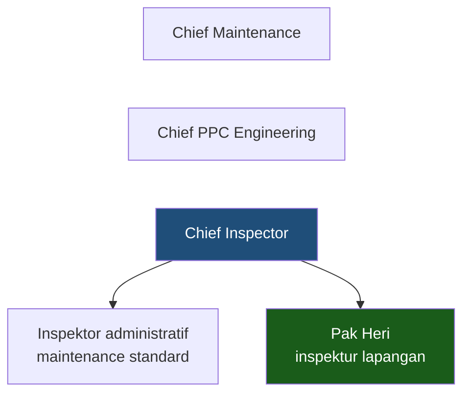

# Q&A Lengkap — Wawancara Pak Heri (Inspector)

**Audiens:** 🔴 Internal saja — MoM internal, berisi penilaian. **Jangan dibagikan ke narasumber.**

> **Isi note ini:** seluruh 41 pertanyaan beserta jawabannya. Sudah diperbarui dari **transkrip verbatim Dovetail**.
> Transkrip mentah: `_sumber-mentah/dovetail-transcript-2026-07-30.csv` (2 file). Catatan tulisan tangan: [[2026-07-30 Staff Inspector Maintenance]]. Analisis: [[2026-07-30 Staff Inspector Maintenance]].

| Status | Jumlah |
|---|---|
| ✅ Terjawab | 12 |
| 🟡 Sebagian | 7 |
| ⬜ Belum tersentuh | 22 |

## Ringkasan sesi

**Pak Heri adalah Inspektor Maintenance** — dan perannya jauh lebih luas dari sekadar memverifikasi dokumen: pengawasan lapangan, receiving material, surveillance internal, audit vendor tahunan, mendampingi audit Dephub & customer, kontrol pembaruan manual, sampai ikut menilai tender charter.

**Lima hal yang paling berdampak dari sesi ini:**

1. **Verifikasi akhir punya definisi tegas.** Pekerjaan dinyatakan selesai hanya kalau *aktual selesai* **dan** *dokumentasi lengkap*. Inspector menyaring, Chief Inspector menandatangani.
2. **Aturan koreksi dokumen sudah tertulis** di peraturan perusahaan: satu kali coret, plus identitas, plus tanggal. Sejalan dengan prinsip append-only.
3. **Ada approval jarak jauh lewat foto** saat inspector tidak di lokasi — menghasilkan Inspection Report dan serviceable tag hijau.
4. **Reminder adalah blocking nomor satu.** Disebut berulang kali. Tidak ada sistem yang mengingatkan masa berlaku dokumen, lisensi, atau kalibrasi alat.
5. **Sebagian besar keluhannya di luar modul saya** — repositori audit, portal vendor, alert dokumen. Perlu diteruskan ke PM modul terkait.

### Peta peran — enam wilayah kerja

| Wilayah | Isi |
|---|---|
| **Pengawasan lapangan** | Memastikan pekerjaan engineer sesuai dokumen hardcopy, langsung di lokasi |
| **Receiving inspection** | Material & alat masuk ke warehouse dan store. Alurnya: kedatangan → dokumen pengiriman → barang aktual → dokumen dalam kemasan |
| **Surveillance internal** | Cengkareng, Halim, Bandung. Bandung punya receiving tersendiri |
| **Audit eksternal** | Mendampingi Dephub dan customer. Termasuk **ram check** — inspeksi mendadak, temuannya masuk portal milik regulator |
| **Audit vendor** | Tahunan; hasilnya jadi dasar memperpanjang perjanjian kerja sama |
| **Administratif & regulasi** | Kontrol pembaruan manual pabrikan, validitas sertifikat pesawat, penghubung Dephub, menilai tender charter |

Ini **fungsi QA, bukan QC murni.**

### Implikasi scope — hanya sebagian kebutuhannya milik saya

| Kebutuhan yang dia sebut | Modul | Punya saya? |
|---|---|---|
| Riwayat perubahan job card | 03 Production | ✅ |
| Alert kalibrasi alat | 03 Production | ✅ |
| Dashboard kelaikudaraan | 02 Planning | 🟡 sebagian |
| Repositori temuan audit | Quality — tidak jelas ada di 10 modul | ❌ |
| Portal vendor | 06 Procurement | ❌ |
| Alert dokumen & manual | 07 Publication | ❌ |
| Receiving inspection material | 05 Material | ❌ |

**Pak Heri stakeholder penting, tapi sebagian besar keluhannya jatuh di modul orang lain.** Perlu diteruskan ke Rigen supaya sampai ke PM terkait — kalau tidak, dia sudah diwawancarai tapi keluhannya tidak sampai ke siapa pun.

Pola yang sama dengan wawancara PPC: kebutuhan pengguna tidak mengenal batas modul, kontraknya iya.

---

Detail lengkap 41 pertanyaan ada di bawah.

> 📌 **Catatan transkrip.** Di file CSV kedua, label speaker tertukar — "Participant 1" di file itu Pak Heri, bukan Eza. Kutipan di bawah sudah disesuaikan berdasarkan isi. Beberapa hal sempat tercatat keliru lalu diperbaiki; riwayatnya di [[Riwayat Koreksi]].

---

## Blok 1 · Buka dengan cerita

### Q1. Ceritakan satu hari kerja dari pagi sampai selesai ✅

Dia **Inspektor Maintenance** — dan menegaskan ada dua inspektor lain yang terpisah: **Inspektor Quality** dan **Inspektor Safety**.

> *"Kalau sebagai inspektor, kebetulan saya jadi Inspektor Maintenance, lebih ke maintenance. Soalnya ada Inspektor Quality juga, Inspektor Safety juga ada. Saya lebih ke maintenance."*

**Di lapangan.** Memonitor pengerjaan mekanik di pesawat, dan memastikan dokumen hardcopy yang dipakai engineer sudah ada di pesawat dan **versinya update**.

**Receiving.** Menerima material dan tool yang masuk. Warehouse di kantor pusat; store di **CGK (Cengkareng)** dan **Halim**. Yang diperiksa: dokumen pengiriman → kondisi aktual barang → dokumen yang menyertai di dalam kemasan → termasuk packaging-nya.

Fasilitas di **Bandung punya receiving sendiri**, tapi sesekali tim inspektor tetap melakukan surveillance ke sana dan ke Halim.

**Administratif.** Menyediakan data teknik maintenance, dan memastikan manual selalu versi terbaru. Dia memisahkan dua jenis: **prosedur manual dari company**, dan **manual pesawat dari pabrikan**.

**Regulator.** Berhubungan dengan Departemen Perhubungan untuk penerbitan dan perpanjangan surat pesawat — sertifikat airworthiness, sertifikat registrasi, dan lain-lain.

**Pengadaan pesawat.** Menyediakan data teknik, data manpower, dokumen manual, dan rencana maintenance untuk manajemen.

**Surveillance.** Internal ke unit-unit di bawah: Cengkareng, Halim, Bandung. Eksternal dari dua arah — **otoritas (Dephub)** dan **customer**. Inspektor yang mendampingi selama masih berkaitan dengan maintenance.

**Ram check.** Dephub melakukan inspeksi mendadak acak di bandara mana pun di Indonesia.

> *"Findingnya itu dikirim ke — mereka punya portal sendiri. Kita monitor, kita jawab corrective prevention di situ juga."*

**Audit vendor.** Rimbun Air tidak punya bengkel sendiri, hanya manpower. Jadi mereka mengaudit vendor maintenance di Jakarta, **terjadwal setahun sekali**, dan hasil auditnya jadi dasar memperpanjang perjanjian kerja sama.

**Tender charter.** Ikut menilai apakah kriteria teknis customer bisa dipenuhi. Contoh yang dia sebut: satu customer punya persyaratan tersendiri yang harus dipenuhi dan dibukukan.

### Q2. Bagian mana yang paling menyita waktu? ✅

1. Rantai **maintenance planning → soft copy → engineer → inspector**
2. **Reminder dan notifikasi** — disebut sebagai *blocking*

### Q3. Tunjukkan diagram alur, minta dikoreksi ⬜

Tidak tercatat apakah sempat dilakukan.

---

## Blok 2 · Peran

### Q4. Jabatan resmi? Ada berapa inspector? ✅

Struktur organisasinya akhirnya jelas — **tiga Chief**:

Di bawah Chief Inspector ada **dua orang**: satu mengurus administratif/maintenance standard, dan Pak Heri sebagai inspektur lapangan.

Terpisah dari struktur ini ada **Inspektor Quality** dan **Inspektor Safety** — dikonfirmasi **di luar tim Chief Inspector**, dengan jenis pekerjaan serupa tapi cakupan lebih luas. Menurut Pak Heri:

> *"Tim inspektor ini lebih dekatnya ke quality dan safety, karena tugasnya hampir mirip. Cuma bagiannya lebih di maintenance."*

Dan Quality corporate cakupannya lebih luas — meliputi teknik maupun operasi.

**Nama lain yang disebut:** Mbak Hilda (mengambil manual) · Mas Bobi (koordinator narasumber, sekaligus pembuat MSS).**

### Q5. Apa yang boleh dan tidak boleh Bapak tandatangani? 🟡

Tidak ditanya langsung, tapi tersirat dari Q7: dia penanda tangan **verifikasi akhir** work order dan job card, dan penerbit **Inspection Report** serta **serviceable tag** untuk material.

Batas kewenangan formalnya belum digali.

### Q6. Lisensinya apa? ⬜

Belum ditanya. Tapi dari cerita reminder, terungkap ada **6 orang di ATR yang punya [[Glosarium#A|AMEL]] dengan otorisasi ber-validity date** — Pak Heri kemungkinan salah satunya.

---

## Blok 3 · Yang diperiksa

### Q7. Waktu terima paket dari PPC, apa saja yang diperiksa? ✅

Perannya adalah **saringan terakhir**:

> *"Terakhir kami dari inspektor ini sebagai saringan untuk verifikasi akhir. Verifikasi akhir ini sudah semua apa — tanda tangannya lengkap semua, terus nilai-nilai final yang harus diisi lengkap."*

Dan dia menegaskan ini bukan sekadar formalitas:

> *"Jadi itu bukan hanya review aja. Dia me-review menyatakan review sudah selesai dengan satisfied."*

Syarat sebuah pekerjaan dinyatakan selesai — **dua-duanya harus terpenuhi**:
1. Pekerjaan aktualnya selesai
2. Dokumentasinya lengkap, tidak ada yang kurang

> *"Baru menyatakan pekerjaan pesawat itu selesai."*

Dia menyebut dirinya *"hakim akhir yang memutuskan semuanya"* — tapi menambahkan bahwa **tanggung jawab lapangan tetap di engineer**, karena engineer yang menandatangani rilis pesawat.

Alur lengkap menurut dia:

> manufacturer publish maintenance program → diturunkan jadi soft copy → **di-print out oleh PPC** untuk dibagikan → engineer kerjakan → *(idealnya inspektor cek aktual di lapangan, tapi kekurangan orang)* → dokumen diverifikasi divisi untuk kelengkapan + tanda tangan → **inspektor verifikasi akhir**

### Q8. Ada checklist bakunya, atau berdasar pengalaman? ⬜

### Q9. Berapa lama biasanya satu paket? 🟡

Tidak dijawab angka. Tapi saat ditanya kendala, dia bilang:

> *"Enggak sih, karena pesawatnya sedikit. Sebelum ini saya di perusahaan pesawat [banyak]. Ini pesawatnya dikit, tapi kerjaannya yang makin banyak, dan saya nggak cuma satu bidang — megang beberapa posisi."*

Jadi bebannya bukan dari volume dokumen, tapi dari **satu orang memegang banyak fungsi**.

### Q10. Di task card ada keterangan sumbernya dari manual mana? Ada nomor revisinya? 🟡

Tidak ditanya langsung. Tapi dia menjelaskan hierarki dokumen acuannya:

| Sumber | Dokumen |
|---|---|
| Pabrikan | **AMM** (Aircraft Maintenance Manual) · **[[Glosarium#C\|CMM]]** (Component Maintenance Manual) — *"lebih detail lagi, ada nomornya"* |
| Otoritas | **[[Glosarium#C\|CASR]]** dari Ditjen Perhubungan Udara |
| Company | Peraturan perusahaan sendiri yang mengacu ke CASR — dia menyebutnya **Company Maintenance Manual** |

> ⚠️ **CMM dipakai untuk dua hal berbeda** dalam wawancara ini: *Component* Maintenance Manual dan *Company* Maintenance Manual. Perlu dipastikan mana yang dimaksud di tiap konteks.

### Q11. Kalau pabrikan merevisi manualnya, tahu dari mana task card lama tidak berlaku? ✅

Caranya masih manual:

> *"Kita lihat updating kapan nih. Ada tanggalnya, berarti last update-nya kapan. Kita cross check ke portalnya."*

Jadi: lihat tanggal di file → bandingkan dengan portal pabrikan. Tidak ada notifikasi otomatis. Dia menyebut inilah yang dia butuhkan:

> *"Harusnya semacam alarm — notifikasi 'ini menu update nih'. Itu yang kita perlukan juga. Karena yang upload ke situ banyak orang juga."*

**Penyaringan manual pabrikan.** Ada langkah yang belum kita tahu sebelumnya — manual dari pabrik **disaring dulu** mana yang relevan untuk operasi di Indonesia:

> *"Manual-manual yang di pabrik itu kita saring lagi, apa yang cocok untuk diterbangkan pesawat di Indonesia. Misalkan ada yang dilengkapi dengan namanya anti-ice system — di kita kan nggak ada musim salju. Kalau kita harus bayar juga, kita rugi di situ."*

Ini contoh konkret penyesuaian AMP: operator menyaring task dari [[Glosarium#M|MPD]] sesuai kondisi operasi nyata. Persis yang dijelaskan di [[Interval, Due Date & Forecasting Maintenance]].

---

## Blok 4 · Kalau ditolak ✅

Jawabannya bukan tentang penolakan dokumen work order, melainkan tentang **material yang tidak lolos** dan bagaimana keputusan diambil.

### Q12–Q14. Kalau ada yang tidak lolos, kembali ke siapa? ✅

> *"Semua keputusan itu dari pesawat itu terbang atau enggak. Nanti engineer-nya yang akan berkoordinasi."*

Jadi bukan alur formal "dikembalikan ke PPC" atau "dikembalikan ke engineer" — **engineer yang berkoordinasi**, dan patokannya satu: pesawat jadi terbang atau tidak.

### Q15. Bagaimana kalau inspector tidak di tempat? ✅

Ini temuan operasional yang penting. Pak Heri hanya ke CGK atau Halim **sekitar seminggu sekali**. Kalau ada pemasangan mendesak saat dia tidak di lokasi:

> *"Pak, saya minta foto. Tolong difoto — termasuk dokumen-dokumen semua. Nanti saya cek. Kalau puas, tolong diputar ke arah sini... Baru saya bikin **Inspection Report**, sama **serviceable** — ada warna hijau, serviceable. Di situ saya yang bertanggung jawab bahwa barang ini sudah lolos pemeriksaan."*

**Ini praktik approval jarak jauh yang sudah berjalan**, lewat foto. Dan hasilnya dua dokumen: Inspection Report + serviceable tag hijau.

> 💡 **Serviceable tag di sini warnanya hijau.** Riset industri di [[Eksekusi Work Order, Kewenangan & Kalibrasi]] menyebut kuning untuk serviceable dan hijau untuk unserviceable/repairable. **Konvensi lokalnya berbeda** — pakai istilah mereka, jangan istilah buku.

### Q16. Kalau dicek langsung, sejauh apa? ✅

> *"Kalau di tempat, saya ngecek langsung... Kecuali kalau benar-benar tertutup, dibongkar semua. Paling yang bisa saya lihat yang di [luar]. Saya lihat proses pemasangannya juga, sebelumnya sudah torsi di waktu itu."*

Jadi kedalaman inspeksi bergantung apakah komponen masih terbuka saat dia datang.

---

## Blok 5 · Tutup & arsip

### Q17. Setelah tanda tangan, dokumennya ke mana? ⬜

Dijawab dengan penjelasan **receiving material** — cek kondisi, safety wire, cocokkan nomor barang dengan dokumennya. Pertanyaan aslinya soal dokumen work order **belum terjawab**.

### Q18. Siapa menuliskan tanggal selesai ke catatan jatuh tempo? ⬜

Tidak terjawab di sesi ini. Yang tertangkap adalah jawaban untuk pertanyaan lain — siapa melakukan pengecekan awal setelah pesawat mendarat:

> *"Jadi kalau di lapangan itu, mau di engineering. Cuma inspektor kadang sekali-kali aja ngecek."*

*(Kemudian terjawab dari transkrip PPC: **Pak Rian sendiri** yang memperbarui [[Glosarium#L|LD/ND]].)*

### Q19. Disimpan di mana, berapa lama? 🟡

Ditanya, tapi dia melempar ke orang lain:

> *"Nah, nanti bisa ditanyakan [ke] ada orang [lain]."*

Perlu dikejar siapa yang dimaksud.

### Q20. Cari dokumen tiga tahun lalu bagaimana? ⬜
### Q21. Pernah ada dokumen hilang? ⬜

---

## Blok 6 · Jam terbang

### Q22. Siapa pertama mencatat setelah mendarat? ✅

> *"Kalau di lapangan itu, mau di engineering. Cuma inspektor kadang sekali-kali aja ngecek."*

**Engineer** yang melakukan pengecekan awal di lapangan; inspektor hanya sesekali. Tapi ini soal *pengecekan*, **bukan** soal pencatatan jam terbang — pertanyaannya bergeser saat dijawab.

**Nama dokumen tempat jam terbang dicatat masih belum diketahui. TB1 tetap terbuka.**

### Q23. Jam dihitung dari roda jalan atau dari mengudara? ⬜
### Q24. Berapa lama sampai angkanya tiba di maintenance? ⬜
### Q25. Pernah ada selisih angka jam? ⬜

---

## Blok 7 · Kewenangan & alat

### Q26. Ada pekerjaan yang wajib diperiksa orang kedua? 🟡

Tersirat dari perannya sebagai verifikasi akhir — dia memeriksa pekerjaan yang bukan dia yang kerjakan. Tapi konsep **[[Glosarium#R|RII]]** (pekerjaan kritis yang wajib inspeksi ganda) tidak disinggung sama sekali. Perlu ditanya eksplisit.

### Q27. Kewenangan dicek sebelum tanda tangan? ⬜

### Q28. Kalau lisensi lama tidak dipakai, masih berlaku? ✅

Terjawab lewat cerita reminder, dan ini salah satu bagian paling konkret dari seluruh sesi:

> *"Kami di ATR ada 6 orang. Mereka punya AMEL, punya otorisasi, yang ada validity expired-nya, yang mereka harus melaksanakan training lagi, assessment lagi."*

Masalahnya tidak ada sistem yang mengingatkan:

> *"Kita nggak punya sistem untuk update, untuk reminder. Kita nggak punya. 'Tolong diingatkan kami kalau sudah mau habis, sebulan atau 3 bulan sebelum habis, ingatkan kami.' Tapi mereka pun juga [lupa], kami juga [lupa]."*

Dia membandingkan dengan sistem di tempat kerja sebelumnya:

> *"Dulu sistemnya itu otomatis ke email company [dan] pribadi. 'Pak, tolong paspor Anda 3 bulan ke depan mau habis.' Bahkan ulang tahun diucapin."*

### Q29. Alat ukur — tahu dari mana kalibrasinya valid? ✅

Lewat **validity tag / validity sticker** yang menempel di alat:

> *"Kayak tool yang kalibrasi, kayak mikrometer, sorong — itu kan harus dikalibrasi tiap setahun atau dua tahun. Itu juga ada validity tag-nya... Dia menunjukkan kapan last calibration, next expired-nya kapan."*

**Interval kalibrasi bisa dinegosiasikan.** Kebijakan company setahun sekali, tapi kalau alatnya jarang dipakai:

> *"Menurut saya itu terlalu dekat, sedangkan kita jarang digunakan. Terus kita koordinasi lagi sama pihak kalibrasi — 'Ini kita penggunaannya jarang, bisa nggak di-extend sampai dua tahun?' 'Oh bisa, Pak.'"*

Jadi interval kalibrasi bukan konstanta — bisa berbeda per alat, dan hasil kesepakatan dengan vendor kalibrasi. Sistem harus menyimpannya per alat, bukan satu aturan global.

### Q30. Pernah ada alat lewat kalibrasi tapi terpaksa dipakai? ⬜

Ditanya di akhir sesi, jawabannya tidak tertangkap jelas di transkrip.

---

## Blok 8 · Koreksi dokumen ✅

### Q31–Q33. Cara membetulkan dokumen yang sudah ditandatangani ✅

Ini jauh lebih rinci daripada catatan tulisan tangan.

Masalahnya nyata dan bervariasi:

> *"Ada kesalahan, terus engineer itu mencoret. Ada yang korek-korek, ada yang hapus."*

Karena itu ditanyakan ke inspektor, dan aturannya sudah ada di peraturan perusahaan:

> *"'Pak, di peraturan perusahaan kita gimana sih caranya kalau ada kesalahan ketik atau kesalahan tulis?' — Itu **satu kali tulis, satu kali coret**, di situ **tanggal berapa**. Jadi ketahuan ini siapa, di tanggal kapan."*

Dan yang penting soal keabsahannya saat diaudit:

> *"Sudah ter-cover di peraturan perusahaan bahwa untuk satu kali [koreksi] ada aturannya. Kecuali kalau dia mencoret aja dan kita nggak ada [identitasnya] — nggak ada dasar hukumnya."*

**Tiga aturan yang bisa langsung jadi spesifikasi:**
1. Coret satu kali, bukan dihapus atau ditimpa
2. Wajib ada **identitas siapa** yang mengoreksi
3. Wajib ada **tanggal** koreksi

Ini persis prinsip append-only dengan atribusi. Versi digitalnya tinggal meniru — dan karena aturannya sudah tertulis di peraturan perusahaan, tidak perlu mengubah kebiasaan siapa pun.

---

## Blok 9 · Defect & penundaan ⬜

### Q34–Q37 ⬜

Tidak tersentuh sama sekali.

---

## Blok 10 · Penutup

### Q38. Apa yang paling bikin frustrasi? ✅

**Reminder dan notifikasi**, disebut berulang kali sepanjang sesi sebagai *blocking* nomor satu.

Kedua, kondisi Google Drive:

> *"Kalau kita masih pakai Google Drive itu berantakan banget. Satu folder, banyak — 3 aja, bertiga. Kadang kita bingung ini yang paling update yang mana. Kadang revisi dia punya sendiri, naruh di sini, naruh di sini, bingung sendiri."*

### Q39. Apa yang jangan diotomatiskan? ⬜

Belum sempat ditanyakan. Masih bernilai tinggi untuk sesi lanjutan.

### Q40. Isi dashboard? 🟡

Tidak dijawab sebagai daftar, tapi dia menyinggung kebutuhan **prioritas**:

> *"Nggak tahu bisa nggak, ke sistem untuk [menampilkan] priority. Ini nih yang baru keluar, hampir [jatuh tempo]."*

### Q41. Siapa lagi yang sebaiknya ditemui? ✅

- **Mbak Hilda** — yang mengambil dan mengelola manual
- Orang yang mengurus pengarsipan dokumen *(disebut tapi namanya tidak tertangkap)*
- Koordinasi dulu dengan **Mas Bobi**, yang mengatur siapa saja yang perlu diwawancarai

---

## Temuan di luar daftar pertanyaan

### Regulator lain, bukan cuma Dephub

Selain Ditjen Perhubungan Udara, Rimbun Air berurusan dengan:
- **Kemenkominfo** (Pos & Telekomunikasi) — untuk radio station pesawat
- **Kementerian Perdagangan** — untuk pengadaan pesawat

Tiap lembaga punya jalur input sendiri. Pak Heri membagi-bagi pekerjaan ini ke beberapa orang.

### Ram check punya portal sendiri

Temuan ram check Dephub masuk ke **portal milik regulator**, dan Rimbun Air wajib memonitor lalu menjawab corrective action di sana. Ini sistem eksternal yang tidak kita kendalikan — tapi statusnya perlu terlihat di sistem baru.

### Siklus audit → corrective action

> *"Audit, evidence saya kumpulkan di sini. Jadi saya collect data-data buat jawab... kita corrective action-nya di sini. Terus ini kita cari evidence yang menyatakan bahwa sudah kita laksanakan action untuk corrective."*

Alurnya: temuan → kumpulkan evidence → corrective action → kumpulkan evidence bahwa action sudah dilaksanakan. Semuanya manual, di Google Drive.

### Perjanjian vendor sering ketahuan kedaluwarsa saat audit

> *"Surat perjanjian kerja sama itu harusnya pihak vendor yang ngingetin kita. Tapi mereka juga [tidak]. Jadi pas kita mau diaudit, ditanya — 'Loh ini kok sudah habis?'"*

Dia sendiri realistis soal ini: vendor punya customer lain, wajar kalau tidak mengingatkan. Karena itu remindernya harus ada di sisi Rimbun Air.

### Preferensi cara kerja

Pak Heri lebih nyaman bertemu langsung. Catatan untuk sesi lanjutan: kalau bisa online, **rekam sambil dia menunjukkan dokumen** — supaya isi dokumennya ikut terekam, bukan cuma penjelasannya.

---

## Tabel ringkas

| # | Pertanyaan | Status | Inti jawaban |
|---|---|---|---|
| 1 | Satu hari kerja | ✅ | Inspektor Maintenance. Lapangan + receiving + surveillance + audit vendor + regulator + tender |
| 2 | Paling menyita waktu | ✅ | Reminder & notifikasi; updating manual |
| 3 | Validasi diagram | ⬜ | Tidak sempat |
| 4 | Struktur & jumlah | ✅ | 3 Chief; di bawah Chief Inspector ada 2 orang. Ada Inspektor Quality & Safety terpisah |
| 5 | Kewenangan tanda tangan | 🟡 | Verifikasi akhir WO/job card, Inspection Report, serviceable tag |
| 6 | Lisensi | ⬜ | Terungkap ada 6 pemegang AMEL di ATR |
| 7 | Yang diperiksa | ✅ | Saringan akhir: tanda tangan lengkap + nilai final terisi. Selesai = aktual selesai **dan** dokumentasi lengkap |
| 8 | Checklist baku | ⬜ | — |
| 9 | Lama per paket | 🟡 | Beban bukan dari volume, tapi satu orang banyak fungsi |
| 10 | Nomor revisi task card | 🟡 | Hierarki: AMM/CMM pabrikan · CASR otoritas · manual company |
| 11 | Deteksi manual direvisi | ✅ | Manual: lihat tanggal, cross-check portal. Tidak ada notifikasi |
| 12–14 | Kalau tidak lolos | ✅ | Engineer yang berkoordinasi; patokannya pesawat terbang atau tidak |
| 15 | Kalau inspector tidak di tempat | ✅ | **Approval lewat foto** → Inspection Report + serviceable tag hijau |
| 16 | Kedalaman inspeksi | ✅ | Tergantung komponen masih terbuka atau sudah tertutup |
| 17 | Dokumen ke mana setelah ttd | ⬜ | *(catatan sebelumnya salah baca)* |
| 18 | Siapa update jatuh tempo | ⬜ | *(catatan sebelumnya salah baca — TB3 tetap terbuka)* |
| 19 | Arsip | 🟡 | Dilempar ke orang lain, perlu dikejar |
| 20–21 | Cari dokumen lama, dokumen hilang | ⬜ | — |
| 22 | Pengecekan awal setelah mendarat | ✅ | Engineer; inspektor sesekali. **Dokumen pencatat jam belum diketahui** |
| 23–25 | Block/airborne, jeda, selisih | ⬜ | — |
| 26 | Inspeksi orang kedua | 🟡 | Tersirat, RII tidak disinggung |
| 27 | Pengecekan kewenangan | ⬜ | — |
| 28 | Recent experience | ✅ | 6 pemegang AMEL ATR dengan validity date, tidak ada reminder |
| 29 | Validitas kalibrasi | ✅ | **Validity tag** di alat. Interval bisa dinegosiasi per alat |
| 30 | Alat lewat kalibrasi terpakai | ⬜ | Jawaban tidak tertangkap |
| 31–33 | Koreksi dokumen | ✅ | **Satu kali coret + identitas + tanggal.** Sudah diatur di peraturan perusahaan |
| 34–37 | Defect & penundaan | ⬜ | — |
| 38 | Paling frustrasi | ✅ | Reminder; Google Drive berantakan |
| 39 | Jangan diotomatiskan | ⬜ | — |
| 40 | Isi dashboard | 🟡 | Menyinggung kebutuhan tampilan prioritas |
| 41 | Siapa lagi | ✅ | Mbak Hilda (manual) · pengelola arsip · koordinasi via Mas Bobby |

---

## Sisa untuk sesi lanjutan

| Prioritas | Yang dicari |
|---|---|
| 1 | **Siapa memperbarui LD/ND** setelah pekerjaan selesai (TB3, ternyata masih terbuka) |
| 2 | **Nama dokumen tempat engineer mencatat jam terbang** (TB1) |
| 3 | Jam dihitung dari roda jalan atau mengudara |
| 4 | Ke mana dokumen work order setelah ditandatangani, dan arsipnya |
| 5 | Apakah ada konsep RII / inspeksi ganda |
| 6 | Nomor revisi di task card — apakah tercantum |
| 7 | Defect & penundaan (blok 9, belum tersentuh) |
| 8 | Apa yang jangan diotomatiskan |

Lembar untuk sesi lanjutan: [[Lembar Wawancara Inspector - Sesi 2]]

## Istilah yang perlu dipastikan

| Istilah | Catatan |
|---|---|
| **Fasilitas Bandung** | Transkrip ASR menuliskannya berbeda-beda: "UMBS", "BPSU", "WMBS". Nama sebenarnya belum diketahui |
| **CMM** | Dipakai untuk *Component* Maintenance Manual **dan** *Company* Maintenance Manual |
| **Serviceable tag** | Di sini **hijau**. Riset industri menyebut kuning — konvensi lokal berbeda |
| **Nama customer charter** | Ada dua nama yang tidak tertangkap jelas oleh ASR |
