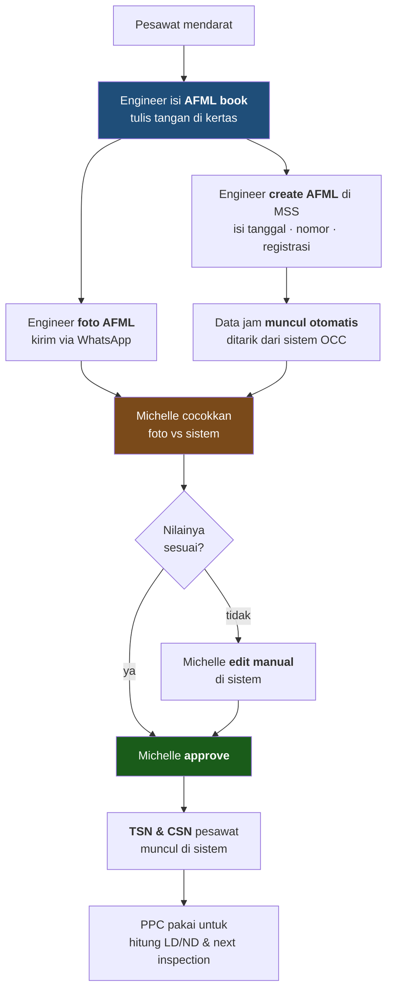

# PPC Technical Record — Mba Michelle

**Audiens:** 🔴 Internal saja — berisi penilaian. Jangan dibagikan ke narasumber.

| | |
|---|---|
| **Tanggal** | 31 Juli 2026, 10:00–11:00 |
| **Narasumber** | **Mba Michelle** — Technical Record. Menyebut dirinya masih baru |
| **Tempat** | Kantor Rimbun Air Meruya, offline |
| **Rekaman** | `_sumber-mentah/Transcript Mentah - PPC Technical Record.csv` |

---

## Ringkasan

**Sesi paling produktif sejauh ini.** Titik buta terbesar — dari mana angka jam terbang masuk — tertutup penuh, lengkap dengan nama dokumen, pelaku, dan mekanismenya.

Lima hal terpenting:

1. **Rantai jam terbang lengkap ketemu**, dan ternyata ada **dua sumber yang harus dicocokkan**: foto AFML dari lapangan, dan data otomatis dari sistem OCC.
2. **MSS ternyata dipakai dan dianggap bagus** — untuk AFML. Catatan kita sebelumnya keliru.
3. **Muncul aktor baru: OCC** (Operations Control Center), departemen Operasional dengan sistem sendiri.
4. **Pekerjaan intinya rekonsiliasi**, bukan pencatatan — mencocokkan foto dengan sistem, lalu approve.
5. **Retensi record: selama pesawat masih dioperasikan**, dan diserahkan saat pesawat dijual.

---

## ✅ TB1 — rantai jam terbang, tertutup

**Yang diinput dan dicek tiap hari:** flight hours · flight cycle · block time.

> *"Setiap hari itu harus di-input karena ada keterkaitan sama LD/ND. Itu semua sinkron, nyambung semuanya — dari situ nanti jadi tahu untuk pengerjaan berikutnya, kapan jatuh temponya, sama hard time atau umur pesawat."*

**Peran Michelle bukan mencatat, tapi merekonsiliasi.** Dia sendiri merumuskannya:

> *"Tugas saya ngecek satu-satu — yang di foto ini sama yang di sistem, sesuai semua atau tidak."*

Setelah approve, barulah TSN dan CSN pesawat muncul — dan itu yang dipakai PPC.

> *"Kalau ini dibuat dari tim PPC, namanya readiness. Ketika saya masukin ini, angkanya bisa berubah, dilihat dari banyaknya jam terbang pesawat. Semakin sering terbang, planner-nya maju. Makanya itu pentingnya flight hours record."*

---

## Isi AFML — siapa mengisi apa

| Bagian | Diisi oleh |
|---|---|
| **Blok hitam** — termasuk discrepancy | **Pilot** |
| **Blok putih** — termasuk oli | **Engineer** |
| Engine parameter | Engineer, manual |
| Rectification | Engineer — jawaban atas discrepancy pilot |
| Component replacement | Engineer, tiap ada pergantian |
| Flight time · block time · cycle · fuel burn · uplift · nama crew | **Ditarik otomatis dari OCC** |

---

## ⚠️ Koreksi: MSS bukan project gagal

Catatan kita sebelumnya menyebut MSS gagal dan tidak dipakai. **Itu keliru** — atau setidaknya tidak berlaku menyeluruh.

> *"Sejauh ini untuk teknik, untuk aircraft maintenance book ini sudah cukup bagus, provide."*
> *"Sistem yang dibuat Mas Bobby ini sudah cukup provide."*

Yang benar: **MSS dipakai dan berfungsi baik untuk AFML/technical record.** Yang tidak memakainya adalah PPC planning — Pak Rian sudah sepenuhnya spreadsheet. Keduanya benar, konteksnya berbeda.

Fitur MSS yang sudah jalan menurut Michelle: create AFML · discrepancy & rectification · component replacement · daftar engineer otomatis · export ke Excel · filter per bulan untuk laporan DKPPU.

Ini mengubah arah K4 secara signifikan — lihat bagian implikasi di bawah.

---

## Aktor & sistem baru

| Siapa | Perannya |
|---|---|
| **OCC** (Operations Control Center) | Departemen **Operasional**, punya sistem sendiri. Memasok data movement: flight time, block time, cycle, fuel, crew. Berlokasi di **Cengkareng** |
| **Pak Andi** | Bagian **movement** — orang yang paling tahu soal data OCC |
| **Mas Sidiq** | Orang **store**, memastikan serial number komponen sesuai |
| **Mas Bobby** | IT, pembuat MSS |
| **Chief LM** | Ikut menyetujui WO, bersama Pak Heri |
| **Bu Mega** | Disebut, perannya belum jelas |

---

## Pain point — semuanya bermuara ke satu hal

**Data dari OCC sering tidak cocok dengan AFML aktual.**

> *"Misalnya fuel burn di AFML aktualnya 420, tapi di sistem jadi 450. Kadang block off, take off, landing ada kelebihan berapa menit, atau malah beda jam — take off jam 18:54 tapi block off-nya jam 7:50."*

Dari situ lahir empat masalah turunan:

| Masalah | Detail |
|---|---|
| **Michelle harus edit manual** | Memakan waktu, dan tiap hari |
| **Engineer tidak punya akses edit** | Jadi semua koreksi menumpuk ke dia |
| **Yang seharusnya memperbaiki adalah OCC** | Tapi beda departemen dan beda lokasi. Menunggu balasan lama, akhirnya dia minta akses edit sendiri |
| **Tidak ada deteksi otomatis** | *"Otomatis nggak bisa ke-filter bahwa datanya itu tidak sesuai"* |

**Fitur "check by engineer" tidak bisa diandalkan.** IT sudah membuatnya supaya Michelle tinggal approve, tapi:

> *"Harusnya kalau engineer check by engineer ini, engineer sudah memastikan dokumennya sesuai. Cuman terkadang… engineer juga pasti 'wah saya nggak punya waktu ngecek'. Jadi saya terpaksa double check jadinya."*

Masalah lain yang lebih ringan: engineer kadang lupa create AFML setelah landing, baru besoknya. Aturannya harus langsung, praktiknya tidak selalu — tapi **AFML tidak memblokir penerbatan**, jadi tidak pernah jadi masalah operasional.

---

## Yang dia minta dari sistem

**1. Foto AFML bisa dilampirkan ke sistem** — dan ini bukan sekadar keinginannya:

> *"DKPPU itu sempat dulu minta, kalau bisa sistemnya dimasukin juga untuk foto AFML-nya. Jadi selain nilai-nilainya, ada juga fotonya. Bahwa pembuktian bisa dilihat langsung dari situ daripada harus terpisah-pisah."*

Regulator sendiri yang meminta. Ini requirement dengan dasar kuat.

**2. Daftar work order di sistem.** Sekarang dia membuatnya manual di spreadsheet sendiri:

> *"Pengennya ketika planner create WO, otomatis langsung masuk dalam list. Terus setelah selesai pengerjaan, dimasukkan juga ke list-nya. Jadi kalau suatu saat ada audit, tinggal buka di sistem — muncul WO ini."*

Yang dia upload cuma hasil scan WO yang **sudah lengkap semua approval**-nya.

---

## Arsip & retensi — TB3/TB4 tertutup

**Berapa lama disimpan:**

> *"Selama masih ada pesawatnya dan beroperasi, harus disimpan. Karena nilai jual pesawat — misalnya Rimbun mau jual pesawatnya, record-nya itu dibutuhin, diberikan ke yang beli. Jadi nilai jual pesawat itu ada di dokumen-dokumen ini."*

Ini persis yang disebut riset: record ikut pesawat saat dijual.

**Cara menyimpan:**
- WO fisik **di-scan** oleh Michelle, disimpan ke **Google Drive**
- Logbook dari MSS **di-export berkala** ke Google Drive sebagai cadangan — *"sistem kan nggak pernah tahu kapan dia akan nge-bug"*
- Hard copy AFML tetap disimpan

**Alur WO sampai ke arsip:** planner create → engineer kerjakan → planner cek → approval Pak Heri + Chief LM → **baru diserahkan ke Michelle untuk di-scan**.

> *"Ketika dikasih ke saya itu memang benar-benar sudah siap di-scan, sudah nggak ada kekeliruan apa-apa. Karena ketika sudah di-scan berarti udah bakalan di-keeping."*

**Tidak pernah ada revisi** setelah dokumen sampai ke technical record.

---

## Serpihan lain

- **WO vs task card** — *"WO itu dokumen besarnya yang sudah isi dengan task card-nya. Task card ya lembar pengerjaannya sendiri."*
- **Laporan DKPPU bulanan** — export dari MSS, filter per bulan, hanya yang ada rectification. Cukup file, tidak perlu dicetak.
- **AD dari FAA dan EASA**, SB dari manufaktur. Yang mengurus engineering, bukan technical record.
- **Ketidaksesuaian serial number komponen** dilaporkan ke Mas Sidiq (store) → diteruskan ke engineer. Sering karena cat komponen sudah pudar sehingga tidak terbaca jelas.

---

## Implikasi

### 🔴 K4 berubah — ada sistem yang bisa dijadikan pijakan

Selama ini kita berasumsi tidak ada sistem eksisting yang bermakna, jadi seluruh data awal harus diinput manual. **Ternyata MSS sudah menyimpan data AFML** — flight hours, cycle, block time, discrepancy, rectification, component replacement — dan bisa diekspor.

Artinya sebagian data baseline **mungkin bisa dimigrasikan**, bukan diketik ulang. Ini perlu dikonfirmasi ke Mas Bobby: apa isi databasenya, sejak kapan, dan bisa di-dump atau tidak.

Ini kabar baik pertama soal K4 sejak isu itu diangkat.

### 🟠 Ada satu sumber data lagi di luar radar: OCC

OCC berada di **departemen Operasional**, bukan maintenance — jadi di luar 10 modul kontrak. Tapi **datanya masuk ke modul saya** lewat AFML, dan ketidakcocokannya jadi beban harian technical record.

Perlu diangkat: apakah sistem baru menarik dari OCC, atau tetap lewat MSS.

### 🟡 Rekonsiliasi adalah kandidat otomasi paling jelas

Pekerjaan Michelle sehari-hari adalah membandingkan dua sumber angka dan menandai yang tidak cocok. Itu persis yang bisa dilakukan sistem otomatis — dan dia sendiri yang menyebutnya:

> *"Otomatis nggak bisa ke-filter bahwa datanya itu tidak sesuai."*

---

## Yang masih gelap

| Pertanyaan | Ke siapa |
|---|---|
| Bagaimana OCC mendapat datanya — input manual atau tarik dari flight radar? | **Pak Andi** atau OCC |
| Isi database MSS, sejak kapan, bisa di-dump? | **Mas Bobby** |
| Kenapa engineer tidak diberi akses edit? | Mas Bobby |
| Peran Bu Mega | — |

---

## Action items

- [ ] Konfirmasi ke Mas Bobby: isi & cakupan database MSS, kemungkinan ekspor — **ini bisa mengubah K4** — PIC: Eza
- [ ] Wawancara Pak Andi soal OCC dan asal data movement — PIC: Eza
- [ ] Perbarui catatan MSS di seluruh vault — bukan project gagal — PIC: Eza ✅
- [ ] Minta contoh foto AFML dan satu WO hasil scan — PIC: Eza
- [ ] Angkat ke Rigen: OCC di luar 10 modul tapi datanya masuk ke modul saya — PIC: Eza

## Kaitan

- Menutup **TB1**, **TB3**, **TB4** di [[Proses Manual Maintenance - DRAFT]]
- Menutup blok **B1** dan **B3** di [[BPMN & Activity Flow - DRAFT]]
- Mengoreksi catatan MSS — lihat [[Riwayat Koreksi]]
