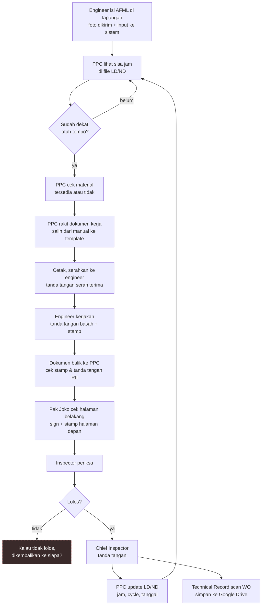
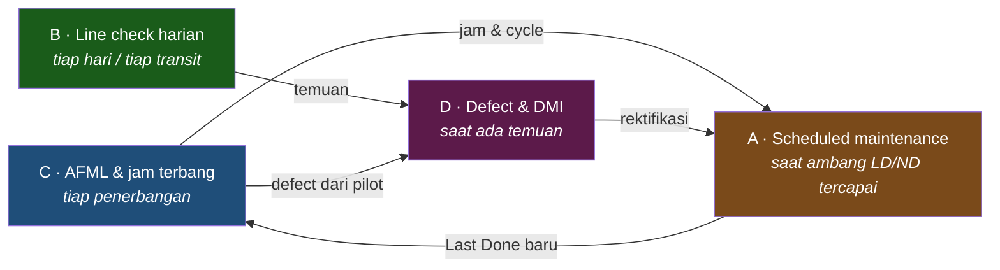
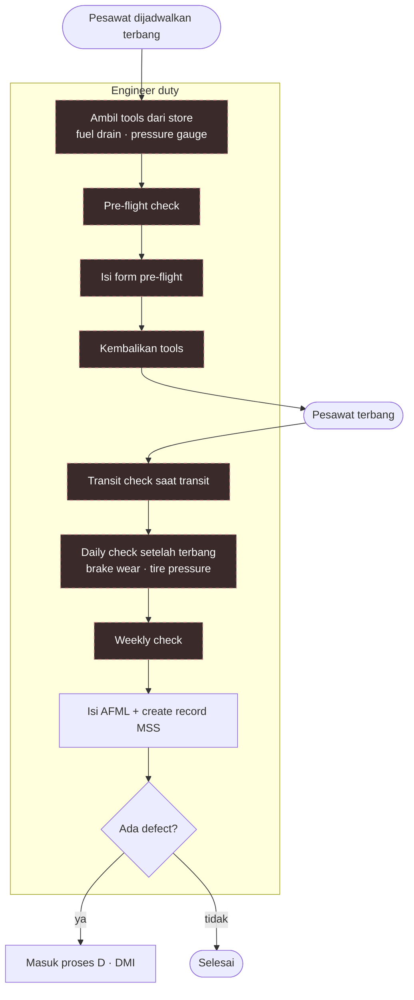
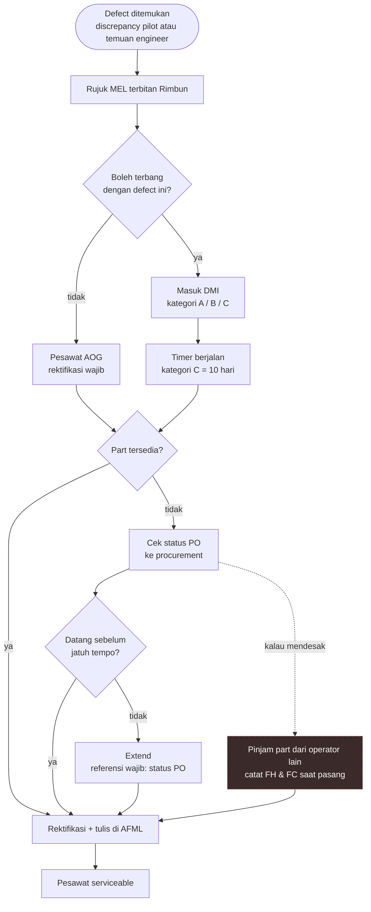

# BPMN & Activity Flow — AS-IS

**Audiens:** 🟢 Boleh ke Rimbun Air — Bagian 1 boleh ditunjukkan ke narasumber. Bagian lain untuk tim.

> **Isi note ini:** seluruh proses Rimbun Air sebagai diagram dan daftar aktivitas.
> Narasi & pain point ada di [[Proses Manual Maintenance - DRAFT]] — sengaja tidak diulang di sini.

**Untuk Gama:** mulai dari bagian **2** *(end-to-end)* → **3** *(detail per proses)* → **6** *(elemen BPMN)*. Blok putus-putus **jangan dimodelkan sebagai fakta**.

## Peta isi

| Bagian | Untuk apa |
|---|---|
| 1 · Diagram validasi | Dibawa ke narasumber, minta dikoreksi |
| **2 · Activity diagram end-to-end** | Tulang punggung — satu siklus penuh |
| 3 · Empat proses, detail | Cabang & jalur eksepsi tiap proses |
| **4 · Register 80 aktivitas** | Daftar lengkap, dasar audit kelengkapan |
| 5 · User activity per aktor | Bahan desain layar nanti |
| 6 · Elemen BPMN | Pool, lane, gateway, data object |
| 7 · Blok belum terkonfirmasi | Yang tidak boleh dimodelkan |
| 8 · Aturan bisnis | Siap masuk PRD |
| **9 · Audit kelengkapan** | Requirement mana yang belum punya aktivitas |

Sumber: lima wawancara — PPC 29 Jul · Inspector 30 Jul · Technical Record 31 Jul · Chief LM & OCC 3 Agu.

---

## 1 · Diagram validasi untuk narasumber

Sengaja disederhanakan. Tujuannya bukan akurat, tapi **mudah dikoreksi**.

**Cara memakainya:** tunjukkan, lalu tanya *"Bagian Bapak yang mana, dan mana yang keliru?"* Diam. Biarkan mereka menunjuk.

---

## 2 · Activity diagram end-to-end

### Start & end — tidak ada satu titik awal

Prosesnya **bukan satu alur panjang**, melainkan empat proses terpisah yang masing-masing punya pemicu dan penutup sendiri:

| Proses | Start event | End event |
|---|---|---|
| **C · AFML & jam terbang** | Message — pesawat mendarat | TSN/CSN terbit, angka tercatat |
| **A · Scheduled maintenance** | Conditional — remaining menyentuh ambang ✅ Message — AD · Alert SB · EO terbit 🔴 | WO ditutup & terarsip |
| **B · Line check harian** | Timer — pesawat dijadwalkan terbang | Form selesai, tidak ada defect |
| **D · Defect & DMI** | Message — defect dilaporkan | Pesawat serviceable |

**Yang menyambungkan keempatnya bukan sequence flow, tapi [[Glosarium#L|LD/ND]] sebagai data store.** Proses C menulis TSN/CSN ke sana. Proses A menulis Last Done ke sana, dan membaca dari sana untuk tahu kapan harus mulai.

Karena itu tidak ada panah *"selesai lalu langsung mulai lagi"*. Jeda antara satu WO dan WO berikutnya bisa berminggu-minggu — yang menggerakkannya bukan penutupan WO, tapi **pesawat yang terus terbang**.

> 🔴 **Satu start event digambar putus-putus: `AD · Alert SB · EO terbit`.** Pemicunya **tidak terjadwal saat datang, tapi terjadwal saat dikerjakan** — begitu terbit ia punya batas waktu kepatuhan sendiri, jadi didaftarkan ke tracker dan diramalkan seperti task lain. Karena itu panahnya masuk ke **LD/ND**, bukan langsung ke penerbitan WO.
>
> Dasarnya scope kontrak: AD · SB · SL · EO ada di modul 02 sebagai *entry*, lengkap dengan tool **Forecast ADSB** dan **ADSB report**. Sesuatu yang benar-benar tak terjadwal tidak bisa di-forecast.
>
> Tetap putus-putus karena **nol aktivitas teramati** — siapa menerima, di mana didaftarkan, dan bagaimana kepatuhannya dipantau, belum ada yang menjelaskan.

### Diagram

Dua start, dua end, dengan LD/ND sebagai penghubung.

```mermaid
flowchart TD
    START1(["Pesawat mendarat"])
    START2(["AD · Alert SB · EO terbit"])
    LDND[("LD/ND<br><i>data store</i>")]
    ENDC(["Data penerbangan tercatat"])
    ENDA(["WO selesai & terarsip"])

    subgraph FASE1["FASE 1 · Penerbangan & perekaman data"]
        direction TB
        subgraph L_PLT["Pilot & co-pilot"]
            A1["Isi blok hitam AFML<br>discrepancy · fuel dipakai & sisa"]
            A2["Catat engine data saat cruising"]
            A3["Co-pilot kirim data<br>format baku"]
        end
        subgraph L_ENG1["Engineer lapangan"]
            A4["Isi blok putih AFML<br>oli · hidrolik · engine parameter"]
            A5["Tulis rectification<br>atas discrepancy pilot"]
            A6["Catat component replacement<br>P/N + S/N on & off"]
            A7["Create record di MSS"]
            A8["Kirim foto AFML"]
        end
        subgraph L_OCC["OCC · Cengkareng"]
            A9["Bandingkan data co-pilot<br>vs foto AFML"]
            A10["Isi kolom actual<br>+ nomor AFML"]
            GA{"Nomor AFML<br>cocok?"}
            A11["Koreksi nomor"]
        end
        subgraph L_SYS["Sistem"]
            A12["Sinkron otomatis ke MSS"]
            A13["Tarik otomatis ke AFML MSS:<br>flight time · block time · cycle<br>fuel burn · uplift · nama crew"]
            AX["Data tidak muncul<br>di sisi maintenance"]
        end
        subgraph L_TR1["Technical Record"]
            A14["Rekonsiliasi hard copy vs MSS"]
            A15["Perbaiki ketidaksesuaian"]
            A16["Approve → TSN / CSN terbit"]
        end
    end

    subgraph FASE2["FASE 2 · Perencanaan"]
        subgraph L_PPC1["PPC Planning"]
            B2["Spreadsheet hitung next due"]
            B3["Pantau remaining"]
            GB{"Mendekati ambang?"}
            B4["Tentukan jenis check"]
            B5["Susun kebutuhan material<br>+ cek ketersediaan"]
            GC{"Material tersedia?"}
            B6["Ajukan permintaan pembelian"]
            B7["Ambil template<br>matriks tipe pesawat x jenis dokumen"]
            B8["Rakit paket dokumen<br>salin instruksi dari AMM / MP"]
            B9["Beri nomor WO berurut<br>merujuk entri LD/ND"]
            B10["Cetak paket hardcopy"]
        end
    end

    subgraph FASE3["FASE 3 · Eksekusi"]
        subgraph L_CLM1["Chief Line Maintenance"]
            C1["Distribusi task ke engineer<br>tanyakan kendala material"]
        end
        subgraph L_ENG2["Engineer lapangan"]
            C2["Terima paket<br>+ tanda tangan checklist serah terima"]
            C3["Kerjakan task"]
            GD{"Ada temuan<br>di luar WO?"}
            C4["Catat di halaman belakang<br>+ lampiran pengeluaran part"]
            C5["Tanda tangan basah<br>+ engineering stamp"]
        end
    end

    subgraph FASE4["FASE 4 · Verifikasi & penutupan"]
        subgraph L_PPC2["PPC Planning"]
            D1["Reviu kelengkapan<br>stamp & tanda tangan RII"]
            GE{"Lengkap?"}
        end
        subgraph L_CLM2["Chief Line Maintenance"]
            D2["Cek halaman belakang task card"]
            D3["Sign + stamp halaman depan"]
        end
        subgraph L_INS["Inspector"]
            D4["Verifikasi akhir<br>ttd lengkap & nilai final terisi"]
            GF{"Satisfied?"}
            D5["Alur penolakan"]
            D6["Chief Inspector<br>tanda tangan penutup"]
        end
        subgraph L_TR2["Technical Record"]
            D7["Scan WO"]
            D8["Simpan ke Google Drive"]
        end
    end

    START1 --> A1
    START1 --> A4
    A1 --> A2 --> A3 --> A9
    A4 --> A5 --> A6 --> A7 --> A8 --> A9
    A9 --> A10 --> GA
    GA -- ya --> A12 --> A13 --> A14
    GA -- tidak --> AX
    AX -.->|"teknik menyadari data hilang"| A11 --> A10
    A14 --> A15 --> A16 --> ENDC
    A16 -.->|"tulis TSN / CSN"| LDND

    LDND -.->|"baca"| B2
    B2 --> B3 --> GB
    START2 -.->|"❓ dinilai berlaku lalu didaftarkan —<br>lewat siapa, di mana"| LDND
    GB -- belum --> B3
    GB -- ya --> B4 --> B5 --> GC
    GC -- tidak --> B6 --> B7
    GC -- ya --> B7
    B7 --> B8 --> B9 --> B10 --> C1

    C1 --> C2 --> C3 --> GD
    GD -- ya --> C4 --> C5
    GD -- tidak --> C5
    C5 --> D1 --> GE
    GE -- tidak --> C3
    GE -- ya --> D2 --> D3 --> D4 --> GF
    GF -- tidak --> D5
    GF -- ya --> D6 --> D7 --> D8 --> ENDA
    D6 -.->|"tulis Last Done"| LDND

    classDef unknown fill:#3a2a2a,color:#fff,stroke:#c88,stroke-dasharray: 5 5
    class D5,C4,AX unknown
    classDef soft fill:#2a2a3a,color:#fff,stroke:#88c,stroke-dasharray: 3 3
    class GB,C1,C3 soft
    class START2 unknown
    classDef store fill:#7a4a1a,color:#fff
    class LDND store
```

**Yang perlu diperhatikan dari diagram ini:**

**LD/ND ditulis dari dua arah.** `A16` menulis TSN/CSN dari penerbangan harian, `D6` menulis Last Done saat WO ditutup. Keduanya garis putus-putus karena itu **akses data, bukan urutan langkah**. Inilah alasan LD/ND disebut pusat gravitasi — dan alasan dua sumber tulis itu harus konsisten di sistem nanti.

**Yang memicu WO berikutnya bukan penutupan WO.** Setelah Last Done diperbarui, `B3 → GB → belum → B3` bisa berputar berminggu-minggu. Yang menggerus remaining adalah **pesawat terbang**, bukan proses maintenance.

**Titik gagal paling berbahaya ada di `GA`.** Nomor AFML salah → data **hilang**, bukan salah. Dan pemulihannya bergantung pada seseorang menyadari ketiadaan data.

**Empat lapis tanda tangan** terlihat berurutan di Fase 4: engineer → PPC → Chief LM → Inspector, ditutup Chief Inspector.

**Yang tidak muncul di diagram ini** karena berjalan paralel, bukan berurutan: line check harian, DMI, kalibrasi, kontrol lisensi, audit, dokumen pesawat. Semuanya ada di bagian 3 dan 4.

---

## 3 · Empat proses, detail

**A** paling jarang tapi paling banyak dokumennya. **B** dan **C** terjadi tiap hari dan menghasilkan angka yang menggerakkan A.

Proses **A** dan **C** sudah tergambar penuh di bagian 2. Dua sisanya:

### B · Line check harian — tidak lewat WO

> ⚠️ **Blok B8 — seluruh alur ini kerangka.** Yang pasti: form-nya **baku**, diisi engineer duty, **tanpa WO dan tanpa planner**. Urutan persisnya belum pernah diamati. Frekuensinya jauh lebih tinggi daripada proses A.
>
> Brake wear saat ini dicatat di **papan tulis di kantor**, bukan di form.

### D · Defect & DMI

> **Reminder yang diminta Pak Joko:** H-1 sebelum DMI jatuh tempo, ditandai merah.
> **Part pinjaman** dicatat pada FH/FC saat dipasang dan saat dikembalikan — jadi dasar pembayaran. Saat ini **murni catatan manual, belum ada di scope mana pun.**

---

## 4 · Register aktivitas — 80 butir

Daftar lengkap semua aktivitas yang pernah disebut narasumber. **Ini acuan kelengkapan** — kalau sebuah aktivitas tidak ada di sini, berarti memang belum pernah kita dengar.

Kolom **?**: ✅ terkonfirmasi · 🟡 sebagian · ❓ dugaan

### F1 · Penerbangan & perekaman data — tiap penerbangan

| #   | Aktivitas                                                                                | Aktor            | Media         | ?                    |
| --- | ---------------------------------------------------------------------------------------- | ---------------- | ------------- | -------------------- |
| 01  | Isi blok hitam AFML — discrepancy, fuel dipakai & sisa                                   | Pilot            | Buku AFML     | ✅                    |
| 02  | Catat engine data saat cruising *(mis. 37.000 kaki)*                                     | Pilot            | Buku AFML     | ✅                    |
| 03  | Tulis nomor AFML — **manual, berurut**                                                   | Pilot / co-pilot | Buku AFML     | 🟡 siapa belum pasti |
| 04  | Isi blok putih AFML — oli, hidrolik                                                      | Engineer         | Buku AFML     | ✅                    |
| 05  | Isi engine parameter secara manual                                                       | Engineer         | Buku AFML     | ✅                    |
| 06  | Tulis rectification atas discrepancy pilot                                               | Engineer         | Buku AFML     | ✅                    |
| 07  | Catat component replacement — P/N + S/N on & off                                         | Engineer         | AFML + MSS    | ✅                    |
| 08  | Create record penerbangan di MSS                                                         | Engineer         | MSS           | ✅                    |
| 09  | Kirim foto AFML                                                                          | Engineer         | WhatsApp      | ✅                    |
| 10  | Kirim data penerbangan format baku                                                       | Co-pilot         | ❓ kanal utama | 🟡                   |
| 11  | Bandingkan data co-pilot vs foto AFML engineer                                           | OCC              | Sistem OCC    | ✅                    |
| 12  | Isi kolom actual + nomor AFML                                                            | OCC              | Sistem OCC    | ✅                    |
| 13  | Sinkron otomatis ke MSS lewat nomor AFML                                                 | Sistem           | Otomatis      | ✅                    |
| 14  | **Jalur gagal** — nomor salah, data tidak muncul di MSS, teknik minta koreksi            | OCC              | WhatsApp      | ✅                    |
| 15  | Tarik otomatis ke AFML MSS: flight time, block time, cycle, fuel burn, uplift, nama crew | Sistem           | Otomatis      | ✅                    |
| 16  | Rekonsiliasi hard copy AFML vs data MSS                                                  | Technical Record | Manual        | ✅                    |
| 17  | Perbaiki ketidaksesuaian data                                                            | Technical Record | MSS           | ✅                    |
| 18  | Approve AFML → TSN / CSN terbit                                                          | Technical Record | MSS           | ✅                    |
| 19  | Export laporan DKPPU bulanan — filter per bulan, hanya yang ada rectification            | Technical Record | MSS → file    | ✅                    |

### F2 · Perencanaan — saat ambang tercapai

| # | Aktivitas | Aktor | Media | ? |
|---|---|---|---|---|
| 20 | Update LD/ND: jam terbang, cycle, tanggal | PPC | Spreadsheet | ✅ |
| 21 | Spreadsheet menghitung next due otomatis | Spreadsheet | Rumus | ✅ |
| 22 | Pantau remaining tiap hari | PPC | Spreadsheet | ✅ |
| 23 | Putuskan kapan WO diturunkan | PPC | — | 🟡 **B5** ambang belum pasti |
| 24 | Tentukan jenis check — daily · weekly · A-Check 730 FH · Phase · C-Check | PPC | — | ✅ |
| 25 | Susun daftar kebutuhan material per pekerjaan | PPC | — | ✅ |
| 26 | Cek ketersediaan material | PPC | ❓ ke store | ✅ |
| 27 | Ajukan permintaan pembelian bila tidak tersedia | PPC | ❓ | ✅ |
| 28 | Ambil template — **matriks tipe pesawat × jenis dokumen** | PPC | File | ✅ |
| 29 | **Rakit paket: salin instruksi dari AMM/IPC/MP ke template** — beban kerja terbesar | PPC | Word / Excel | ✅ |
| 30 | Beri nomor WO berurut, merujuk entri LD/ND | PPC | — | ✅ |
| 31 | Cetak paket hardcopy | PPC | Printer | ✅ |

### F3 · Eksekusi

| # | Aktivitas | Aktor | Media | ? |
|---|---|---|---|---|
| 32 | Distribusi task ke engineer + tanyakan kendala material | Chief LM | Lisan / WA | ✅ |
| 33 | Serah terima paket + tanda tangan checklist | PPC → Engineer | Kertas | ✅ |
| 34 | Kerjakan task sesuai task card | Engineer | — | 🟡 **B7** |
| 35 | Catat temuan di luar WO di **halaman belakang task card** | Engineer | Kertas | 🟡 **B4** |
| 36 | Lampirkan bukti pengeluaran part untuk temuan | Engineer | Kertas | 🟡 **B4** |
| 37 | Tanda tangan basah + engineering stamp | Engineer | Basah | ✅ |
| 38 | Kembalikan dokumen ke planner | Engineer → PPC | Kertas | ✅ |

### F4 · Verifikasi & penutupan

| # | Aktivitas | Aktor | Media | ? |
|---|---|---|---|---|
| 39 | Reviu kelengkapan stamp & tanda tangan RII | PPC | Kertas | ✅ |
| 40 | Kembalikan ke engineer bila ada yang kurang | PPC → Engineer | Kertas | 🟡 |
| 41 | Cek halaman belakang task card | Chief LM | Kertas | ✅ |
| 42 | Sign + stamp halaman depan | Chief LM | Basah | ✅ |
| 43 | Verifikasi akhir — tanda tangan lengkap & nilai final terisi | Inspector | Kertas | ✅ |
| 44 | **Alur penolakan** bila tidak satisfied | Inspector | ❓ | ❓ **B6** |
| 45 | Tanda tangan penutup | Chief Inspector | Basah | ✅ |
| 46 | Scan WO | Technical Record | Scanner | ✅ |
| 47 | Simpan ke Google Drive — retensi selama pesawat dioperasikan | Technical Record | Drive | ✅ |
| 48 | Update Last Done di LD/ND | PPC | Spreadsheet | ✅ |
| 49 | Tutup WO meski material kurang → sisanya jadi *out of phase* | PPC / Chief LM | — | 🟡 praktik baku? |

### P1 · Line check harian — paralel, frekuensi tertinggi

| # | Aktivitas | Aktor | Media | ? |
|---|---|---|---|---|
| 50 | Ambil tools dari store untuk pre-flight — fuel drain, pressure gauge | Engineer | ❓ pencatatan | 🟡 **B8** |
| 51 | Pre-flight check | Engineer | — | 🟡 **B8** |
| 52 | Isi form pre-flight check *(form baku)* | Engineer | Kertas | 🟡 **B8** |
| 53 | Kembalikan tools | Engineer | ❓ | 🟡 **B8** |
| 54 | Transit check saat transit | Engineer | Kertas | 🟡 **B8** |
| 55 | Daily check — brake wear, tire pressure | Engineer | Kertas + **papan tulis** | 🟡 **B8** |
| 56 | Weekly check | Engineer | Kertas | 🟡 **B8** |

### P2 · Defect & DMI — paralel

| # | Aktivitas | Aktor | Media | ? |
|---|---|---|---|---|
| 57 | Rujuk MEL terbitan Rimbun saat ada defect | Chief LM / Engineer | Dokumen | ✅ |
| 58 | Masukkan ke DMI dengan kategori A / B / C | ❓ | ❓ | 🟡 |
| 59 | Pantau batas waktu — kategori C = 10 hari, reminder H-1 | Chief LM | Excel | ✅ |
| 60 | Cek status PO ke procurement | Chief LM | Koordinasi | ✅ |
| 61 | Extend DMI dengan referensi status PO | Chief LM | ❓ | ✅ |
| 62 | Pinjam part dari operator lain — catat FH & FC saat pasang dan lepas | Chief LM | **Manual** | 🟡 |
| 63 | Rektifikasi, tulis di AFML → pesawat serviceable | Engineer | AFML | ✅ |

### P3 · Kewenangan & alat — paralel

| # | Aktivitas | Aktor | Media | ? |
|---|---|---|---|---|
| 64 | Pantau validitas AMEL — maksimal 3 tahun | Chief LM | Excel | ✅ |
| 65 | Pantau Company Authorization — tidak boleh melebihi AMEL | Chief LM | Excel | ✅ |
| 66 | Assessment ulang 1 bulan sebelum authorization habis | Chief Inspector | ❓ | ✅ |
| 67 | Pantau kalibrasi tools, reminder 1 bulan sebelum expiry | Chief LM | Excel | ✅ |
| 68 | Kirim tool ke vendor kalibrasi bersertifikasi nasional | Chief LM / Zainul | Fisik | ✅ |
| 69 | Terima tool + sertifikat kalibrasi, catat interval berikutnya | Chief LM | Kertas | ✅ |
| 70 | Catat transaksi keluar-masuk tool & tool pinjaman | ❓ | ❓ | 🟡 |
| 71 | Pantau status GSE — GPU, genset, emergency equipment | Chief LM | Excel | ✅ |

### P4 · Material & inspeksi — paralel

| # | Aktivitas | Aktor | Media | ? |
|---|---|---|---|---|
| 72 | Terima material, cocokkan dengan pesanan | Store / Engineer | — | ✅ |
| 73 | Inspeksi material di lokasi | Inspector | — | ✅ |
| 74 | **Approval jarak jauh lewat foto** bila inspector tidak di lokasi → Inspection Report + **serviceable tag hijau** | Inspector | Foto | ✅ |
| 75 | Laporkan ketidaksesuaian serial number komponen | Store → Engineer | — | ✅ |

### P5 · Dokumen & regulasi — paralel

| # | Aktivitas | Aktor | Media | ? |
|---|---|---|---|---|
| 76 | Saring manual pabrikan sesuai kondisi operasi Indonesia *(mis. buang anti-ice)* | Inspector / Engineering | — | ✅ |
| 77 | Cek tanggal update manual vs portal pabrikan — **manual, tidak ada notifikasi** | Inspector | Portal | ✅ |
| 78 | Unduh manual → MSS → Google Drive sebagai versi current | ❓ | Drive | ✅ |
| 79 | Pantau validitas CoA & CoR — berlaku 1 tahun | Chief LM | Excel | ✅ |
| 80 | Perpanjangan CoA: ajukan berkas → DKPPU jadwalkan aircraft inspection → lengkapi evidence temuan lewat inspector → CoA terbit ulang | Chief LM + Inspector + DKPPU | Kertas + foto | ✅ |
| 81 | Kontrol temuan audit internal & eksternal, status open/close + evidence | Chief LM | Excel | ✅ |

---

## 5 · User activity per aktor

Ini yang dipakai saat merancang layar nanti. Satu tabel = satu pengguna.

### Pak Rian — PPC Planning · 1 orang

| | |
|---|---|
| **Pemicu** | Terus-menerus. Memantau remaining di LD/ND setiap hari |
| **Aktivitas** | 20–31 · 39–40 · 48 |
| **Keputusan yang dia ambil** | Kapan WO diturunkan · jenis check apa · dokumen apa saja yang masuk paket |
| **Input** | LD/ND · Maintenance Program · AMM/IPC per ATA chapter · template |
| **Output** | WO bernomor + task card + dokumen pendukung, **hardcopy** |
| **Titik nyeri** | **Salin-tempel manual dari manual pabrikan ke template.** Keluhan terbesarnya |
| **Alat sekarang** | Spreadsheet + template Word/Excel. Tidak memakai MSS |
| **Frekuensi** | ❓ volume WO per bulan belum diketahui |

### Pak Joko — Chief Line Maintenance · 1 orang, bekerja sendiri

| | |
|---|---|
| **Peran** | **Koordinator yang memonitor**, bukan atasan struktural engineer |
| **Pemicu** | Paket task turun dari planner · pemantauan berjalan terus |
| **Aktivitas** | 32 · 41–42 · 49 · 57–62 · 64–71 · 79–81 |
| **Keputusan yang dia ambil** | Dokumen lengkap atau belum · extend DMI atau tidak · pinjam part atau tidak |
| **Output** | WO tertandatangani · keputusan extend · permintaan kalibrasi |
| **Titik nyeri** | **Semua monitoring dibuat sendiri di Excel, belum selesai, belum digabung.** Brake wear masih di papan tulis |
| **Yang dia minta** | **Dashboard berwarna** — kuning 1 bulan sebelum expiry, merah saat lewat |
| **Frekuensi** | Setiap WO, tanpa kecuali |

### Engineer lapangan — ❓ jumlah belum diketahui, semua di Cengkareng

> ⚠️ **B7 — seluruh baris ini disusun dari cerita orang lain.** Belum pernah dari pelakunya.

| | |
|---|---|
| **Pemicu** | Jadwal duty · paket task dari planner · pesawat mendarat |
| **Aktivitas** | 04–09 · 33–38 · 50–56 · 63 |
| **Keputusan yang dia ambil** | Apakah temuan perlu dilaporkan · apakah pesawat layak dilepas |
| **Output** | Pekerjaan selesai · tanda tangan basah · **AFML terisi** · record MSS |
| **Kewenangan** | Dibatasi **AMEL** dan **Company Authorization** — yang berlaku adalah yang lebih pendek |
| **Alat sekarang** | Kertas + MSS. Belum diketahui apakah ada perangkat di lapangan |
| **Frekuensi** | Tiap penerbangan untuk aktivitas harian |

### Pak Heri & Chief Inspector — Inspector · 2 orang

| | |
|---|---|
| **Pemicu** | Dokumen masuk setelah disahkan Chief LM · permintaan inspeksi material |
| **Aktivitas** | 43–45 · 66 · 73–74 · 76–77 |
| **Aturan yang dia pegang** | Selesai hanya kalau **aktual selesai** *dan* **dokumentasi lengkap** |
| **Peran lain di luar alur ini** | Surveillance lapangan · audit vendor · kontrol manual · penghubung regulator · penerbit Company Authorization |
| **Kendala operasional** | Hanya ke Cengkareng atau Halim **seminggu sekali** — sisanya approval lewat foto |
| **Titik nyeri** | Satu orang memegang banyak fungsi. Kalibrasi tool tertunda urusan pembayaran vendor |
| **Frekuensi** | Tiap WO |

### Mba Michelle — Technical Record

| | |
|---|---|
| **Pemicu** | Foto AFML masuk · WO selesai ditandatangani · akhir bulan |
| **Aktivitas** | 16–19 · 46–47 |
| **Titik nyeri** | **Memperbaiki ketidakcocokan data setiap hari secara manual**, karena engineer tidak punya akses edit dan OCC beda departemen |
| **Retensi** | Selama pesawat masih dioperasikan. Record diserahkan saat pesawat dijual |
| **Frekuensi** | Harian, plus laporan DKPPU bulanan |

### Pak Pipit — Staff OCC · departemen Operasional, Cengkareng

> Di luar 10 modul kontrak. Dicantumkan karena datanya masuk ke modul ini.

| | |
|---|---|
| **Pemicu** | Penerbangan selesai |
| **Aktivitas** | 11–14 |
| **Titik nyeri** | **Nomor AFML sering salah tulis** — akibatnya data hilang dari sisi teknik |
| **Yang dia tidak tahu** | Bahwa datanya menopang seluruh perencanaan maintenance |
| **Frekuensi** | Tiap rute penerbangan |

### Pilot & co-pilot

| | |
|---|---|
| **Pemicu** | Tiap penerbangan |
| **Aktivitas** | 01–03 · 10 |
| **Yang dia isi** | **Blok hitam** AFML — discrepancy, fuel dipakai & sisa, actual take off, touchdown |
| **Catatan** | Engine data dicatat saat cruising, lalu diinput engineer saat post-handling |

---

## 6 · Elemen BPMN untuk Gama

### Pool & lane

| Pool | Lane | Status |
|---|---|---|
| **Rimbun Air — Maintenance** | PPC Planning | ✅ |
| | Chief Line Maintenance | ✅ |
| | Engineer lapangan | 🟡 **B7** — tangan kedua |
| | Inspector | ✅ |
| | Technical Record | ✅ |
| | Engineering | 🟡 **B2** — tinggal penyusun EO |
| **Rimbun Air — Operasional** | OCC | ✅ |
| | Pilot & co-pilot | ✅ |
| **Rimbun Air — Pendukung** | Store / material control | 🟡 disinggung |
| | Procurement | 🟡 disinggung |
| **Eksternal** | Vendor kalibrasi | 🟡 disinggung |
| | Pabrikan — portal manual | 🟡 |
| | Regulator DKPPU | ✅ untuk alur CoA |
| | Operator lain — part pinjaman | 🟡 baru teridentifikasi |

### Start event

| Event | Pemicu | Proses |
|---|---|---|
| Timer / kondisi | Remaining LD/ND mendekati ambang | A |
| Message | AD terbit dari otoritas | A |
| Message | Alert SB terbit dari pabrikan | A |
| Message | Engineering Order | A · 🟡 B2 |
| Timer | Jadwal penerbangan | B · C |
| Message | Discrepancy dari pilot atau temuan engineer | D |
| Timer | CoA / CoR mendekati kedaluwarsa — 30 hari | P5 |
| Timer | AMEL / authorization / kalibrasi mendekati kedaluwarsa | P3 |
| Message | Temuan audit internal atau eksternal | P5 |

### Gateway

| # | Gateway | Kondisi | Cabang | Status |
|---|---|---|---|---|
| G1 | Remaining mendekati ambang? | Sisa FH | ya → lanjut · belum → pantau | 🟡 **B5** |
| G2 | Material tersedia? | Cek stok | ya → rakit · tidak → ajukan beli | ✅ |
| G3 | Ada temuan di luar WO? | Saat pengerjaan | ya → halaman belakang + lampiran | 🟡 **B4** |
| G4 | Dokumen lengkap? | Stamp & tanda tangan RII | ya → Chief LM · tidak → balik ke engineer | ✅ |
| G5 | Verifikasi satisfied? | Kelengkapan | ya → Chief Inspector · tidak → ❓ | ❓ **B6** |
| G6 | Nomor AFML cocok? | Sinkronisasi | ya → masuk MSS · tidak → **data hilang** | ✅ |
| G7 | Boleh terbang dengan defect? | Rujuk MEL | ya → DMI · tidak → AOG | ✅ |
| G8 | Part datang sebelum jatuh tempo? | Status PO | ya → rektifikasi · tidak → extend | ✅ |
| G9 | Inspector ada di lokasi? | Keberadaan | ya → cek langsung · tidak → approval foto | ✅ |

### Data object

| Objek | Bentuk sekarang | Dibaca oleh | Ditulis oleh |
|---|---|---|---|
| **LD/ND** | Spreadsheet, satu file semua pesawat | PPC | PPC |
| **Maintenance Program** | Dokumen, revisi 3–4 bulan Boeing / 2× setahun ATR | PPC | Pabrikan → disaring internal |
| **AMM · IPC · CMM · manual lain** | Google Drive, diunduh manual | PPC, Engineer, Inspector | Pabrikan |
| **Work Order** | Hardcopy — dokumen besar berisi task card | Engineer, Chief LM, Inspector | PPC |
| **Task card — scheduled** | Hardcopy, template per model | Engineer | PPC |
| **Task card — daily/transit/weekly** | **Form baku**, sudah ada | Engineer | Engineer |
| **Lampiran temuan** | Kertas, di balik task card | Chief LM, Inspector | Engineer |
| **AFML** | Buku — blok hitam pilot, blok putih engineer. **Nomor ditulis manual** | OCC, Technical Record | Pilot, co-pilot, engineer |
| **DMI** | ❓ | Chief LM | ❓ |
| **MEL** | Dokumen terbitan Rimbun | Semua | Rimbun |
| **Inspection Report + serviceable tag hijau** | Kertas + tag fisik | Store, Engineer | Inspector |
| **Sertifikat kalibrasi** | Kertas dari vendor | Chief LM | Vendor |
| **Daftar lisensi & authorization** | Excel buatan Chief LM | Chief LM | Chief LM |
| **CoA · CoR** | Kertas, berlaku 1 tahun | Chief LM | DKPPU |
| **Laporan DKPPU bulanan** | Export dari MSS | DKPPU | Technical Record |
| **Checklist serah terima** | Kertas | PPC, Engineer | Keduanya |

### End event

| Event | Kondisi |
|---|---|
| Pekerjaan selesai | Aktual selesai **dan** dokumentasi lengkap — keduanya wajib |
| WO ditutup dengan sisa pekerjaan | Material kurang → digeser jadi *out of phase* · 🟡 belum dipastikan |
| Pesawat serviceable | Setelah rektifikasi DMI |
| CoA terbit ulang | Setelah inspeksi DKPPU dan seluruh temuan ditutup |
| WO dibatalkan | 🟡 belum digali |

---

## 7 · Blok yang belum terkonfirmasi

**Jangan dimodelkan sebagai fakta.**

| # | Blok | Kenapa belum bisa | Cara menutupnya |
|---|---|---|---|
| **B2** | Penyusun EO | Nama yang sempat tercatat ternyata salah dengar. Task card scheduled ternyata dari planner | Satu pesan ke Mas Bobby |
| **B4** | Non-routine card | Temuan di halaman belakang + lampiran. Belum jelas apakah sama dengan *"non-routine card bernomor otomatis"* di scope | Sesi 2 PPC / observasi |
| **B5** | Ambang di G1 | Contoh 100 FH dan 38 FH — patokan tetap atau penilaian? | Sesi 2 PPC |
| **B6** | Alur penolakan di G5 | Cabang "tidak satisfied" belum diketahui ujungnya | Sesi 2 Inspector |
| **B7** | Lane engineer lapangan | Semua aktivitasnya dari cerita orang lain | **Observasi Cengkareng** |
| **B8** | Alur line check harian | Tidak lewat WO. Urutan persisnya belum pernah diamati | **Observasi Cengkareng** |

Tertutup: ~~B1~~ rantai jam terbang · ~~B3~~ lane Technical Record · ~~B9~~ alur AFML di hulu.

---

## 8 · Aturan bisnis yang sudah bisa ditulis

Cukup kuat untuk masuk PRD, dengan catatan sumbernya wawancara — bukan dokumen.

1. **Pekerjaan selesai hanya kalau dua syarat terpenuhi:** aktual selesai **dan** dokumentasi lengkap.
2. **Tanda tangan berlapis empat:** engineer → reviu PPC → sign + stamp Chief LM → verifikasi Inspector, ditutup Chief Inspector.
3. **Koreksi dokumen:** satu kali coret, wajib disertai identitas pengoreksi dan tanggal. Tidak boleh dihapus atau ditimpa.
4. **Nomor WO berurutan** dan merujuk ke entri LD/ND terkait.
5. **Setelah WO ditutup**, LD/ND diperbarui dengan jam, cycle, dan tanggal — jatuh tempo berikutnya dihitung dari situ.
6. **Template berbentuk matriks:** per tipe pesawat × per jenis dokumen.
7. **Approval jarak jauh lewat foto** sah untuk pemeriksaan material, menghasilkan Inspection Report + serviceable tag **hijau** *(konvensi lokal, bukan konvensi buku)*.
8. **Satu AFML = satu rute**, bukan satu cycle. Ganti kru atau engineer → AFML baru.
9. **Nomor AFML adalah kunci sinkronisasi.** Salah nomor = data hilang, bukan salah tampil.
10. **Pembagian pengisian AFML tetap:** blok hitam pilot, blok putih engineer, dan enam field ditarik otomatis dari OCC.
11. **Lisensi punya dua tanggal kedaluwarsa:** AMEL maks 3 tahun, dan Company Authorization yang tidak boleh melebihinya.
12. **DMI kategori C wajib direktifikasi dalam 10 hari**, atau di-*extend* dengan referensi status PO.
13. **Pemeriksaan harian tidak melahirkan WO** — form baku diisi langsung engineer duty.
14. **Part pinjaman dicatat pada FH & FC** saat dipasang dan dikembalikan, sebagai dasar pembayaran.
15. **Laporan DKPPU bulanan** hanya memuat entri yang punya rectification.
16. **Retensi record** selama pesawat masih dioperasikan; diserahkan ke pembeli saat pesawat dijual.

---

## 9 · Audit kelengkapan

Tiap requirement di [[Scope]] dicocokkan dengan aktivitas yang benar-benar teramati. **Baris merah = requirement tanpa aktivitas apa pun** — artinya kita akan merancang sesuatu yang belum pernah kita lihat cara kerjanya.

| Requirement | Aktivitas | Status |
|---|---|---|
| LD/ND report | 20–23, 48 | ✅ |
| Task card | 28–29 | ✅ |
| Work Order + penomoran | 30, 33–49 | ✅ |
| Check-pack A/C/yearly | 24 | ✅ |
| AMP | 76 | 🟡 hanya penyaringannya |
| AFML / Flight log | 01–19 | ✅ |
| CRS / Return to Service | 45 | 🔴 **tidak pernah disebut narasumber** — kita mengasumsikan ttd Chief Inspector = CRS |
| Defect & Deferred / DMI | 57–63 | ✅ |
| HR License Validation | 64–66 | ✅ |
| Tool Crib & Calibration | 67–70 | ✅ |
| Non-routine card | 35–36 | 🟡 penomoran belum terkonfirmasi |
| Component transaction | 07, 62, 75 | ✅ |
| **AD / SB / SL / EO** | — | 🔴 **Tidak ada aktivitas.** Hanya diketahui sebagai pemicu. Siapa mendaftarkan, di mana, bagaimana dipantau — belum pernah dijelaskan siapa pun |
| **Forecast** — Task, ADSB, HT, Check-pack, Deferred | — | 🔴 **Tidak ada aktivitas.** Yang kita tahu hanya spreadsheet menghitung next due. Forecast sebagai laporan belum pernah terlihat |
| **Fluid consumption monitor** | 04 saja | 🔴 Oli & hidrolik dicatat, tapi **tidak ada aktivitas pemantauan atau pelaporan** |
| **Reliability & Repetitive** | — | 🔴 **Tidak ada aktivitas.** Belum tersentuh di lima wawancara |

### Lima requirement tanpa aktivitas

Ini hasil terpenting dari audit — bukan blok BPMN yang putus-putus, tapi **requirement yang akan dirancang tanpa dasar AS-IS**:

1. **AD/SB/SL/EO** — paling mendesak. Empat jenis dokumen ini ada di scope Anda sebagai entri yang harus didaftarkan, tapi tidak satu pun narasumber menjelaskan cara mengelolanya hari ini.
2. **Forecast** — inti modul Planning, dan yang terlihat baru rumus next due di spreadsheet.
3. **CRS** — kita mengasumsikan tanda tangan Chief Inspector berfungsi sebagai CRS, tapi tidak ada yang menyebut CRS atau DGCA Form 21-18.
4. **Fluid consumption** — datanya dicatat, pemantauannya tidak ada.
5. **Reliability & Repetitive** — Pak Joko menyinggung *"analisis kerusakan berulang"* sebagai wilayah Engineering, tapi tidak ada yang menjelaskan prosesnya.

Semuanya cocok dijadikan agenda **sesi 2 PPC** — bukan observasi lapangan, karena kelimanya pekerjaan meja.

---

## 10 · Yang belum bisa dimodelkan sama sekali

- **RII / inspeksi ganda** — disebut Pak Joko dan Pak Rian, mekanismenya belum digali
- **Validasi kewenangan sebelum tanda tangan** — belum diketahui apakah dicek, dan oleh siapa
- **Pembatalan WO** — belum pernah dibahas
- **Shift & roster engineer** — diminta Pak Joko, alurnya belum ada
- **Training & medical personel** — wilayah modul HR, disebut tapi tidak digali

---

Terkait: [[Proses Manual Maintenance - DRAFT]] · [[Scope]] · [[2026-08-03 Chief Line Maintenance - Pak Joko]] · [[2026-08-03 Staff OCC - Pak Pipit]] · [[2026-07-31 PPC Technical Record]] · [[2026-07-30 Staff Inspector Maintenance]]
