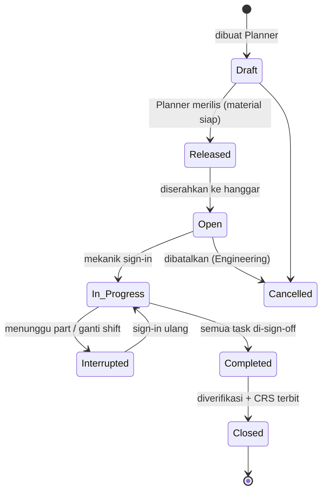

# Eksekusi Work Order, Kewenangan & Kalibrasi

**Audiens:** 🟡 Tim Nodewave — Untuk tim Nodewave. Teori standar industri.

> **Isi note ini:** teori domain untuk modul Production. Standar industri, bukan praktik Rimbun Air.
> Praktik lapangannya ada di [[Proses Manual Maintenance - DRAFT]].

Sumber: [[Riset Modul Eksekusi MRO]] (deep research, `_sumber-mentah/`) · scope: [[Scope]] modul 2

## Ringkasan

Modul ini bukan aplikasi produktivitas. Aplikasi produktivitas memberi pengguna kebebasan memperbaiki kesalahan dengan cepat; modul MRO justru harus **menolak** — mekanik tanpa rating yang sesuai, alat yang kedaluwarsa kalibrasinya, [[Glosarium#C|CRS]] yang syaratnya belum lengkap. Semua harus membentur dinding, bukan peringatan yang bisa diklik lewat.

Empat pilarnya: siklus hidup work order · kewenangan personel · pengendalian alat terkalibrasi · penerbitan CRS sebagai gerbang legal terakhir.

## Siklus hidup Work Order



Tiap transisi dipagari RBAC:

| Transisi | Siapa yang berwenang |
|---|---|
| Draft → Released | Planner |
| Released → Open | Serah terima ke hanggar |
| Open → In Progress | Mekanik (sign-in) |
| Completed → **Closed** | **Certifying Staff / Quality Inspector** |

> 💡 Status **Interrupted** penting dicatat, bukan disembunyikan. Auditor akan bertanya kenapa pekerjaan estimasi 2 jam selesai dalam 3 hari — dan jawabannya harus ada di sistem.

## Line vs Base maintenance

Dua konteks eksekusi dengan kewenangan berbeda:

| | Line Maintenance | Base Maintenance |
|---|---|---|
| Di mana | Di stasiun, antar penerbangan | Hanggar / [[Glosarium#A\|AMO]] |
| Cakupan | Kewenangan terbatas — pemeriksaan harian, defect ringan, deferral | Heavy check, pekerjaan struktural, penggantian komponen besar |
| Implikasi sistem | Butuh antarmuka ringkas, sering di luar pangkalan | Butuh work package penuh, koordinasi material & alat |

## Hierarki dokumen kerja

| Tingkat | Isi | Contoh |
|---|---|---|
| **Work Package** (check-pack) | Semua pekerjaan dalam satu periode grounded | C-Check PK-xxx, 10 Agustus |
| **Work Order** | Otorisasi kerja, mengelompokkan task per zona atau keahlian | WO penggantian landing gear kiri |
| **[[Glosarium#T\|Task Card]]** | Instruksi spesifik dari [[Glosarium#M\|MPD]] | Inspeksi korosi strut landing gear |
| **Job Card** | Pemecahan granular per langkah + peringatan keselamatan | 1. Pasang dongkrak 2. Lepas baut X 3. … |

**Sign-in / sign-out** bukan absensi — itu pengikatan tanggung jawab. Kalau komponen gagal di kemudian hari, penyelidik bisa melacak sampai level menit siapa yang menyentuh baut mana.

## Syarat penutupan WO

WO **tidak boleh** ditutup sebelum semuanya terpenuhi:

- [ ] Semua langkah task card punya sign-off
- [ ] Semua non-routine finding sudah selesai **atau** dialihkan legal jadi [[Glosarium#D|DMI]]
- [ ] Part yang diminta tercatat terpasang; komponen rusak sudah dikembalikan bertag
- [ ] Semua alat terkalibrasi yang dipinjam sudah check-in
- [ ] Tes operasional (mis. engine run-up) tercatat lulus

Kalau satu saja gagal, tombol Close harus mati — bukan memunculkan konfirmasi.

**Pembatalan WO** boleh kalau terbukti duplikat atau digantikan AD/SB yang lebih baru. Tapi [[Glosarium#C|CASR]] 43.12 melarang penghancuran catatan: dokumen tidak boleh dihapus, harus diberi watermark **CANCELLED** + alasan + tanda tangan otoritas.

**Man-hour** dihitung otomatis dari akumulasi sign-in/sign-out, dipakai untuk tiga hal: penagihan · penyempurnaan estimasi forecast (kalau manual bilang 2 jam tapi realitas 4 jam, planner harus menyesuaikan) · dan **manajemen kelelahan** — regulasi membatasi jam kerja personel, sistem harus memperingatkan saat mendekati ambang.

## Non-routine finding

Diterbitkan saat mekanik menemukan kerusakan **di luar cakupan** pekerjaan yang sedang dilakukan. Contoh: sedang melumasi engsel pintu kargo, menemukan retakan 2 cm di kusen pintu. Pekerjaan berhenti, [[Glosarium#N|NRC]] terbit.

| Tingkat keparahan | Siapa menyetujui |
|---|---|
| Perbaikan standar (ada di SRM pabrikan) | Supervisor / Base Maintenance Manager |
| **Major repair** (melampaui toleransi manual) | Engineering menerbitkan EO + **wajib lapor [[Glosarium#D\|DKPPU]] via [[Glosarium#D\|DGCA]] Form 43-337 dalam 48 jam** setelah pesawat dirilis |

**NRC masuk ke work package yang sama**, ditautkan sebagai *child record* dari task card yang memicunya. Alasannya keterlacakan: auditor dua tahun kemudian harus bisa membaca narasinya — "retakan A ditemukan saat inspeksi B, diperbaiki dengan part C". Kalau NRC jadi WO baru yang terputus relasinya, konteks itu hilang.

## Kewenangan personel

Ini jantung kepatuhan. Menandatangani rilis tanpa wewenang sah bukan pelanggaran administratif — itu pemalsuan dokumen.

### Tiga pilar lisensi (CASR Part 65)

1. **Basic Certificate** — lulus ujian dasar DKPPU, **belum** berhak merilis pesawat. Kategori: A1 (airframe pesawat) · A2 (airframe helikopter) · A3 (piston engine) · A4 (turbine engine) · C1 (radio) · C2 (instrument) · C4 (electrical)
2. **[[Glosarium#A|AMEL]]** — lisensi penuh, terbit setelah pemegang basic certificate memenuhi syarat pengalaman lapangan terawasi
3. **Type / Group Rating** — kewenangan spesifik per keluarga pesawat (mis. ATR 42/72), butuh type training

### Scope of authority

> **Lisensi negara ≠ boleh tanda tangan.** Kewenangan sebenarnya adalah irisan **lisensi DKPPU** ∩ **[[Glosarium#C|Company Authorization]]**.

Quality Assurance menilai tiap mekanik dan menerbitkan izin internal yang bisa **lebih sempit** dari lisensi negaranya. Contoh: mekanik punya AMEL A1, A4, dan type rating ATR 72, tapi karena baru bergabung hanya diberi otorisasi Daily Check — bukan C-Check.

**Company Authorization adalah source of truth sistem**, bukan lisensi negara.

### Validasi hard-stop saat sign-off

Saat mekanik menekan Sign-Off, sistem harus memeriksa keempatnya:

1. Punya Company Authorization aktif?
2. Otorisasi mencakup type rating pesawat ini?
3. Punya basic rating yang sesuai dengan jenis pekerjaan?
4. Lisensi DKPPU dan otorisasi perusahaan belum kedaluwarsa?

Satu saja `false` → blokir.

### Recent experience

Lisensi bisa "membeku" kalau tidak dipakai: mekanik harus melakukan atau mengawasi pemeliharaan **minimal 6 bulan dalam 24 bulan terakhir**. Sistem harus terus menghitung frekuensi sign-in dan otomatis menandai status **Suspended** kalau ambang terlewat — QA harus menguji ulang sebelum mengaktifkan kembali.

### RII — Required Inspection Item

Daftar pekerjaan yang kalau salah bisa berakibat katastropik: pengaturan flight control, pemasangan mesin, manipulasi kabel kemudi.

> **Aturan emas [[Glosarium#R|RII]]: yang mengerjakan dilarang keras menginspeksi pekerjaannya sendiri.**

Inspeksi ganda wajib, dan hanya boleh dilakukan RII Inspector yang namanya tercatat eksplisit di Company Maintenance Manual. Kalau ditolak, mekanik memperbaiki lalu inspektur melakukan **buy-back inspection**.

### Data personel yang wajib disimpan

Nomor pegawai & nama · nomor lisensi DKPPU · tanggal kedaluwarsa lisensi · daftar basic rating · daftar type rating · **daftar otorisasi perusahaan** (termasuk flag: RII inspector? boleh engine run-up?) · tanggal recurrent training.

## Tool crib & kalibrasi

Alat ukur yang menyimpang menghasilkan torsi baut yang salah — dan baut yang salah bisa melepaskan mesin di udara.

**CASR 145.109** mewajibkan semua instrumen pengujian dan peralatan inspeksi dikalibrasi berkala. Sertifikat kalibrasi harus **tertelusur ke standar nasional**, di Indonesia lewat **Komite Akreditasi Nasional (KAN)**. Tiap alat wajib punya stiker fisik berisi nama, part number, dan next due date.

**Check-out / check-in** wajib: mekanik memindai identitas dan barcode/RFID alat, lalu menautkannya ke WO tertentu. Kalau akhir shift alat belum kembali, alarm ke shift lead — dan **pesawat dilarang dirilis sampai alat ditemukan**. Ini sekaligus pencegahan **[[Glosarium#F|FOD]]** (benda asing tertinggal di kompartemen pesawat).

### Quality escape & reverse trace

Skenario terburuk: alat yang sudah kedaluwarsa kalibrasinya terlanjur dipakai merilis pekerjaan penting.

Sistem harus bisa menjawab kueri: *"Tampilkan semua WO dan registrasi pesawat yang pernah disentuh Torque Wrench S/N 4455 sejak tanggal kedaluwarsanya."*

Kalau setelah dites ulang alat itu terbukti tidak akurat, operator mungkin harus memanggil pulang pesawat yang sedang beroperasi untuk mengencangkan ulang. Kemampuan **reverse trace** ini bukan fitur tambahan — itu yang membatasi kerusakan saat hal buruk terjadi.

Data per alat: P/N · S/N unik · deskripsi · lokasi aktual (tersedia / dipinjam / karantina) · tanggal kalibrasi terakhir · **tanggal jatuh tempo** · riwayat peminjaman.

## Certificate of Release to Service

Batas legal antara sekumpulan logam di hanggar dan entitas yang boleh terbang. Tanda tangan di CRS mengikat secara hukum — kalau pesawat jatuh karena kelalaian perawatan, penandatangan menghadapi penyelidikan pidana.

| | CRS Pesawat (Return to Service) | CRS Komponen (Authorized [[Glosarium#R\|Release Certificate]]) |
|---|---|---|
| Kapan | Seluruh pesawat siap terbang setelah dirawat | Komponen selesai diperbaiki di bengkel, belum terpasang |
| Bentuk | Stempel + tanda tangan di **[[Glosarium#A\|AFML]]** | **[[Glosarium#D\|DGCA Form 21-18]]** |
| Fungsi | Menyatakan registrasi PK-xxx siap terbang | "Paspor" kelaikudaraan yang melekat pada komponen fisik |

> ⚠️ **Form 21-18, bukan "Form 1".** Otoritas India (juga bernama DGCA) menerbitkan "DGCA Form 1". Untuk Indonesia yang sah adalah **DGCA Form 21-18**, diterbitkan inspektur tersertifikasi dalam organisasi CASR 145.

**Prasyarat sebelum CRS pesawat boleh ditandatangani** — layar rekapitulasi yang dilihat certifying staff:

- Semua task card rutin berstatus Closed
- Semua NRC Closed atau legal masuk deferral MEL/CDL
- Catatan pemasangan part seimbang dengan komponen yang dilepas
- Semua alat pinjaman sudah check-in
- Tes operasional tercatat Passed

Menerbitkan CRS prematur karena ditekan jadwal penerbangan = pemalsuan dokumen keselamatan (CASR 43.12), dasar bagi DKPPU mencabut lisensi mekanik dan membekukan AOC/AMO.

## Pemasangan & pelepasan komponen

Saat **melepas**, catat: P/N · S/N · lokasi pemasangan sebelumnya (mis. Engine #1) · alasan pelepasan · TSN · CSN.
Saat **memasang**, catat: P/N & S/N pengganti · nomor referensi Form 21-18-nya.

### Tagging

| Tag | Arti |
|---|---|
| 🟡 **Yellow** | Serviceable — layak pasang, selalu ditemani Form 21-18 sah |
| 🟢 **Green / tanpa warna** | [[Glosarium#U\|Unserviceable]] / repairable — baru dilepas, akan ke bengkel |
| 🔴 **Red** | Condemned / scrap — harus dimutilasi agar tidak dijual kembali ke pasar gelap |

### Receiving inspection

Inspektur penerimaan **tidak** mengecek fungsi komponen — itu urusan bengkel. Yang dicek adalah **keabsahan dokumen**: Form 21-18 asli, tidak ada kerusakan pengiriman, dan komponen bukan barang palsu (*Suspected Unapproved Parts*).

### Akumulasi jam komponen

Umur komponen berjalan sendiri, terpisah dari pesawat:

```
Generator S/N 99 dilepas dari Pesawat A pada 1.000 FH
→ diperbaiki, disimpan di gudang (umur BEKU di 1.000 FH)
→ 6 bulan kemudian dipasang di Pesawat B (saat itu B = 5.000 FH)
→ Pesawat B terbang 100 jam (jadi 5.100 FH)
→ Umur generator jadi 1.100 FH
```

Logika detach-and-attach ini absolut diperlukan modul planning.

## Entitas data & hard-stop

| Entitas | Atribut kunci |
|---|---|
| **Aircraft** | Registration, Type, Total_FH, Total_FC |
| **WorkPackage** | PackageID, Type, Aircraft_Reg, Status |
| **WorkOrder** | WO_ID, PackageID, Status, Planned_ManHour |
| **TaskCard** | TaskID, WO_ID, MPD_Ref, **Is_RII** (boolean), Required_Trade |
| **Employee** | EmpID, License_No, License_Expiry — many-to-many ke Capability |
| **Tool** | ToolID, P/N, S/N, Cal_DueDate, Status |
| **Component** | PartNo, SerialNo, Status, TSN, CSN, Form21-18_Ref |

**Empat penolakan keras:**

1. **Lisensi** — tolak sign-off kalau lisensi kedaluwarsa atau trade tidak ada di capability mekanik
2. **RII** — kalau `Is_RII = TRUE`, tolak inspector sign-off kalau user ID-nya sama dengan mekanik yang mengerjakan
3. **Alat** — tolak check-out alat yang `Cal_DueDate` sudah lewat
4. **CRS** — matikan tombol Release kalau masih ada task card berstatus ≠ Closed

## Audit trail (CASR 43.12)

Hukum melarang penghapusan atau pengubahan rekam pemeliharaan tanpa meninggalkan jejak asli.

**Database tidak boleh mengizinkan DELETE atau UPDATE yang menimpa baris tanda tangan.** Arsitekturnya append-only / event sourcing.

Kalau mekanik A salah menandatangani task card milik mekanik B, **tidak ada tombol Undo**. Yang ada fungsi koreksi: sistem menyimpan entri baru yang membatalkan entri lama, menampilkan tanda tangan pertama dengan coretan visual, plus teks alasan dan nama pengoreksi. Keduanya tetap tersimpan bersebelahan.

## Transisi tanda tangan basah ke digital

Rimbun Air sekarang 100% kertas. Transisinya bertahap:

| Fase | Bentuk |
|---|---|
| **Hibrida** | WO dirilis & dilacak elektronik, task card **tetap dicetak**. Mekanik tanda tangan basah, petugas memperbarui status di sistem lalu memindai kertasnya untuk arsip |
| **Full digital** | Mekanik pakai tablet di hanggar, sign-off dengan PIN unik. Sistem otomatis menghasilkan PDF non-editable terkunci kriptografi per WO yang ditutup |

> ⚠️ **Jangan setengah-setengah.** Satu work package yang separuh kertas separuh digital akan mengacaukan audit DKPPU. Dan sebelum kertas benar-benar ditinggalkan, Rimbun Air wajib merevisi [[Glosarium#O|OpSpecs]] dan mendapat persetujuan inspektur DKPPU.

## Caveat

- **Sumber riset lemah.** Sitasi mengarah ke Scribd, bukan dokumen CASR primer. Verifikasi semua nomor pasal ke JDIH Kemenhub.
- **Angka retensi berbeda dengan note lain.** Riset ini menyebut "CASR 121.380 minimum 2 tahun"; [[Regulasi & Kepatuhan CASR Indonesia]] menyebut skema berbeda (1 tahun / sampai superseded, 90 hari pasca-withdrawal, ≥2 tahun untuk duplikat Form 21-18). **Salah satu keliru** — harus dicek ke teks CASR asli.
- **Format Form 21-18 diatur ketat.** Modul cetak tidak boleh mengubah margin, font, atau urutan nomor kotak. Minta template resmi dari QA Rimbun Air.
- **Recent experience 6 bulan dalam 24 bulan** perlu dikonfirmasi ke teks CASR Part 65 asli.
- Registrasi pesawat yang muncul di dokumen riset asli adalah **karangan**, bukan armada Rimbun Air.

## Kenapa relevan buat project ini

Ini isi modul 2 di [[Scope]] — WO management, component transaction, HR license validation, tool crib, CRS. Juga bekal untuk wawancara inspector: sebagian besar blok B di [[Lembar Wawancara Inspector - Sesi 2]] menanyakan apakah praktik di sini punya padanan manualnya.
