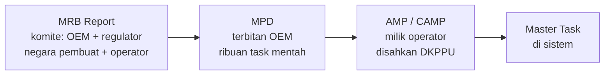

# Interval, Due Date & Forecasting Maintenance

**Audiens:** 🟡 Tim Nodewave — Untuk tim Nodewave. Teori standar industri.

> **Isi note ini:** teori domain untuk modul Planning. Standar industri, bukan praktik Rimbun Air.
> Praktik lapangannya ada di [[Proses Manual Maintenance - DRAFT]].

Sumber: [[Riset Sistem MRO Aviasi]] (deep research, `_sumber-mentah/`) · scope: [[Scope]] modul 1

## Ringkasan

Ini aritmetika di balik [[Glosarium#L|LD/ND]]. Setiap task punya satu atau lebih interval; **Next Due = Last Done + Interval**, dan kalau intervalnya lebih dari satu, yang berlaku adalah yang tercapai duluan. Dari sisa jarak ke Next Due, sistem memproyeksikan tanggal jatuh tempo memakai rata-rata utilisasi harian.

Dua hal yang paling gampang salah dan paling mahal akibatnya: **cara menghitung Next Due setelah task dikerjakan dalam toleransi**, dan **menyamakan umur komponen dengan umur pesawat**.

## Jenis interval

| Jenis | Kode | Yang menyebabkan aus | Contoh task |
|---|---|---|---|
| Flight Hours | FH | Gesekan mekanis selama di udara | Inspeksi filter oli, generator |
| Flight Cycles | FC | Tekanan struktural & siklus presurisasi | Landing gear, struktur sayap |
| Kalender | Mo/Yr/Dy | Korosi, penuaan karet & seal | Inspeksi korosi, ganti selang hidrolik |
| Engine Hours/Cycles | EH/EC | Sama dengan FH/FC tapi khusus mesin | Bilah turbin, kompresor |

> ⚠️ **Jangan ikat umur mesin ke umur airframe.** Mesin bisa dipindah antar pesawat, jadi akumulasinya harus berdiri sendiri. Ini kesalahan desain klasik.

## Menghitung Next Due

Bedakan dua sumber angka: **[[Glosarium#A|AFTF]]** (Airframe Total Time) untuk task yang melekat di badan pesawat, dan **[[Glosarium#T|TSN/TSO]]** untuk komponen rotable yang bisa dicabut-pasang.

Contoh — penggantian starter generator, interval 1.500 FH:

```
Last Done       = 4.000 FH
Interval        = 1.500 FH
Next Due        = 4.000 + 1.500 = 5.500 FH
Current AFTF    = 5.200 FH
Remaining       = 5.500 − 5.200 = 300 FH
```

Kalau komponennya bekas dari pesawat lain, perhitungan **wajib** pakai TSN komponen — bukan AFTF pesawat.

## Whichever Comes First (WCF)

Sebagian besar task punya beberapa parameter berjalan bersamaan. Yang tercapai duluan yang menang.

Contoh — inspeksi struktur sayap, **1.500 FH ATAU 1.500 FC ATAU 12 bulan**:

| | Last Done (1 Jan 2026) | Limit | Posisi 1 Mei 2026 | Sisa | [[Glosarium#A\|ADU]] | Proyeksi |
|---|---|---|---|---|---|---|
| **FH** | 10.000 FH | 11.500 FH | 10.600 FH | 900 FH | 5 FH/hari | 180 hari → **28 Okt 2026** |
| **FC** | 12.000 FC | 13.500 FC | 12.720 FC | 780 FC | 6 FC/hari | 130 hari → **8 Sep 2026** |
| **Kalender** | 1 Jan 2026 | +12 bulan | — | — | — | **1 Jan 2027** |

Yang mengendalikan task ini adalah **FC** — 8 September 2026. Itu yang ditampilkan sistem sebagai Absolute Due Date.

> 📌 Rumus di dokumen riset asli hilang (jadi placeholder gambar saat diekspor). Angka di tabel ini saya rekonstruksi dan periksa ulang — hasilnya konsisten.

## Toleransi — dan bahaya "interval creep"

**Toleransi** adalah kelonggaran melewati due date tanpa melanggar. Diusulkan OEM, tapi **harus disahkan [[Glosarium#D|DKPPU]] di dalam AMP**. Besaran lazim ~10% dari interval, atau nilai absolut.

Pertanyaan yang menentukan desain: kalau task dikerjakan memakai toleransi, Next Due dihitung dari mana?

| | Cara hitung | Contoh (interval 500 FH, due di 500, dikerjakan di 540) |
|---|---|---|
| **Praktik A** ✅ | Dari **due date asli** | 500 + 500 = **1.000 FH** |
| **Praktik B** ❌ | Dari tanggal aktual | 540 + 500 = **1.040 FH** |

**Sistem wajib menerapkan Praktik A.** Kalau Praktik B dibiarkan otomatis, keterlambatan menumpuk tiap siklus (1.040 → 1.580 → …) dan interval dasar berubah tanpa persetujuan regulator. Itu namanya *interval creep*, dan secara hukum sama dengan mengubah AMP diam-diam.

Kalau dikerjakan **lebih awal** (misal di 450), umumnya di-reset dari aktual: 450 + 500 = 950 FH. Operator "rugi" 50 FH, tapi batas keselamatan tidak pernah terlampaui.

## Eskalasi interval

Memperpanjang interval secara permanen (500 → 600 FH) untuk seluruh armada. **Wajib persetujuan tertulis DKPPU** ([[Glosarium#C|CASR]] 121.367 / 135.367), didukung data reliability berbulan-bulan.

Implikasi sistem: interval dasar di Master Task harus terkunci, hanya bisa diubah role tertentu, dan audit trail wajib merekam **nomor surat persetujuan DKPPU** sebagai justifikasi.

**[[Glosarium#A|AD]] dan [[Glosarium#L|LLP]] tidak boleh dieskalasi sama sekali.**

## Forecasting

```
ADU        = Total FH 90 hari terakhir ÷ 90
Est. Due   = Hari ini + (Remaining ÷ ADU)
```

Contoh: Remaining 400 FH, terbang 450 FH dalam 90 hari → ADU 5 FH/hari → jatuh tempo ~80 hari lagi.

Hitung ulang tiap malam sebagai batch, karena ADU bergerak terus.

**Kenapa forecast meleset:** pesawat [[Glosarium#A|AOG]] dua minggu (ADU anjlok, task FH mundur tapi task kalender tetap) · lonjakan utilisasi mendadak karena kontrak baru · bandara tutup karena cuaca. Ketiganya normal — sistem harus menghitung ulang tiap ada flight log masuk, bukan menyimpan tanggal statis.

## Hierarki dokumen program



**Aturan emas:** operator **boleh** memperketat interval dari [[Glosarium#M|MPD]] (misal 500 → 400 FH karena kondisi operasi tertentu), tapi **tidak boleh** melonggarkan tanpa kajian teknik dan persetujuan DKPPU.

## Anatomi task card

| Field | Fungsi |
|---|---|
| Task Number | Identitas unik (mis. 32-10-00-101), tidak boleh duplikat |
| Description | Ringkas, mis. "Inspect Main Landing Gear Tire" |
| **Effectivity** | Pesawat mana yang terdampak — tidak semua task berlaku untuk semua MSN |
| Interval | Nilai + satuan, bisa lebih dari satu ([[Glosarium#W\|WCF]]) |
| Skill Code / Trade | Kualifikasi lisensi yang dibutuhkan |
| Man-Hours | Estimasi beban kerja, dipakai kalkulasi kapasitas |
| Parts / Tools Required | Relasi ke inventory |
| Sign-Off / [[Glosarium#R\|RII]] | Kolom validasi; RII butuh inspektur independen |

**Penomoran ATA iSpec 2200** format `XX-YY-ZZ`: chapter (32 = Landing Gear) – section (32-10 = Main Landing Gear) – subject. Sistem butuh tabel master ATA supaya planner bisa memfilter task per sistem pesawat.

## HT / OC / CM — pengaruhnya ke penjadwalan

| Filosofi | Perilaku algoritma |
|---|---|
| **[[Glosarium#H\|Hard Time]]** | Batas umur mutlak. Sistem melacak TSN dan memblokir saat limit tercapai |
| **On-Condition** | Yang dijadwalkan adalah **inspeksi**, bukan penggantian. Penggantian terpicu hanya kalau mekanik mencatat temuan |
| **Condition Monitoring** | Tidak ada interval terjadwal sama sekali. Kesehatan dipantau lewat data (mis. [[Glosarium#E\|ECTM]]). Sistem menerima data, lalu memicu alert kalau tren menyimpang |

## LLP & Airworthiness Limitations

Task berlabel **LLP, [[Glosarium#C|CMR]], atau [[Glosarium#A|AWL]]** adalah hard-stop mutlak:
- Sistem **menolak memberi toleransi apa pun**
- Tidak ada eskalasi
- Saat limit tercapai: tolak penerbitan [[Glosarium#C|CRS]], pesawat langsung berstatus AOG

## Check-pack: letter vs phase

| | Letter Check | Phase Check (equalized) |
|---|---|---|
| Bentuk | Bundel besar statis: A, C, D | Task dipecah rata jadi puluhan paket kecil |
| Downtime | C-Check 2–4 minggu menginap | 1–2 malam per phase, besoknya terbang lagi |
| Cocok untuk | Jet besar dengan pesawat cadangan | Operator armada minim yang tidak bisa menghanggarkan pesawat berminggu-minggu |
| Tuntutan sistem | Cukup melacak blok statis | Harus mahir interval fraksional + perataan man-hour |

> 💡 **Jangan hard-code "A-Check"/"C-Check" sebagai struktur.** Bangun arsitektur berbasis **task**, dengan check-pack sebagai keranjang fleksibel. Ini kesalahan desain paling umum di software MRO buatan pengembang non-aviasi.

**Kalau satu task dalam check-pack gagal dikerjakan** (mis. part rusak dalam pengiriman), jalur keluar legalnya: defer lewat [[Glosarium#M|MEL]] dengan hitung mundur sesuai kategori · short-term escalation lewat QC yang disetujui DKPPU · atau pesawat dikunci AOG.

## AD & SB

| Tipe AD | Perilaku di sistem |
|---|---|
| **One-time** | Sekali kerjakan, status Closed permanen |
| **Recurring** | Berperilaku seperti task AMP biasa dengan Next Due |
| **Terminating action** | Recurring **sampai** modifikasi tertentu dikerjakan. Sistem butuh "pembatalan relasional": selesai Task B → hentikan penjadwalan Task A |

**[[Glosarium#S|SB]] tidak wajib**, kecuali diangkat jadi AD. Kalau operator memutuskan mengadopsi SB, Engineering menerbitkan EO, dan task-nya disuntikkan ke Master Task List pesawat tertentu.

Kolom **AD/SB Status Report** yang lazim diminta regulator: nomor · subject · applicability (per MSN) · **Method of Compliance** · Last Done · Next Due · status (Open/Closed/Repetitive).

## Struktur kolom LD/ND

| ATA | Task No | Deskripsi | Interval (WCF) | Reg | Last Done | Current | Next Due | Remaining | Est. Due Date | Status |
|---|---|---|---|---|---|---|---|---|---|---|
| 32 | 32-10-01 | MLG Visual Insp. | 500 FH / 6 Mo | PK-xxx | 1.200 FH · 1-Jan-26 | 1.600 FH · 1-Mei-26 | 1.700 FH · 1-Jul-26 | 100 FH · 2 Mo | 21-Mei-26 | DUE |

Status pakai kode warna: hijau aman · kuning masuk jendela perencanaan · merah jatuh tempo.

## Aturan validasi wajib

Ini penolakan keras, bukan peringatan:

1. **Tanggal masa depan** — tolak Last Done atau tanggal flight log yang melampaui tanggal server
2. **Waktu mundur** — tolak Current FH/FC yang lebih kecil dari angka kumulatif sebelumnya
3. **Toleransi ilegal** — tolak toleransi apa pun pada task berlabel LLP, CMR, atau AWL
4. **Sign-off tidak lengkap** — tolak penerbitan CRS kalau ada task yang belum terekam identitas pelaksananya

## Kesalahan desain yang harus dihindari

1. **Hard-code nama check** — bangun berbasis task, bukan blok
2. **Mengabaikan out-of-phase ([[Glosarium#O|OOP]])** — banyak task punya interval eksentrik (mis. kalibrasi baterai tiap 3 bulan) yang tidak cocok ikut phase check. Harus bisa dilacak independen
3. **Mengandalkan pemindahan angka manual** — jam terbang harus mengalir langsung dari modul tech log ke kalkulasi Current FH/FC

## Caveat

- **Sumber riset lemah untuk klaim regulasi.** Sebagian besar sitasi mengarah ke Scribd, bukan dokumen CASR primer. Semua nomor pasal di note ini **harus** diverifikasi ke JDIH Kemenhub sebelum jadi aturan kode.
- **Armada campuran:** Boeing 737 Classic (*"klasik"*, 500 FH) · ATR (1500 FH) · satu model lagi (10000 FH, tipe belum diketahui). Angka-angka ini dari wawancara, belum dari MPD. Minta MPD tiap tipe untuk memastikan.
- **10.000 FH sebagai interval check per model tidak lazim** — sudah dikonfirmasi dua kali bahwa itu memang per model, tapi tetap murah diverifikasi sekalian saat MPD diterima.
- **Besaran toleransi Rimbun Air belum diketahui** — 10%, 5%, atau nilai absolut? Ada di AMP mereka.
- **Whichever Comes Last** juga ada untuk sebagian task struktural. Kalau ada di AMP Rimbun, algoritmanya kebalikan: pilih tanggal terjauh.
- Registrasi pesawat yang muncul di dokumen riset asli (PK-RMB, PK-RBA) adalah **karangan riset**, bukan armada Rimbun Air.

## Kenapa relevan buat project ini

Ini fondasi matematis modul 1 di [[Scope]] — Forecast Task, Forecast ADSB, Forecast HT, Forecast [[Glosarium#C|Check-pack]], dan LD/ND report semuanya berdiri di atas aritmetika ini. Juga bekal untuk menilai apakah rumus di spreadsheet LD/ND Pak Rian sudah benar; lihat [[Proses Manual Maintenance - DRAFT]].
