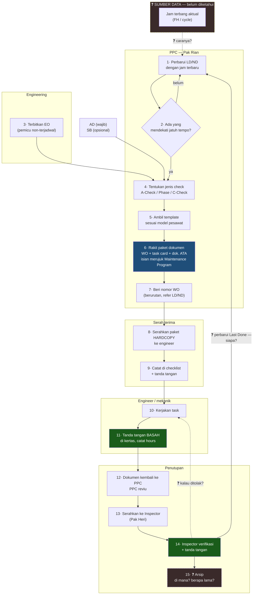

# Proses Manual PPC End-to-End (AS-IS)

**Audiens:** 🟢 Boleh ke Rimbun Air — **Boleh ditunjukkan ke tim Rimbun Air** — isinya proses mereka sendiri.

> **Isi note ini:** cara kerja PPC hari ini (AS-IS), plus **daftar TB** — pertanyaan proses yang belum terjawab.
> Kalau cari dokumen yang harus diminta ke klien, buka [[Checklist Data dari Rimbun Air]].

Sumber: transkrip verbatim PPC, Inspector & Technical Record di `_sumber-mentah/` · [[2026-07-29 Staff PPC & Engineering]] · [[2026-07-30 Staff Inspector Maintenance]] · scope: [[Scope]]

## Ringkasan

Bagaimana **PPC (Production, Planning & Control)** bekerja hari ini, tanpa sistem — dari memantau jatuh tempo sampai menutup pekerjaan. Semua dijalankan **satu orang** (Pak Rian) dengan **spreadsheet + dokumen kertas**.

Inti pekerjaannya satu kalimat: **membaca tracker [[Glosarium#L|LD/ND]], merakit paket dokumen kerja, menyerahkannya ke engineer, lalu memperbarui tracker setelah pekerjaan selesai.** Siklus itu berputar terus.

> 📌 **Kenapa manual, bukan lewat sistem.** **MSS** dibangun internal oleh Mas Bobby. Aslinya untuk Store/Inventory, dan **tidak cocok untuk planning** — PPC kini sepenuhnya spreadsheet. Tapi untuk **AFML/technical record, MSS dipakai setiap hari dan dianggap berfungsi baik**.

> ✅ **Boleh ditunjukkan ke tim Rimbun Air.** Isinya proses mereka sendiri, tanpa penilaian internal.
> **Kelengkapan:** rantai alurnya sudah utuh dari hulu ke hilir. Tersisa **lima titik buta**, terbesar dua — asal jam terbang (TB1) dan jalur penolakan (TB2).

## Aktor

| Aktor | Peran dalam alur | Jumlah |
|---|---|---|
| **PPC** (Pak Rian) | Pemantau LD/ND, perakit & penerbit dokumen | **1 orang** |
| **Engineering** *(orangnya belum diketahui)* | Penerbit Engineering Order. Untuk task card, *"engineering planner"* yang disebut Pak Joko kemungkinan besar **Pak Rian sendiri** | ❓ belum diketahui |
| **Chief Line Maintenance** (Pak Joko) | **Maintenance control** — koordinator yang mendistribusikan task ke engineer, memantau status pesawat/personel/tools/GSE, dan **sign + stamp setiap WO** sebelum masuk ke inspector | **1 orang**, bekerja sendiri |
| **Engineer / mekanik** | Pelaksana pekerjaan, tanda tangan basah + cap. Juga mengisi AFML & mengoperasikan MSS di lapangan | ❓ belum diketahui — semua di Cengkareng |
| **Inspector Maintenance** (Pak Heri) | Saringan verifikasi akhir. Perannya jauh lebih luas: pengawasan lapangan, surveillance, audit vendor, kontrol manual, penghubung regulator | 2 orang di bawah Chief Inspector |
| **Chief Inspector** | Pemberi tanda tangan akhir sebelum dokumen masuk record | 1 |
| **Mas Bobi** | Pembuat sistem MSS (internal) | 1 |
| **Technical Record** (Mba Michelle) | Menerima AFML dari lapangan, merekonsiliasi dengan sistem, approve, lalu arsipkan | ❓ |
| **OCC** — Operations Control Center (Pak Pipit) | Departemen Operasional di Cengkareng. Menerima data dari **co-pilot** (format baku) dan **foto AFML dari engineer**, membandingkan keduanya, lalu sinkron otomatis ke MSS lewat **nomor AFML** | ❓ |
| **Pilot & co-pilot** | Mengisi AFML di pesawat: bahan bakar dipakai & sisa, actual take off, touchdown. Juga mencatat engine data saat cruising | — |

## Alur end-to-end

> Kotak putus-putus = masih belum tergali. Biru = inti pekerjaan PPC. Hijau = gerbang legal.

## Langkah demi langkah

| # | Langkah | Pelaku | Input | Output | Media |
|---|---|---|---|---|---|
| 1 | Perbarui LD/ND dengan jam terbang terbaru | PPC | ❓ sumber jam belum diketahui | LD/ND terkini | Spreadsheet |
| 2 | Pantau mana yang mendekati jatuh tempo | PPC | LD/ND | Daftar task yang perlu diturunkan | Spreadsheet |
| 2b | Putuskan kapan diturunkan, lihat sisa *remaining* | PPC | Kolom remaining | Keputusan menurunkan WO | Spreadsheet |
| 3 | *(jalur non-terjadwal)* Terbitkan EO | Engineering | Temuan teknis | EO | ❓ |
| 4 | Tentukan jenis check | PPC | Interval + model pesawat | Jenis check (A / Phase / C) | — |
| 5 | Ambil template sesuai model | PPC | Model pesawat | Template paket dokumen | ❓ |
| 6 | Rakit paket dokumen | PPC | Template, Maintenance Program, AMM/IPC per ATA chapter | WO + task card + dokumen pendukung | **Hardcopy** |
| 7 | Beri nomor WO | PPC | Nomor terakhir | WO bernomor urut, merujuk LD/ND | Hardcopy |
| 8 | Serahkan paket ke engineer | PPC → Engineer | Paket dokumen | Paket berpindah tangan | **Hardcopy** |
| 9 | Catat serah-terima | PPC + Engineer | Paket | Checklist + tanda tangan | Kertas |
| 10 | Kerjakan task | Engineer | Paket dokumen | Pekerjaan selesai | — |
| 11 | Tanda tangan penyelesaian | Engineer | WO + task card | Dokumen tertandatangani, hours tercatat | **Tanda tangan basah** |
| 12 | Dokumen kembali ke PPC, direviu | PPC | Dokumen tertandatangani engineer | Cek kelengkapan stamp & tanda tangan RII | Hardcopy |
| 12b | **Cek halaman belakang task card, lalu sign + stamp halaman depan** | **Chief LM (Pak Joko)** | Dokumen dari planner | Dokumen disahkan penanggung jawab maintenance | **Tanda tangan basah + stamp** |
| 13 | Serahkan ke tim Inspector | PPC → Inspector | Dokumen | Berpindah tangan | Hardcopy |
| 14 | Verifikasi akhir & tanda tangan | Inspector (Pak Heri) menyaring, **Chief Inspector** menandatangani | Dokumen | Pekerjaan resmi selesai | **Tanda tangan basah** |
| 15 | Arsip | ❓ | Dokumen selesai | ❓ | ❓ |

Setelah langkah 14, hasilnya kembali ke langkah 1: tanggal/jam penyelesaian jadi **Last Done** baru di LD/ND — diperbarui **Pak Rian** sendiri.

> 📌 **Alur di atas hanya berlaku untuk *scheduled check*** — A-Check, C-Check, yearly, yang dipicu ambang LD/ND. **Pemeriksaan harian tidak lewat jalur ini sama sekali:** pre-flight, transit, daily, dan weekly check memakai **form baku yang sudah ada**, diisi langsung oleh engineer yang bertugas, tanpa WO dan tanpa planner. *(Pak Joko, 3 Agu)*
>
> Ini jauh lebih sering terjadi daripada scheduled check, dan **belum punya padanan jelas di scope kontrak** — lihat [[Scope]].

> ✅ **TB2 sebagian tertutup.** Rantai penutupannya sekarang jelas: engineer tanda tangan → **PPC reviu** → inspector verifikasi & tanda tangan. Langkah 12 adalah temuan baru — PPC ternyata punya peran verifikasi, bukan sekadar menerima kembali. Yang masih gelap: siapa memperbarui LD/ND, dan apa yang terjadi kalau inspector menolak.

## Empat pemicu pekerjaan

Pekerjaan bisa lahir dari empat arah. Satu terjadwal, tiga tidak.

| Pemicu | Asal | Bisa diprediksi? | Status penggalian |
|---|---|---|---|
| **Ambang LD/ND tercapai** | Pemantauan PPC sendiri | Ya | ✅ lengkap |
| **Discrepancy dari pilot** | Blok hitam AFML → MEL → DMI | Tidak | ✅ lengkap |
| **Temuan engineer saat membongkar** *(non-routine)* | Saat mengerjakan task | Tidak | 🟡 mekanismenya tahu, penomorannya belum |
| **AD · Alert SB · EO** | Regulator, pabrikan, Engineering | Tidak | 🔴 **nol aktivitas teramati** |

Perbedaan ini penting untuk desain: jalur terjadwal butuh **forecasting**, tiga jalur lainnya butuh **antrean yang tidak boleh terlewat** — masing-masing dengan pintu masuk berbeda.

> ⚠️ **Scheduled vs unscheduled ada di kontrak, tidak ada di praktik.** Scope memecah *Component Transaction* jadi **Scheduled** (modul 03) dan **Unscheduled** (modul 04). Tapi di lapangan keduanya dicatat identik — P/N & S/N on/off di AFML dan MSS, baik komponen *hard time* yang jamnya tercapai maupun main wheel yang diganti mendadak setelah landing *(Pak Joko, 3 Agu)*.
>
> Pemisahannya sah secara data, tapi **sebaiknya terjadi di belakang layar**. Kalau engineer harus memilih salah satu saat mencatat, itu langkah baru yang hari ini tidak dia lakukan.

## Peran tiap dokumen dalam alur

| Dokumen | Dipakai di langkah | Perannya |
|---|---|---|
| **LD/ND** | 1, 2, 7 | Acuan induk — menentukan apa yang perlu dikerjakan dan kapan |
| **Maintenance Program** | 6 | Buku panduan — sumber kode dan isian baku saat mengisi WO |
| **AMM / IPC / Task Manual** | 6 | Rujukan teknis, dibagi per ATA chapter, berbeda isi per model |
| **AD** | 3/4 | Pemicu wajib |
| **SB / ASB** | 3/4 | SB biasa opsional. **Alert SB** dikeluarkan untuk isu keselamatan mendesak dan diperlakukan jauh lebih ketat |
| **Service Letter** | — | Informatif, tidak menciptakan pekerjaan |
| **EO** | 3 | Pemicu dari Engineering |
| **ADSB** | 3/4 | **AD + ASB** — Airworthiness Directive dan **Alert** Service Bulletin. Bukan ADS-B avionik, dan bukan Service Bulletin biasa |
| **Work Order + task card** | 6–11 | Dokumen kerja yang berpindah tangan |

## Armada & interval per model

| Model | Interval | Keyakinan |
|---|---|---|
| **Boeing 737 Classic** (737-300F) — disebut *"klasik"* | 500 FH | Dikonfirmasi |
| **ATR 72-600** | 1500 FH | Dikonfirmasi |
| *"eng"* — **(asumsi kuat)** Boeing 737**NG** (737-800SF) | 10000 FH | Perlu konfirmasi satu kalimat |

Armada lengkap menurut riset publik: **4× Boeing 737-300F · 1× Boeing 737-800SF · 1× DHC-6 Twin Otter · 1× ATR 72-600**. Pak Rian menyebut tiga yang paling sering ditangani, jadi **sistem harus siap untuk empat tipe**.

Ini armada jet, bukan turboprop kecil. Konsekuensinya: bagian mesin PT6A/PW127 di [[Tech Log, Defect & Reliability Analysis]] hanya relevan untuk Twin Otter dan ATR.

**Frekuensi revisi Maintenance Program berbeda per tipe:** Boeing tiap 3–4 bulan · ATR 2× setahun. Perubahannya biasanya kecil (penyesuaian tempo atau penambahan pekerjaan), tapi frekuensinya memperkuat kebutuhan versioning.

**Jenis check yang disebut:** free flight check · daily check · weekly check · A-Check 730 FH · Phase Check · C-Check (*"tingkat berat"*).

**Template bukan cuma per model — tiap jenis dokumen juga punya template sendiri.** Artinya yang harus di-setup adalah **matriks**: jenis dokumen × tipe pesawat. Empat tipe pesawat dikali beberapa jenis dokumen sudah jadi belasan template yang harus disiapkan, diverifikasi terhadap Maintenance Program, lalu dipelihara tiap MP direvisi.

Ini memperbesar temuan soal beban setup yang belum terhitung di work plan mana pun.

**Trigger penerbitan WO:** berdasarkan sisa *remaining* dalam **flight hours** — Pak Rian menyebut contoh *"tinggal 100 lagi saya turunin"* dan *"tinggal 38"*. Apakah ada ambang baku atau penilaian per kasus, belum dipastikan.

## Asal-usul data baseline

Satu hal yang muncul dari transkrip dan penting untuk migrasi data:

> *"Riwayatnya dari mana? Dari yang sebelumnya sudah. Misalnya beli pesawat second, yang dia udah kasih tahu... Kalau misalnya baru semua, kan sudah pasti dari awal diiniin sama pabrikannya, terus kita tinggal nerusin."*

Jadi baseline LD/ND berasal dari dua sumber berbeda:
- **Pesawat baru** — data awal dari pabrikan, tinggal diteruskan
- **Pesawat bekas** — riwayat diserahkan pemilik sebelumnya

Untuk pesawat bekas, kualitas dan kelengkapan riwayatnya bergantung pada apa yang diserahkan penjual. Ini menambah alasan kenapa **verifikasi baseline sebelum go-live** tidak bisa dilewati — lihat risiko migrasi data di [[Overview]].

## Pain point yang tercatat

Tiga hambatan konkret dari wawancara — ini yang paling menentukan nilai sistem bagi mereka:

### PP1 — Copy-paste manual dari dokumen pabrikan 🔴

Untuk membuat WO, PPC harus **menyalin instruksi dari PDF/Word pabrikan ke template task card perusahaan**, satu per satu. Diakui sangat memakan waktu, dan inilah beban kerja terbesar Pak Rian.

Ini memberi bentuk konkret pada kebutuhan "generator paket dokumen": bukan sekadar mencetak, tapi **menghilangkan langkah transkripsi manual** dengan menyimpan instruksi task sebagai master data yang bisa dirakit otomatis.

### PP2 — Manual teknis tersebar di Google Drive 🟠

AMM, IPC, dan Maintenance Program disimpan di **Google Drive** dan diunduh manual tiap kali dibutuhkan. Tidak ada repositori terpusat, tidak ada kontrol revisi.

> ⚠️ **Batas scope.** PPC mengharapkan sistem punya *library* dokumen teknis — tapi itu **modul 07 Publication, bukan modul saya** ([[Scope]]). Kebutuhan nyata pengguna utama saya jatuh di modul orang lain. Ini bukti tambahan untuk eskalasi batas scope ke Rafi.

### PP3 — Kalibrasi alat tertunda urusan pembayaran vendor 🟡

Alat yang seharusnya dikalibrasi tertahan karena **vendor meminta pembayaran di muka**. Hambatannya administratif, bukan teknis — sistem tidak bisa menyelesaikannya, tapi bisa memberi peringatan dini supaya tidak ketahuan mendadak saat alat sudah kedaluwarsa.

## Ekspektasi sistem menurut PPC sendiri

Requirement langsung dari pengguna, bukan tafsiran:

| Yang diminta | Kondisi sekarang |
|---|---|
| **Dashboard LD/ND** menampilkan *remaining* hours/cycles otomatis | Manual, tidak ada visibilitas instan |
| **Generator WO / task card** dari master data | Copy-paste dari PDF pabrikan ke Word/Excel |
| **Repositori dokumen** terpusat (AMM, IPC, MP) | Google Drive, unduh manual |
| **Alert kedaluwarsa** alat ukur & lisensi | Terpisah, sering terhambat koordinasi vendor |

## Titik buta

Tiga hal yang tersisa.

> ✅ **Tertutup 31 Jul dari sesi Technical Record:** rantai jam terbang (siapa mencatat, di dokumen apa, bagaimana sampai ke LD/ND) · arsip & retensi. Detailnya di [[2026-07-31 PPC Technical Record]].

> ✅ **Siapa memperbarui LD/ND: Pak Rian sendiri.**
>
> *"Nanti kalau udah selesai saya update di sini — hours jam berapa, itu pesawat take-off landing cycle ini berapa, terus tanggal berapa. Nanti dia udah ngitung buat next-nya lagi."*
>
> Tiga data yang diinput: **jam terbang · cycle · tanggal**. Dan **spreadsheet-nya sudah menghitung sendiri** jatuh tempo berikutnya — jadi rumusnya sudah ada di sana, tinggal ditiru dan diverifikasi.

### TB1 — Alur penolakan & rework 🔴

Rantai penutupan sudah jelas, **jalur gagalnya belum**.

Yang sudah diketahui: untuk **material** yang tidak lolos, keputusan ada di engineer — *"semua keputusan itu dari pesawat itu terbang atau enggak."* Yang belum diketahui adalah jalur untuk **dokumen** yang tidak lengkap: dicoret langsung atau ada form penolakan? Kembali ke engineer atau ke PPC? Bagaimana melacak yang sedang dikembalikan?

**Aturan koreksi dokumen sendiri sudah jelas dan tertulis di peraturan perusahaan:** satu kali coret, plus identitas siapa yang mengoreksi, plus tanggal. Bukan dihapus, bukan ditimpa. Coretan tanpa identitas tidak punya dasar hukum. Ini persis prinsip append-only dengan atribusi — versi digitalnya tinggal meniru.

### TB2 — Kalau task butuh sparepart, bagaimana? 🟡

**Sebagian terjawab.** PPC menyusun daftar kebutuhan material per pekerjaan saat merakit paket dokumen, lalu **mengecek ketersediaan lebih dulu**. Kalau tidak ada, dia mengajukan permintaan pembelian.

Yang jadi masalah: **tidak ada material planning tahunan.** Pembelian bersifat reaktif, per kebutuhan. Menurut Pak Rian idealnya kebutuhan setahun sudah dihitung di awal atau pertengahan tahun supaya tidak beli berulang kali.

Yang masih terbuka: apakah sistem baru harus terhubung ke MSS untuk sisi inventory, atau ada modul material tersendiri.

### TB3 — Berapa volumenya? 🟡

WO per bulan, waktu merakit satu paket, jumlah dokumen per paket. Tanpa angka ini tidak ada dasar menghitung berapa besar beban yang sistem hilangkan — dan itu argumen ROI paling konkret.

## Yang sudah terlihat jelas

Tiga hal yang tidak perlu digali lagi, dan bisa langsung jadi dasar desain:

1. **Perakitan dokumen adalah beban kerja terbesar PPC.** Bukan pengambilan keputusan, bukan analisis — merakit. Satu orang, tiga model pesawat, tiap model beda template. Di sinilah sistem memberi nilai paling besar.
2. **Sudah ada rekam-jejak manual di serah-terima** (checklist + tanda tangan). Sistem tidak perlu menciptakan proses baru, cukup memindahkan yang sudah jalan — jauh lebih mudah diadopsi.
3. **LD/ND adalah pusat gravitasi.** Semua bermula dan berakhir di sana. Kalau satu hal saja harus benar di sistem baru, itu LD/ND.
4. **Ada tiga lapis tanda tangan**, bukan satu: engineer (pelaksana) → PPC (reviu) → inspector (verifikasi akhir). Approval engine harus memodelkan rantai ini, bukan sekadar satu sign-off.

## Pemetaan ke sistem nanti

| Langkah manual | Yang dilakukan sistem | Modul |
|---|---|---|
| 1 · Update jam ke LD/ND | Jam mengalir otomatis dari flight ops — *"sudah ke detect hoursnya"* | 04 → 02 |
| 2 · Pantau jatuh tempo | Dashboard jatuh tempo + peringatan dini otomatis | 02 |
| 3 · EO / AD / SB masuk | Antrean pemicu non-terjadwal yang tidak bisa terlewat | 01, 02 |
| 4–5 · Tentukan check & template | Template per model, dikonfigurasi bukan hard-coded | 02 |
| **6 · Rakit paket dokumen** | **Generator paket dokumen otomatis** — menghilangkan copy-paste manual (PP1). Inti nilai sistem bagi PPC | 02 + 03 + 07 |
| 7 · Nomor WO | Penomoran otomatis berurutan, terhubung ke LD/ND | 03 |
| 8–9 · Serah terima | Transaksi handover tercatat, menggantikan checklist kertas | 03 |
| 10–11 · Eksekusi & tanda tangan | Cetak "sign-ready PDF", tanda tangan tetap basah *(kondisi sekarang)* | 03 |
| 12–14 · Reviu PPC → verifikasi inspector | Rantai approval tiga lapis, plus jalur penolakan/rework | 03 |
| Update Last Done | Otomatis begitu WO ditutup | 02, 03 |
| 15 · Arsip | Retention engine sesuai aturan [[Glosarium#C\|CASR]] | 07 *(bukan modul saya)* |

Baris ke-6 yang paling penting: **kebutuhan utama PPC jatuh di persimpangan tiga modul** (02 Planning, 03 Production, 07 Publication). Kalau tidak ada yang secara eksplisit memilikinya, fitur ini gampang hilang di celah antar modul saat PRD disusun.

## Catatan sumber

Disusun dari dua wawancara: PPC (29 Jul) dan Inspector (30 Jul), keduanya punya transkrip verbatim di `_sumber-mentah/`, ditambah riset publik untuk data armada.

Beberapa hal di sini sempat tercatat keliru lalu diperbaiki — riwayatnya di [[Riwayat Koreksi]], bukan di badan note ini.

Yang masih perlu dikonfirmasi: nama & jabatan resmi, dan apakah **reviu PPC di tahap 12** itu verifikasi formal atau sekadar menerima kembali.

## Kenapa relevan buat project ini

Ini AS-IS pertama yang benar-benar milik Rimbun Air — bukan riset industri generik. Dipakai untuk tiga hal: bahan BPMN modul 02/03, dasar wawancara lanjutan (enam titik buta di atas adalah agendanya), dan alat validasi ke Pak Rian — tunjukkan diagramnya, minta dia koreksi.

Terkait: [[2026-07-29 Staff PPC & Engineering]] · [[Scope]] · [[Checklist Data dari Rimbun Air]]
