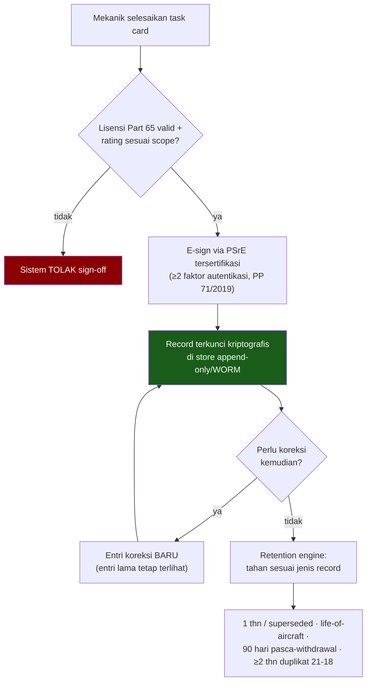

# Regulasi & Kepatuhan CASR Indonesia

**Audiens:** 🟡 Tim Nodewave — Untuk tim Nodewave. ⚠️ Nomor pasal belum diverifikasi.

> **Isi note ini:** aturan [[Glosarium#C|CASR]] yang mengikat desain sistem — audit trail, lisensi, retensi record.
> ⚠️ Nomor pasal belum diverifikasi ke JDIH Kemenhub. Jangan dikutip sebagai pernyataan ke narasumber.

Sumber: [[Sumber Riset A - Proses Bisnis ERP MRO Kargo Perintis]] · [[ERP_MRO Kargo Perintis Indonesia]]

## Ringkasan

Regulator: DGCA/Ditjen Hubud c.q. **[[Glosarium#D|DKPPU]]**. CASR harmonis dengan FAR AS (penomoran section identik).

### Peta regulasi → implikasi sistem

| Regulasi | Isi pokok | Implikasi sistem |
|---|---|---|
| CASR 121/135 Subpart L | Maintenance program (x.367), CAMP, [[Glosarium#C\|CAS]] (x.373), maintenance recording (121.380/135.439) | Modul CAMP/AMP status, reliability, recording |
| CASR 135.439 / 121.380 | Retensi: release & status 1 tahun/sampai superseded; overhaul sampai superseded; record ikut pesawat saat dijual (135.441) | Retention engine + transfer record |
| CASR Part 43 | Siapa boleh RTS (43.5/43.7); isi record: deskripsi, tanggal, nama, ttd + no. lisensi (43.9); **43.12(c): retensi 90 hari setelah unit ditarik permanen — spesifik Indonesia**; major repair via Form 43-337 | Validasi sign-off vs lisensi; retensi pasca-retirement |
| CASR Part 145 | [[Glosarium#A\|AMO]]: manual, quality, capability list, recordkeeping, reports of failures | Rekam alat ukur terkalibrasi; penerbitan release cert |
| CASR Part 65 | Lisensi [[Glosarium#A\|AMEL]]: basic cert, license, type/group rating; renewal tiap 2 tahun + recent experience | Validasi certifying staff saat sign-off WO |
| CASR Part 91 | 91.25 journey log tiap flight; 91.417 records; 91.421 rebuilt engine; 91.423 [[Glosarium#S\|SDR]] | ATL/eTLB per flight leg |
| [[Glosarium#D\|DGCA]] **Form 21-18** + SI 21-09 | Authorized [[Glosarium#R\|Release Certificate]] (ekuivalen FAA 8130-3 / EASA Form 1); issuer simpan duplikat ≥2 tahun | Entitas release cert + arsip duplikat |
| UU ITE Ps.11 + PP 71/2019 Ps.59–60 | Tanda tangan elektronik **tersertifikasi** via [[Glosarium#P\|PSrE]] terdaftar Komdigi | Lihat [[Decision - E-Signature & Electronic Recordkeeping]] |
| UU No.1/2009 | Definisi angkutan udara perintis | Konteks subsidi |

### Data yang wajib terekam & auditable oleh DKPPU

- ATL/journey log per flight (jam & cycle)
- Work order, task card, sign-off certifying staff
- Traceability part: serial, release cert (Form 21-18), back-to-birth
- CAMP/AMP status; AD/SB status; [[Glosarium#L|LLP]] status; TSN/TSO/CSN/CSO
- Deferred defects/MEL log
- Kualifikasi personel (Part 65 license & rating scope)

### Alur sign-off yang sah secara hukum

> Tidak ada jalur hard-edit/hard-delete — bahkan untuk admin tertinggi. Koreksi selalu berupa entri baru yang menjaga kronologi.

### Implikasi desain non-negotiable

1. **Audit trail imutabel** — append-only/WORM; koreksi lewat entri perbaikan baru, bukan hard-edit/hard-delete (bahkan oleh admin tertinggi).
2. **E-signature tersertifikasi** (PSrE, ≥2 faktor autentikasi) untuk maintenance release — scan/tempel di PDF **tidak setara secara hukum**.
3. **Retention engine** per jenis record (1 tahun/superseded; life-of-aircraft; 90 hari pasca-withdrawal; ≥2 tahun duplikat 21-18) + dukung transfer record saat pesawat dijual.
4. **[[Glosarium#E|eTLB]] belum punya AC/SI Indonesia spesifik** → butuh proposal & approval kasuistik ke DKPPU; acuan best practice: FAA AC 120-78B.

## Caveat penting

- Angka retensi CASR dikonfirmasi dari teks FAR harmonis — **verifikasi angka persis ke PDF CASR di JDIH Kemenhub sebelum dijadikan aturan kode**.
- Riset B menyebut release cert sebagai "DGCA Form 1" — yang benar per dokumen resmi adalah **[[Glosarium#D|DGCA Form 21-18]]** (Riset A, dari Form & SI resmi). Pakai 21-18.
- AC e-records Des 2023 yang beredar adalah milik DGCA **India**, bukan Indonesia — jangan dikutip.

## Kenapa relevan buat project ini

Regulasi ini adalah requirement non-fungsional paling keras dari sistem: menentukan skema audit trail, e-signature, retensi, dan validasi sign-off. Pelanggaran = risiko pencabutan [[Glosarium#A|AOC]].
