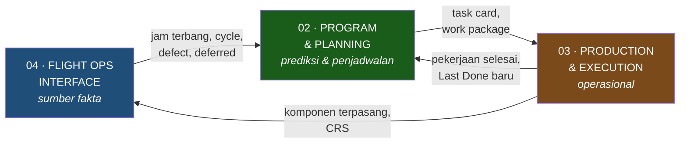
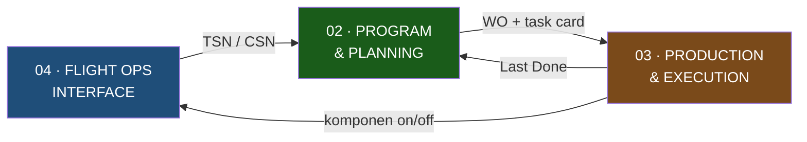

# Scope & Requirement — Modul yang Saya Handle

**Audiens:** 🟡 Tim Nodewave — Untuk tim Nodewave. Berisi batas scope antar-PM.

> **Isi note ini:** definisi kerja saya — 3 modul, 16 requirement, dan batas dengan modul orang lain.
> Kalau cari cara kerja Rimbun Air sekarang, buka [[Proses Manual Maintenance - DRAFT]].

Sumber: dokumen scope internal Nodewave

## Ringkasan

Dari **10 modul** yang dikontrakkan di [[2026-07-27 Kickoff Nodewave x Rimbun Air]], yang saya pegang ada **tiga** — dan ketiganya adalah rantai yang saling menyambung, bukan modul terpisah:

Alurnya tertutup: **Flight Ops** memasok fakta (jam, cycle, defect) → **Planning** memprediksi apa yang jatuh tempo → **Production** mengeksekusi → hasilnya kembali jadi Last Done baru di Planning.

Ini persis alur manual yang sudah dipetakan di [[Proses Manual Maintenance - DRAFT]]. Jadi tiga modul ini = versi sistem dari pekerjaan Pak Rian, plus sumber datanya, plus eksekusinya.

## Layanan yang di-handle

**Maintenance and Flight** → Maintenance Programming & Planning · Production & Execution · Flight Operations

## Rincian scope per modul

### 02 · Program & Planning — *prediksi & penjadwalan*

| Sub-modul | Catatan |
|---|---|
| Approved Maintenance Program (AMP) | |
| Maintenance Planning & Forecasting | |
| [[Glosarium#T\|Task Card]] | |
| Work Package Management | [[Glosarium#C\|Check-pack]]: A-Check, C-Check, yearly |

### 03 · Production & Execution — *operasional*

| Sub-modul | Catatan |
|---|---|
| Work Order (WO) Management | |
| Component Transaction (Install/Remove) — **Scheduled** | |
| Human Resource License & Capability Validation | |
| Tool Crib & Calibration Management | |
| Certificate of Release to Service ([[Glosarium#C\|CRS]]) | |

### 04 · Flight Ops Interface — *log & pemantauan operasional*

| Sub-modul | Catatan |
|---|---|
| Aircraft Flight & Maintenance Log ([[Glosarium#A\|AFML]]) | Persiapan untuk EFL |
| Defect & Deferred Report Flow | |
| Component Transaction (Install/Remove) — **Unscheduled** | |
| Pilot Report ([[Glosarium#P\|PIREP]]) | |
| Fluid Consumption Monitor | |
| Reliability & Repetitive Analysis | |
| ~~RFQ (Request for Quotation)~~ | ❌ **Salah tempat** — ada di modul Procurement & Contract, bukan di sini |

## Requirement detail

### Maintenance Program & Planning

> 📌 **Empat jenis dokumen teknis didaftarkan** ([[Glosarium#A|AD]] · [[Glosarium#S|SB]] · SL · EO), tapi **hanya AD dan ASB yang di-forecast**. Masuk akal: SL sifatnya informatif dan SB biasa opsional, jadi keduanya tidak punya jatuh tempo untuk diramalkan — tapi nomor dokumennya tetap perlu tercatat. Perlu dipastikan saat requirement dibahas dengan Rimbun.

| Entry / Master | Form | Tools | Report |
|---|---|---|---|
| Task card number | Task card | Forecast Task | [[Glosarium#L\|LD/ND]] report (Last Done Next Due) |
| Task card material required | | Forecast ADSB | ADSB report |
| **Technical document number:** | | Forecast Deferred | HT report |
| · AD (Airworthiness Directive) — Authority | | Forecast Check-pack | Check-pack report |
| · SB (Service Bulletin) — Manufacture | | Forecast HT ([[Glosarium#H\|Hard Time]]) | |
| · SL (Service Letter) — Manufacture | | | |
| · EO (Engineering Order) — Internal (Maintenance) | | | |
| Check-pack Master | | | |

### Production & Execution

| Entry / Master | Form | Tools | Report |
|---|---|---|---|
| Work Order Master — penomoran otomatis | Work Order | WO In-progress Monitoring | Work Order Report |
| Non-routine card — penomoran otomatis | Control Sheet / Control Job Card / Control Task Card | WO Sign-in & Sign-out | |
| Task card material required — additional | Return to Service | Closing & cancel WO | |
| | | Closing & cancel Task card | |

### Flight Operations Interfacing

| Entry / Master | Form | Tools | Report |
|---|---|---|---|
| Flight log entry | Flight log form | Component Install & Remove | Flight hour report |
| Defect entry | [[Glosarium#D\|DMI]] (Deferred Maintenance Item) form | Reliability — by ATA & component | Oil & hydraulic consumption report |
| Deferred entry | | Repetitive — by ATA & component | Fuel consumption report |
| Oil & hydraulic consumption entry | | | Defect / Deferred report |
| Fuel consumption entry | | | Component installed report |

---

## Peta modul

Tiga modul saya, dengan yang masuk dan keluar dari modul lain.

**Masuk:** 01 Engineering *(AMP · EO)* → 02 · 07 Publication *(AMM · IPC)* → 02 & 03 · 05 Material *(ketersediaan)* → 02 · 06 Procurement *(status PO untuk extend DMI)* → 04 · **OCC & pilot** *(data jam terbang, di luar 10 modul)* → 04

**Keluar:** 02 → 06 *(permintaan beli)* · 03 → 07 *(arsip WO)* · 03 → 08 *(biaya per WO)* · 03 ↔ 09 *(komponen ke bengkel)*

### Yang dibetulkan dari peta brainstorm

- `04 → 03` **salah arah** — jam terbang masuk lewat LD/ND ke **02**, bukan ke Production
- `03 → 02` **hilang** — Last Done setelah WO ditutup, ini lingkaran intinya
- `07 Publication` **menggantung** tanpa satu pun sambungan
- **08 Costing dan 10 GSE** tidak punya dasar AS-IS — nol aktivitas dalam lima wawancara
- **Tidak ada modul HR**, padahal validasi lisensi ada di modul 03 saya

Versi sepuluh modulnya di `_sumber-mentah/Flow-Proses-Maintenance-Aircraft.md`.

---

## Batas scope — yang BUKAN saya

Tujuh modul lain dari kontrak, dan beberapa di antaranya **bersinggungan langsung** dengan modul saya. Titik singgung ini yang rawan jatuh di celah:

| Modul orang lain | Titik singgung dengan modul saya | Risiko |
|---|---|---|
| **05 Material & Logistics** | *"Task card material required"* ada di scope saya — tapi stok, reservasi, dan pengeluaran part bukan | Task card tahu butuh part apa, tapi tidak tahu apakah tersedia. Siapa yang menyambung? |
| **07 Publication** | Task card & WO merujuk AMM/IPC per ATA chapter — dan **PPC secara eksplisit meminta repositori dokumen terpusat** | Revision control bukan saya, padahal isi task card bergantung padanya. AMM/IPC sekarang di Google Drive, diunduh manual |
| **01 Engineering & Configuration** | AMP dan EO masuk scope saya sebagai *dokumen*, tapi konfigurasi pesawat & component life limit tidak | Batas antara "menerima EO" dan "membuat EO" harus jelas |
| **08 Costing** | *"Cost capture per work order"* — WO ada di modul saya | Costing butuh data WO dari saya. Arah panahnya belum ada di peta modul |
| **09 Workshop (MRO)** | Component removal ada di scope saya; perbaikannya di workshop | Komponen keluar dari radar saya saat masuk bengkel, lalu muncul lagi. **Tidak ada jalur langsung Production ↔ Workshop di peta modul** |
| **10 GSE** | Pak Joko memantau GPU & genset bersama pekerjaan lain | Bukan modul saya — kebutuhannya diteruskan, jangan diserap |

> ⚠️ **Konsekuensi untuk temuan T3.** Sebelumnya saya catat bahwa kebutuhan PPC "merakit paket dokumen" jatuh di persimpangan modul 02, 03, dan **07 Publication**. Ternyata **07 bukan scope saya**. Jadi kebutuhan inti Pak Rian terbelah antara modul saya dan modul orang lain — ini harus dipagari eksplisit ke Rafi sebelum PRD, bukan diasumsikan beres.

### ⚠️ Celah baru: pemeriksaan harian tidak lewat WO

Pak Joko (3 Agu): **pre-flight · transit · daily · weekly check memakai form baku, diisi langsung engineer duty — tanpa WO, tanpa planner, tanpa LD/ND.** Yang lewat jalur WO hanya *scheduled check* (A/C/yearly).

Di scope saya, *Work Package Management* hanya menyebut **Check-pack: A-Check, C-Check, yearly** — keluarga kedua. Keluarga pertama **jauh lebih sering terjadi** dan Pak Joko eksplisit menginginkannya masuk sistem: *"kalau bisa sekalian diinput di sistem, form-nya online."*

Perlu diputuskan sebelum PRD: apakah line check harian masuk modul saya, atau tidak ada yang memilikinya.

### ⚠️ *Engineer* bukan *engineering*

Dua kata mirip yang menandai **dua sisi berbeda dari garis scope**. Sempat tertukar; ditegaskan rekan tim, 3 Agu 2026.

| | Yang dikerjakan | Modul |
|---|---|---|
| **Engineering** *(fungsi/departemen)* | Membuat AMP, menerbitkan EO, menilai AD/SB berlaku untuk armada mana | **01 — bukan saya** |
| **Engineer** *(orang, pemegang lisensi CASR Part 65)* | Mengerjakan & menandatangani pekerjaan di lapangan. Di Indonesia sering disebut "mekanik" | **02 Production & Execution — saya** |

Konsekuensinya:

- **Engineer lapangan adalah pengguna utama modul 02 saya** — WO, component transaction, validasi lisensi, tool crib, CRS. Dia juga yang mengisi AFML (modul 03). Sampai 3 Agu **belum pernah diwawancarai** — semua yang kita tahu tangan kedua. Ini blok **B7** di [[BPMN & Activity Flow - DRAFT]].
- **Penyusun EO belum diketahui orangnya.** Yang jelas masuk scope saya adalah *pendaftaran & forecast* nomor AD/SB/SL/EO, bukan penyusunannya.
- Saat wawancara Engineering, yang dicari cukup **bentuk serah terimanya** — dokumen apa yang keluar, ke siapa, kapan. Proses internalnya diteruskan ke PM modul 01.

> ❓ **Belum diverifikasi:** apakah di Rimbun "engineer" dan "mekanik" memang satu orang, dan apakah Chief PPC Engineering berbeda orang dari Chief Maintenance. Ditanyakan di [[Lembar Wawancara Chief Engineer]] blok 0.

## Istilah yang perlu dipastikan

| Istilah | Bacaan saya | Keyakinan |
|---|---|---|
| **ADSB** | **AD + ASB** — Airworthiness Directive dan **Alert** Service Bulletin | ✅ Dikonfirmasi 30 Jul |
| **PIREQ** | **PIREP** (Pilot Report) | ✅ Dikonfirmasi |
| **Booking engine** | Label kolom untuk **daftar fitur yang akan dibangun**, bukan istilah teknis. Isinya memang titik entri & master data | ✅ Cukup jelas |
| **AFML → EFL** | Aircraft Flight & Maintenance Log → Electronic Flight Log. Ini yang di vault disebut **ATL/eTLB** | Tinggi |
| **Check-pack** | Bundel task card untuk satu check (A/C/yearly) — sama dengan *work package* | Tinggi |
| **HT** | Hard Time — komponen dengan batas umur pasti | Pasti — lihat [[Glosarium]] |
| **DMI** | Deferred Maintenance Item — turunan dari [[Glosarium#M\|MEL]] | Pasti |
| **CRS** | Certificate of Release to Service — di Indonesia berbentuk [[Glosarium#D\|DGCA Form 21-18]] | Pasti |
| **RFQ di modul Flight Ops** | **Salah tempat** — seharusnya di Procurement & Contract | ✅ Dikonfirmasi |

> 📌 **Koreksi penting.** Di [[2026-07-29 Staff PPC & Engineering]], "EDSB" dari catatan mentah sempat dibaca sebagai **ADS-B** (sistem avionik). Berdasarkan dokumen scope ini, yang jauh lebih masuk akal: **AD/SB** — dokumen pemicu yang memang sudah muncul terpisah di daftar dokumen PPC. Perlu satu kalimat konfirmasi.

## Status tiap requirement

Dua sumbu berbeda: **riset** = sudah paham standar industrinya · **lapangan** = sudah tahu praktik Rimbun Air-nya.

| Requirement | Riset | Lapangan |
|---|---|---|
| LD/ND report | ✅ [[Interval, Due Date & Forecasting Maintenance]] | ✅ ada, berupa spreadsheet |
| Task card | ✅ | ✅ ada, ikut paket ke engineer |
| Work Order + penomoran | ✅ [[Eksekusi Work Order, Kewenangan & Kalibrasi]] | 🟡 alur lengkap (4 lapis ttd); format nomor belum diketahui |
| Check-pack (A/C/yearly) | ✅ | ✅ A-Check 730 FH, Phase, C-Check |
| AD / SB / SL / EO | ✅ | 🟡 AD wajib, SB opsional, SL informatif. **Penerbit EO belum diketahui** |
| AMP | ✅ | 🟡 ada, dokumennya belum diterima |
| Forecast (Task/ADSB/HT/Check-pack/Deferred) | ✅ | ❌ belum tergali caranya sekarang |
| AFML / Flight log | ✅ [[Tech Log, Defect & Reliability Analysis]] | ✅ **TB1 tertutup penuh.** Per rute bukan per cycle; kunci sinkron = nomor AFML |
| CRS / Return to Service | ✅ | 🟡 rantai penutupan jelas; **alur penolakan masih gelap** |
| Defect & Deferred / DMI | ✅ | ✅ MEL Rimbun → DMI kategori A/B/C → C = 10 hari → extend dengan referensi PO |
| HR License & Capability Validation | ✅ | ✅ **Dua** tanggal expired: AMEL (maks 3 th) & Company Authorization (≤ AMEL, dari Chief Inspector) |
| Tool Crib & Calibration | ✅ | ✅ database tools, transaksi keluar-masuk, tool pinjaman, vendor bersertifikasi nasional, reminder 1 bulan |
| Non-routine card | ✅ | 🟡 temuan di halaman belakang task card + lampiran part. Penomoran otomatis belum terkonfirmasi |
| Fluid consumption | ✅ | ❌ belum tergali |
| Reliability & Repetitive | ✅ | ❌ belum tergali |
| Component transaction | ✅ | 🟡 P/N + S/N on/off dicatat di MSS. **Part pinjaman antar-operator belum ada di scope** |

**Sisi riset praktis tuntas** setelah tiga deep research (29 Jul). **Sisi lapangan 9 tuntas + 4 sebagian dari 16** setelah lima wawancara (PPC · Inspector · Technical Record · Chief LM · OCC). Yang tersisa: forecast, PIREP, fluid consumption, reliability.

Pergeseran ini penting: sebelumnya pertanyaan wawancara harus terbuka karena kita tidak tahu apa yang harus ditanya. Sekarang kita tahu bentuk baku tiap proses, jadi pertanyaannya bisa berupa **konfirmasi terarah** — "di sini pakai [[Glosarium#R|RII]] atau tidak?", "toleransinya berapa persen?" — yang jauh lebih cepat dan lebih dalam.

## Kenapa relevan buat project ini

Ini definisi kerja saya: apa yang harus dibangun, dan apa yang bukan urusan saya. Dipakai untuk dua hal — menyusun agenda wawancara (tiap baris requirement = satu hal yang harus dicari padanannya di proses manual), dan memagari batas scope sebelum PRD.

Riset per modul: [[Interval, Due Date & Forecasting Maintenance]] (modul 1) · [[Eksekusi Work Order, Kewenangan & Kalibrasi]] (modul 2) · [[Tech Log, Defect & Reliability Analysis]] (modul 3)

Terkait: [[Proses Manual Maintenance - DRAFT]] · [[Lembar Wawancara Inspector - Sesi 2]] · [[Interval, Due Date & Forecasting Maintenance]] · [[Rekonsiliasi Scope - Riset vs Kontrak]]
