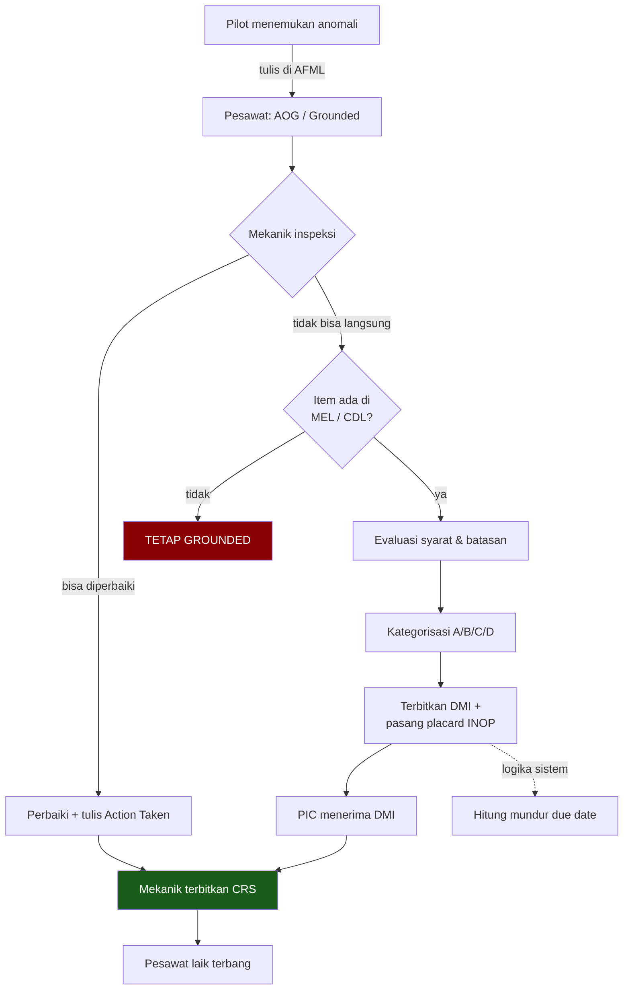

# Tech Log, Defect & Reliability Analysis

**Audiens:** 🟡 Tim Nodewave — Untuk tim Nodewave. Teori standar industri.

> **Isi note ini:** teori domain untuk modul Flight Ops. Standar industri, bukan praktik Rimbun Air.
> Praktik lapangannya ada di [[Proses Manual Maintenance - DRAFT]].

Sumber: [[Desain Modul Sistem MRO Aviasi]] (deep research, `_sumber-mentah/`) · scope: [[Scope]] modul 3

## Ringkasan

Modul Flight Ops Interfacing adalah **hulu seluruh sistem**: angka jam terbang yang masuk di sini memicu semua penjadwalan maintenance. Salah di sini, salah semuanya.

Tiga hal yang paling menentukan desain: **jenis waktu mana yang dipakai untuk interval** (airborne, bukan block), **cara menghitung due date deferral** (midnight-to-midnight, hari temuan tidak dihitung), dan **satu pintu masuk data waktu** — karena perpecahan sumber data antara ops dan maintenance adalah failure point paling mematikan di sistem MRO.

## Anatomi AFML

Satu halaman tech log = satu hari operasi atau satu rangkaian sektor oleh kru yang sama. Tiga segmen:

| Segmen | Isi |
|---|---|
| **Header** | Registrasi pesawat · tanggal · **nomor halaman sekuensial** · nama & ID PIC dan FO |
| **Sektor (berulang per leg)** | Rute asal–tujuan · nomor penerbangan · empat waktu: **Chocks-Off, Take-Off, Touch-Down, Chocks-On** · fuel berangkat, sisa, uplift · penambahan oli/hidrolik |
| **Maintenance & anomali** | [[Glosarium#P\|PIREP]] dari pilot · **Action Taken** dari teknisi · referensi [[Glosarium#D\|DMI]] · tanda tangan [[Glosarium#C\|CRS]] |

**Batas kewenangan pengisian itu kewajiban regulasi, bukan preferensi:**

| Pilot boleh isi | Teknisi boleh isi |
|---|---|
| Rute, semua waktu pergerakan, data fuel, PIREP | Action Taken, referensi DMI, penerbitan CRS |

Sistem wajib punya RBAC yang **menolak keras** pilot menandatangani CRS.

Nomor halaman harus di-generate sekuensial dan tidak bisa dimodifikasi — di dunia kertas, nomor seri unik itulah yang mencegah lembar cacat dihilangkan.

## Block vs Flight vs Airborne Time

Ini titik rawan yang sering salah dipahami pengembang non-aviasi.

| Istilah | Dihitung dari | Dipakai untuk |
|---|---|---|
| **[[Glosarium#B\|Block Time]]** | Chocks-Off → Chocks-On (termasuk taxi) | Batas jam kerja kru, penggajian |
| **Flight / [[Glosarium#A\|Airborne Time]]** | Take-Off → Touch-Down | **Perhitungan interval maintenance** |

Alasannya fisika: beban aerodinamika, siklus presurisasi, dan keausan termal turbin hanya terjadi saat pesawat di udara. Kalau sistem keliru memakai Block Time, umur komponen habis untuk waktu mengantre di darat — overhaul datang terlalu dini dan biayanya nyata.

## Penghitungan cycle

Satu cycle = satu lepas landas diikuti satu pendaratan. Tapi harus dipecah tiga:

| Jenis | Kekhususan |
|---|---|
| **Airframe Cycle (FC)** | Terkait siklus tekanan kabin. Lepas landas + mendarat = 1 FC |
| **Landing Gear Cycle ([[Glosarium#L\|LGC]])** | Dihitung tiap roda menerima beban pendaratan. **Touch-and-go menambah LGC tapi belum tentu FC** |
| **Engine Cycle ([[Glosarium#E\|ENC]])** | Siklus termal mesin. **Aborted take-off kecepatan tinggi menambah 1 ENC meski 0 FC** — mesin sudah mencapai suhu puncak lalu mendingin |

Sistem butuh penanda khusus untuk skenario touch-and-go dan aborted take-off.

## Jeda log antara pesawat dan pangkalan

> ⚠️ **Premisnya perlu dicek ulang.** Bagian ini ditulis dengan asumsi Rimbun Air operator perintis di stasiun terpencil — dan asumsi itu **ternyata salah**. Angka 3–7 hari di bawah berasal dari riset tentang operator perintis, bukan dari Rimbun Air.

Di operator dengan stasiun terpencil, lembar asli tetap di pesawat sementara salinan fisik bisa tertahan berhari-hari sebelum sampai pangkalan, dan jam terbang sering didiktekan lewat radio dulu.

**Yang tetap relevan:** berapa pun jedanya, selalu ada selang waktu antara pesawat mendarat dan angkanya tercatat di maintenance. Jadi status **"Draft / Menunggu Rekonsiliasi"** tetap masuk akal — data awal bisa masuk untuk memicu perhitungan, lalu dikunci setelah dokumen fisik diverifikasi. Yang perlu dipastikan cuma berapa lama jeda sebenarnya di Rimbun Air.

> ⚠️ **[[Glosarium#C|CASR]] 91.25: journey log wajib berada di dalam pesawat selama operasi.** Kalau beralih ke log elektronik, tablet-nya secara hukum jadi bagian kelengkapan pesawat. Tablet rusak/hilang/kehabisan daya tanpa cadangan atau prosedur balik ke kertas = pesawat dianggap tidak punya journey log dan dilarang terbang.

## Alur defect & deferral



**[[Glosarium#M|MEL]]** = daftar instrumen/sistem yang boleh rusak tanpa membahayakan, disetujui [[Glosarium#D|DKPPU]]. **[[Glosarium#C|CDL]]** = panel aerodinamis eksternal yang boleh tidak terpasang, biasanya berkonsekuensi penalti performa (harus bawa beban lebih ringan).

## Kategori deferral & cara menghitungnya

Penghitungan memakai aturan **midnight-to-midnight**, dan **hari penemuan tidak dihitung**.

| Kategori | Batas | Bisa diperpanjang? |
|---|---|---|
| **A** | Bervariasi, ditentukan spesifik di teks MEL | ❌ Tidak |
| **B** | 3 hari kalender | ✅ One-time extension |
| **C** | 10 hari kalender | ✅ One-time extension |
| **D** | 120 hari kalender | ❌ Tidak |

Contoh konkret — defect Kategori B dilaporkan **Senin 10 Mei pukul 09:00**:

```
10 Mei  → hari penemuan, DIABAIKAN
11 Mei  → hari ke-1
12 Mei  → hari ke-2
13 Mei  → hari ke-3  ← Due Date = 13 Mei pukul 23:59
14 Mei 00:00 → sistem mengunci pesawat jadi Grounded
```

**Otorisasi deferral melibatkan dua pihak:** mekanik berlisensi menerbitkan DMI, tapi **PIC punya hak veto operasional** — sistem harus memodelkan langkah "PIC menerima DMI" sebelum take-off boleh dilaksanakan.

**Extension** durasinya sama dengan interval asli, hanya sekali, hanya untuk B dan C, hanya kalau part tertahan di luar kendali operator, dan butuh persetujuan manajer teknik senior. Sistem harus mencegah teknisi lini biasa mengubah due date — butuh alur persetujuan terpisah.

**Repetitive inspection sebagai syarat deferral:** kadang komponen boleh rusak asalkan diperiksa tiap 10 FH atau tiap hari. Sistem harus otomatis melahirkan sub-task tiap ambang itu mendekat, dan menampilkan next due-nya di [[Glosarium#A|AFML]] supaya pilot sadar.

**[[Glosarium#P|Placard INOP]]** adalah stiker fisik di atas instrumen yang rusak. Form Action Taken harus mewajibkan mekanik memasukkan nomor kontrol placard sebagai bukti tanda fisik sudah terpasang.

## Monitoring konsumsi fluida

Bukan soal memastikan tangki tidak kosong — ini **sistem peringatan dini** untuk kerusakan internal.

### Oli mesin

Yang dideteksi: keausan bearing, robeknya carbon seal, pengikisan poros pelumas. Konsumsi naik = oli ikut terbakar atau merembes.

```
Oil Consumption Rate = volume oli ditambahkan ÷ jam terbang sejak pengisian terakhir
```

Syarat pengambilan data: cek level **10–20 menit setelah mesin dimatikan**, sebelum oli turun ke sump.

> ⚠️ **Berlaku untuk armada turboprop saja.** Rimbun Air juga mengoperasikan **Boeing 737 Classic**, yang mesinnya bukan PT6A. Angka di bawah tidak berlaku untuk pesawat itu — ambang batasnya harus diambil dari manual mesin yang sesuai.

Untuk keluarga **PT6A** (lazim di turboprop kecil): batas absolut pabrikan sering ~1,5 quart/jam, tapi baseline mesin sehat biasanya **0,2–0,5 pon/jam**.

> 💡 **Jangan tunggu batas pabrikan.** Pakai pelacakan delta: kalau baseline historis 0,2 pon/jam lalu melompat ke 0,8 — masih jauh di bawah 1,5 quart, tapi lonjakan itu sendiri yang jadi sinyal. Peringatan kuning sekarang, bukan nanti.

### Hidrolik

Logikanya biner. Sistem hidrolik itu tertutup — konsumsi normal **mendekati nol**. Kalau harus diisi ulang terus, itu kebocoran. Sistem harus memicu work order pemeriksaan setiap ada input penambahan berturut-turut.

### Fuel & ECTM

Konsumsi bahan bakar dipakai menilai deviasi *Specific Fuel Consumption*, dan bersambung ke **Engine Condition Trend Monitoring**.

Segitiga termodinamika yang dipantau: **Ng** (putaran gas generator) · **[[Glosarium#I|ITT]]** (suhu antar-turbin) · **Wf** (fuel flow).

Logikanya, dan ini berlaku umum untuk mesin turbin: bilah kompresor kotor atau terkikis → untuk menghasilkan torque yang sama, mesin harus berputar lebih cepat (Ng naik) dan menelan lebih banyak bahan bakar (Wf naik) → ITT bergeser mendekati batas kritis. Deteksi dini ini memungkinkan penjadwalan compressor wash sebelum kerusakan permanen.

**Delapan parameter input [[Glosarium#E|ECTM]]:** Altitude · IAS · OAT · Torque · Propeller RPM (Np) · Ng · ITT/T5 · Fuel Flow.

Pembacaan **hanya boleh diambil saat fase jelajah yang stabil** — bukan saat menanjak, bermanuver, atau dalam turbulensi.

## Reliability analysis

Metrik dominan: **Unscheduled Removal Rate per 1000 Flight Hours**.

```
Rate = (jumlah kegagalan ÷ total FH armada dalam periode) × 1000
MTBUR = 1000 ÷ Rate
```

Contoh: armada terbang 1.500 FH bulan Juli, generator (ATA 24) dicabut paksa 3 kali.
→ Rate = (3 ÷ 1500) × 1000 = **2,0 per 1000 FH** · [[Glosarium#M|MTBUR]] = **500 jam**

### Alert level

Batas kontrol statistik yang bergerak mengikuti tren historis, bukan angka tetap:

```
Alert Level = Mean historis + (2 × Standard Deviation)
```

dihitung dari observasi 12–24 bulan ke belakang.

| Periode | Rate | Status |
|---|---|---|
| Jan–Jun | Mean 2,0 · SD 0,5 | Alert level dikunci di **3,0** |
| Juli | 2,0 | Normal |
| Agustus | 4,0 | ⚠️ **Exceedance** — wajib investigation report |

### Repetitive defect

Terpenuhi kalau laporan serupa (**ATA chapter & seksi yang sama**) terjadi pada **tail number yang sama sebanyak 3 kali** dalam jendela 15 atau 30 hari kalender, tergantung manual reliability operator.

Implementasi: tiap mekanik menyimpan Action Taken, sistem memindai 30 hari ke belakang. Kalau ketemu dua rekam identik sebelumnya → tampilkan peringatan "REPETITIVE DEFECT", pesawat umumnya ditahan, dan perbaikan dieskalasi dari teknisi lini ke engineering.

Ini gejala **root cause meleset** — mekanik memperbaiki gejala, bukan penyebabnya.

### CASS

CASR Part 121 dan 135 mewajibkan **Continuing Analysis & Surveillance System** yang independen. Dwifungsi: mengevaluasi apakah program perawatan sudah memadai, dan mengevaluasi kinerja pelaksanaan di lapangan.

Laporan bulanan (dispatch reliability, utilisasi, tren alert level, repetitive defect) disajikan ke **Reliability Control Board** — Director of Maintenance, Quality Manager, engineer senior, dan auditor DKPPU. Mereka pembaca akhir laporan yang sistem hasilkan.

## Entitas data

| Entitas | Atribut kunci | Fungsi |
|---|---|---|
| **Aircraft** | Tail_No (PK), Model, Current_FH, Current_FC, Status | Repositori induk umur armada |
| **Component** | Component_ID (PK), Serial_No, Part_No, TSN, [[Glosarium#T\|TSI]], Tail_No (FK) | Umur per komponen, terpisah dari airframe |
| **Flight_Leg** | Leg_ID (PK), Tail_No (FK), Dep, Arr, Block_Off, Take_Off, Touch_Down, Block_On, Crew_ID | **Form entri utama.** (Touch_Down − Take_Off) menghasilkan delta jam |
| **Defect** | Defect_ID (PK), Leg_ID (FK), ATA_Code, Description, Status | PIREP, terikat ke leg spesifik |
| **Deferral (DMI)** | DMI_ID (PK), Defect_ID (FK), Category, Due_Date_Timestamp, Extension_Auth | Kontrol batas waktu penundaan |

**Alur pemicu:** tiap baris baru di `Flight_Leg` → hitung delta airborne time & cycle → tambahkan ke `Aircraft.Current_FH` → **lalu susuri semua komponen yang terpasang di pesawat itu dan naikkan TSN masing-masing**. Kaskade inilah yang menua-kan sistem setiap hari.

## Aturan validasi wajib

1. **Urutan waktu** — wajib `Block-Off < Take-Off < Touch-Down < Block-On`
2. **Tumpang tindih leg** — Block-Off leg berikutnya tidak boleh mendahului Block-On leg sebelumnya
3. **Kapasitas fisik** — tolak input pengisian oli/hidrolik yang melebihi volume tangki
4. **Zero airborne paradox** — block time > 0 tapi airborne = 0 harus ditolak, kecuali ada konfirmasi pembatalan penerbangan

## Failure point paling mematikan

**Perpecahan sumber data antara ops dan maintenance.**

Skenario nyata: pilot mencatat 1,5 jam di aplikasi operasionalnya. Di kertas karbon AFML, tulisan tangannya terburu-buru, dan petugas data entry di pangkalan membacanya sebagai **1,9 jam**.

Selisih 0,4 jam terlihat sepele. Tapi kalau terjadi di 5 penerbangan pendek per hari, akumulasi fiktifnya masif per bulan. Akibatnya interval overhaul mesin terhitung jauh lebih agresif dari realitas — atau sebaliknya, kalau angkanya terlalu kecil, pesawat melewati jatuh tempo tanpa terdeteksi. Kalau DKPPU menemukan selisih ini, pesawat terbukti terbang di interval saat seharusnya di hanggar.

**Mitigasinya: single source of truth.** Modul tech log harus jadi **satu-satunya** portal masuk parameter waktu penerbangan. Sistem penggajian dan rotasi kru hanya boleh membaca (API pull), tidak boleh menulis.

Langkah lanjut yang bisa dipertimbangkan: auto-population waktu take-off/touch-down dari sistem pemantauan pesawat, sehingga peran kru tinggal memvalidasi dan menandatangani.

## Caveat

- **Sumber riset lemah.** Sitasi mengarah ke Scribd, bukan dokumen CASR primer. Verifikasi semua nomor pasal ke JDIH Kemenhub.
- **Klaim "wajib pakai Airborne Time"** perlu dicek ke AMP Rimbun Air — praktiknya bervariasi antar operator, dan yang mengikat adalah definisi di AMP mereka sendiri.
- **Extension B & C** sebagian besar bersandar pada praktik FAA. Perlu dipastikan apakah DKPPU sudah menerbitkan OpSpec yang memberi Rimbun Air kewenangan itu. **Kalau tidak ada, tombol extension harus disembunyikan.**
- **Armada campuran.** Dikonfirmasi ada **Boeing 737 Classic** dan **ATR**, plus satu model lagi. Bagian ECTM/PT6A hanya relevan untuk turboprop; parameter untuk Boeing berbeda. Perlu daftar mesin per pesawat.
- **Bagian offline-sync di riset asli premisnya salah.** Ditulis dengan asumsi operasi perintis Papua — yang ternyata salah dengar. Jangan dipakai sebagai justifikasi arsitektur. Lihat K2 di [[Rekonsiliasi Scope - Riset vs Kontrak]].
- Nama pangkalan ("Sentani") di riset asli adalah **karangan**. Lokasi yang sebenarnya disebut narasumber: Cengkareng, Halim, Bandung.

## Kenapa relevan buat project ini

Ini isi modul 3 di [[Scope]] — AFML, defect & deferred, PIREP, fluid consumption, reliability. Sekaligus menjawab separuh **TB1** di [[Proses Manual Maintenance - DRAFT]]: bentuk baku dokumen sumber jam terbang sudah jelas, tinggal memastikan versi Rimbun Air yang sebenarnya.
