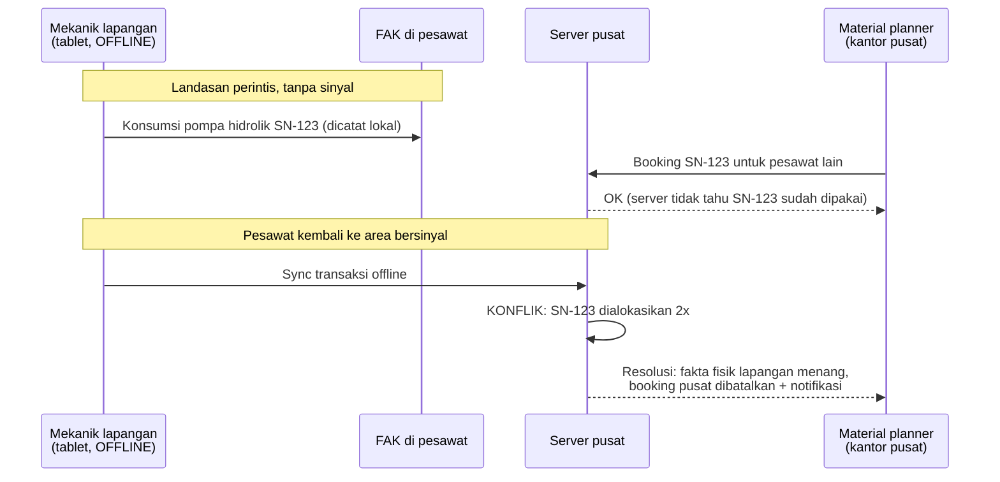

# Konteks Operasi Perintis Papua & Offline-First

Sumber: [[Sumber Riset A - Proses Bisnis ERP MRO Kargo Perintis]] · [[ERP_MRO Kargo Perintis Indonesia]]

## Ringkasan

### Konteks program & lingkungan

- **Program Jembatan Udara / Tol Udara**: per KP 206/207 Tahun 2024 — 22 Korwil, **46 rute kargo perintis** (+266 rute penumpang, 1 rute subsidi kargo). 46 rute kargo terkonsentrasi di 7 KPA Korwil: Tarakan, Masamba, Timika, Dekai, Tanah Merah, Oksibil, Wamena. Multi-operator (Trigana Air, Nasional Global Aviasi, Susi Air, dll).
- Armada tipikal: Cessna 208 Caravan, DHC-6 Twin Otter, ATR 42/72, Dash-8, Pilatus — short unpaved strips, medan pegunungan, elevasi tinggi, cuaca mikro tak terprediksi.
- Sebagian besar penerbangan **disubsidi pemerintah** → akurasi data muatan = syarat audit pencairan subsidi.
- Risiko keamanan nyata (contoh: penembakan Caravan PK-SNR, rute Tanah Merah–Danawage, Feb 2026; DGCA: stop terbang atas alasan keamanan tidak disanksi).
- Bandara perintis: UPBU kelas III, infrastruktur minim, sering tanpa GHA komersial, konektivitas terbatas atau nihil.

### Anatomi race condition offline-sync (failure mode utama)

> Tanpa aturan resolusi eksplisit (timestamp hierarchy / flag manual), konflik seperti ini merusak buku besar material dan jadwal terbang. Keputusannya di [[Decision - Strategi Offline-First & Conflict Resolution]].

### Konsekuensi desain sistem

1. **Offline-first wajib**, bukan nice-to-have: line maintenance, cargo acceptance, POD, dan konsumsi FAK harus jalan penuh tanpa internet, sinkron saat online.
2. **Conflict resolution eksplisit** untuk offline-sync (opsi di riset: last-write-wins per field + audit log, merge dengan flag manual, atau timestamp hierarchy yang memprioritaskan lapangan) — lihat [[Decision - Strategi Offline-First & Conflict Resolution]].
3. **SDM terbatas**: engineer Part 65 & personel garis depan minim latar IT → UI harus sederhana, memandu prosedur, validasi otomatis, pemindaian barcode alih-alih pencarian ATA chapter manual. Over-engineering UI = penolakan adopsi.
4. **Flight following mandiri** via telemetri satelit (di luar coverage radar ATC).
5. Multi-location inventory sampai level "pesawat sebagai gudang" (FAK).

## Kenapa relevan buat project ini

Ini konteks yang membedakan ERP Rimbun Air dari ERP penerbangan umumnya: constraint konektivitas, SDM, dan subsidi menentukan arsitektur (offline-first + sync), desain UX, dan modul pelaporan subsidi.
