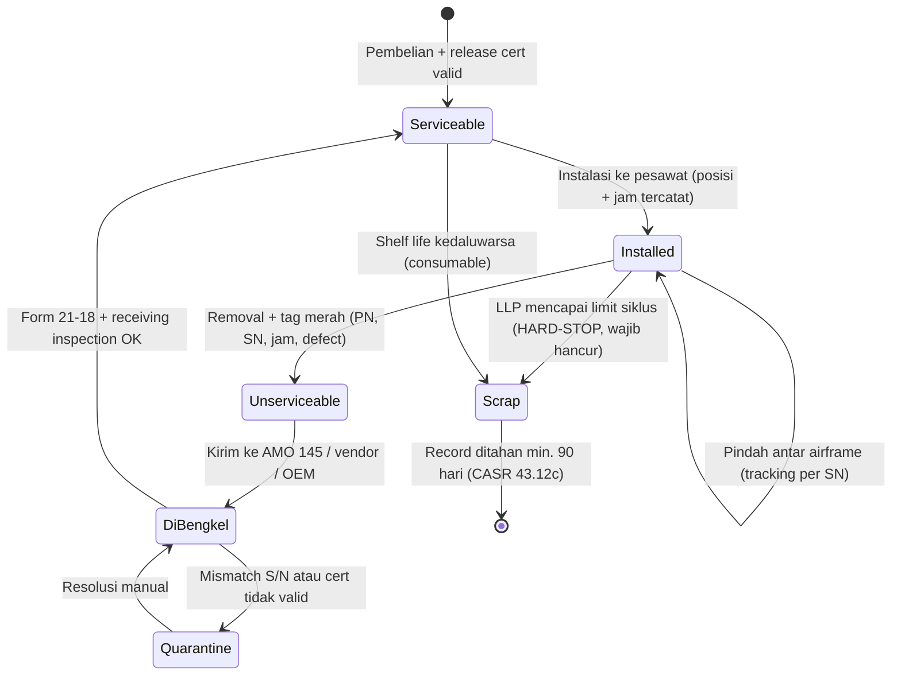
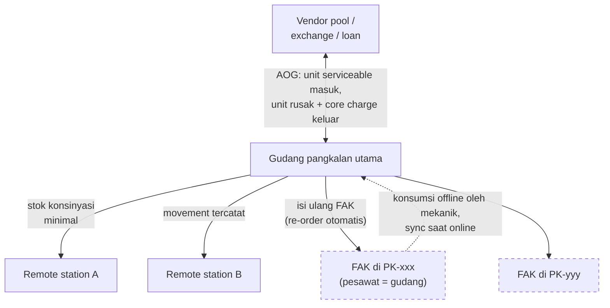

# Manajemen Sparepart & Supply Chain

Sumber: [[Sumber Riset A - Proses Bisnis ERP MRO Kargo Perintis]] · [[ERP_MRO Kargo Perintis Indonesia]]

## Ringkasan

### Siklus hidup komponen rotable (state machine)

### Topologi multi-lokasi inventory

> Setiap panah = movement yang **wajib terekam** agar back-to-birth traceability tidak putus. Garis putus-putus = transaksi offline.

### Klasifikasi material (beda perlakuan di database)

| Kelas | Ciri | Tracking |
|---|---|---|
| **Rotable** | High-value, repairable berulang (landing gear, avionics, propeler, pompa) | Per **serial number**, lifecycle penuh, bisa pindah antar airframe |
| **Repairable** | Dapat diperbaiki, nilai/siklus lebih terbatas | Per SN |
| **Consumable** | Dipakai habis (grease, filter, hidrolik) | Per **batch** + shelf life/expiry |
| **Expendable** | Dibuang setelah pakai (fasteners, seals, washer) | Kuantitas |

### Aturan kunci

- **LLP (Life-Limited Parts)**: hard life (turbine disk, landing gear) — wajib dihancurkan setelah limit siklus, apapun kondisi fisiknya. Sistem harus **hard-stop**: tidak bisa terbitkan release bila LLP melewati limit. Status LLP wajib terekam (CASR 135.439(a)(2)(ii)/121.380).
- **Serialized tracking & back-to-birth**: identitas unik per part serialized, barcode/RFID (ATA Spec 2000); birth record + rantai release cert = back-to-birth records. Release cert elektronik dipertukarkan di bawah ATA Spec 2000 Ch.16.
- **Shelf life**: consumable dengan expiry (seals, adhesives, oksigen) butuh manajemen tanggal kedaluwarsa.
- **AOG logistics**: skema exchange / loan / pooling dengan vendor. Modul pengadaan harus otomatis rekonsiliasi **core charge** transaksi exchange di buku besar.
- **Fly-Away Kits (FAK)**: gudang mini bergerak di kabin pesawat. Implikasi arsitektur: **multi-location inventory di mana tiap ekor pesawat = 1 gudang terpisah**. Konsumsi FAK dicatat offline oleh mekanik/pilot, sinkron saat online, memicu re-order.
- **Rekonsiliasi stok** fisik vs sistem, terutama remote station — setiap movement antar-stasiun harus terekam agar traceability tidak putus.

## Kenapa relevan buat project ini

Menentukan skema data inventory: part master vs component instance (SN), multi-lokasi termasuk pesawat-sebagai-gudang, dan validasi hard-stop LLP. Duplikasi part master adalah failure point klasik — lihat [[Interval, Due Date & Forecasting Maintenance]]. Konsumsi offline dari FAK terkait langsung dengan [[Decision - Strategi Offline-First & Conflict Resolution]].
