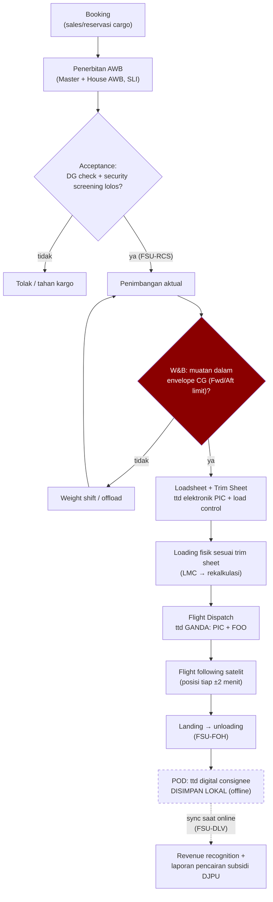

# Proses Bisnis Kargo Perintis End-to-End

Sumber: [[Sumber Riset A - Proses Bisnis ERP MRO Kargo Perintis]] · [[ERP_MRO Kargo Perintis Indonesia]]

## Ringkasan

Rantai proses kargo dari hulu ke hilir, termasuk dua gerbang validasi (DG check dan W&B) serta jalur offline untuk POD:

> Node merah = titik keputusan paling fatal: sistem **memblokir** penerbitan loadsheet bila limit CG terlampaui. Garis putus-putus = transisi offline→online.

### Tahapan & aktor kunci

| Tahap | Aktor | Dokumen/Output | Standar |
|---|---|---|---|
| Booking | Sales/reservasi cargo | Kapasitas, rute, tanggal | — |
| Penerbitan AWB | Cargo acceptance officer | Master AWB (+House AWB bila konsolidasi), SLI dari shipper | IATA e-AWB, Cargo-IMP FWB/16, FHL/4, FZB |
| Acceptance | Cargo officer | e-CSD, DG check | IATA DGR; status EDI FSU-RCS |
| Penimbangan & W&B | Load control officer / loadmaster + FOO | Loadsheet, Trim Sheet | IATA AHM, IGOM Ch.5 |
| Loading | Ramp/ground handling | Sesuai trim sheet; LMC direkalkulasi | IGOM Ch.3–4 |
| Dispatch & flight following | FOO/dispatcher + PIC (otoritas ganda — dua-duanya tanda tangan) | Dispatch release, loadsheet final, NOTOC (bila DG) | CASR 121/135 |
| Unloading & POD | Ground handling stasiun tujuan | Delivery receipt/signature | Status EDI FSU-FOH → FSU-DLV |

### Poin kritis untuk desain sistem

- **W&B adalah titik keputusan paling fatal.** Turboprop kecil (Caravan, Twin Otter) punya toleransi CG sangat sempit. Kalkulasi: BEW + kargo + kru + fuel → ZFW → TOW, momen via Index Units, harus dalam envelope Forward/Aft Limit. Sistem harus **memblokir penerbitan loadsheet** bila limit terlampaui, dan memaksa weight shift/offload.
- Turboprop kecil memuat **bulk/loose, bukan ULD** → W&B manual per-leg sangat kritikal.
- Banyak bandara perintis tidak punya GHA komersial → operator **self-handling**; sistem harus mendukung ini.
- **POD offline**: tanda tangan digital dan status pengiriman disimpan lokal, sinkron saat online → memicu revenue recognition + pelaporan ke DJPU untuk **pencairan subsidi perintis bulanan**. Akurasi data muatan = syarat audit pencairan dana subsidi Kemenhub.
- Flight following mandiri wajib (Papua di luar coverage radar sekunder ATC) — telemetri satelit tipe Spidertracks, posisi tiap ±2 menit.
- Standar messaging: Cargo-IMP edisi 34 adalah edisi final; arah industri ke Cargo-XML dan **IATA ONE Record** (preferred standard efektif 1 Jan 2026). Lihat [[Decision - Standar Cargo Messaging]].
- Arsip pesan EDI perlu ditahan lama (SOP IATA menyebut 5–7 tahun di beberapa bandara).

## Kenapa relevan buat project ini

Ini adalah salah satu dari dua rantai proses inti yang harus dijahit ERP Rimbun Air. Entitas kuncinya AWB dan flight leg — lihat [[Interval, Due Date & Forecasting Maintenance]].
