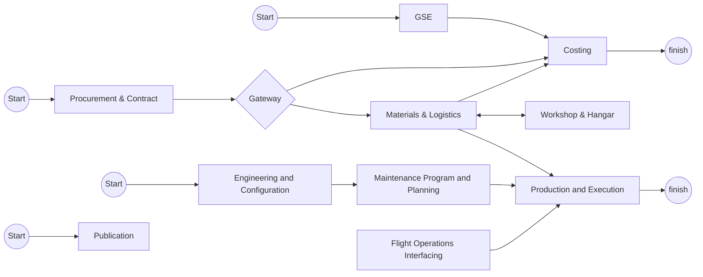

# Flow Proses — Hasil Translate dari Diagram

> Catatan: Ini adalah hasil pembacaan visual dari diagram yang diupload. Silakan cek ulang setiap node & arah panah, karena beberapa jalur (terutama di sekitar gateway/diamond) agak padat dan berpotensi salah baca. Bagian **⚠️ Perlu Dikonfirmasi** di bawah berisi poin-poin yang sebaiknya dicek ke sumber aslinya.

---

## 1. Jalur "GSE → Costing"

```
(Start) → [GSE] → [Costing] → (finish)
```

- Start #1 langsung menuju proses **GSE**.
- **GSE** mengarah ke **Costing**.
- **Costing** mengarah ke titik akhir **finish** (end event pertama).

---

## 2. Jalur Utama "Procurement → Gateway → Materials/Workshop"

```
(Start) → [Procurement & Contract] → <Gateway> ─┬─→ [Materials & Logistics] ⇄ [Workshop & Hangar]
                                                  └─→ [Costing]

[Materials & Logistics] → [Costing]
[Materials & Logistics] → [Production and Execution]
```

- Start #2 → **Procurement & Contract** → masuk ke **Gateway** (simbol diamond, kemungkinan exclusive/parallel gateway).
- Dari **Gateway**, ada 2 cabang keluar:
  1. → **Materials & Logistics**
  2. → **Costing** (cabang naik ke atas lalu masuk ke Costing dari sisi kiri)
- **Materials & Logistics** dan **Workshop & Hangar** saling terhubung dua arah (bolak-balik / iterative loop).
- **Materials & Logistics** juga mengarah naik ke **Costing**.
- **Materials & Logistics** mengarah ke **Production and Execution** (jalur horizontal panjang ke kanan).

---

## 3. Jalur "Engineering → Maintenance Program → Production"

```
(Start) → [Engineering and Configuration] → [Maintenance Program and Planning] → [Production and Execution] → (finish)

[Flight Operations Interfacing] → [Production and Execution]
```

- Start #3 → **Engineering and Configuration** → **Maintenance Program and Planning** → **Production and Execution**.
- **Flight Operations Interfacing** juga mengarah ke **Production and Execution** (dari bawah, sebagai input tambahan).
- **Production and Execution** → titik akhir **finish** (end event kedua).

---

## 4. Jalur "Publication" (berdiri sendiri)

```
(Start) → [Publication]
```

- Start #4 → **Publication**.
- Tidak ada garis keluar lain yang terlihat dari **Publication** — jalur ini terlihat terputus / belum terhubung ke proses lain.

---

## Ringkasan Node

| No | Node | Jenis | Terhubung dari | Terhubung ke |
|----|------|-------|-----------------|---------------|
| 1 | Start (kiri atas) | Start event | – | GSE |
| 2 | GSE | Task | Start | Costing |
| 3 | Costing | Task | GSE, Gateway, Materials & Logistics | finish (1) |
| 4 | finish (1) | End event | Costing | – |
| 5 | Start (tengah) | Start event | – | Procurement & Contract |
| 6 | Procurement & Contract | Task | Start | Gateway |
| 7 | Gateway (◇) | Gateway | Procurement & Contract | Materials & Logistics, Costing |
| 8 | Materials & Logistics | Task | Gateway, Workshop & Hangar | Costing, Workshop & Hangar, Production and Execution |
| 9 | Workshop & Hangar | Task | Gateway, Materials & Logistics | Materials & Logistics |
| 10 | Start (kanan atas) | Start event | – | Engineering and Configuration |
| 11 | Engineering and Configuration | Task | Start | Maintenance Program and Planning |
| 12 | Maintenance Program and Planning | Task | Engineering and Configuration | Production and Execution |
| 13 | Flight Operations Interfacing | Task | – (tidak ada input terlihat) | Production and Execution |
| 14 | Production and Execution | Task | Maintenance Program and Planning, Materials & Logistics, Flight Operations Interfacing | finish (2) |
| 15 | finish (2) | End event | Production and Execution | – |
| 16 | Start (kiri bawah) | Start event | – | Publication |
| 17 | Publication | Task | Start | – (tidak ada output terlihat) |

---

## ⚠️ Perlu Dikonfirmasi

Beberapa hal yang sebaiknya dicek ulang ke sumber asli / pemilik proses, karena rawan salah interpretasi dari gambar:

1. **Gateway (◇) setelah Procurement & Contract** — apakah ini *exclusive gateway* (pilih salah satu jalur) atau *parallel gateway* (jalan bersamaan ke Materials & Logistics dan Costing)? Simbolnya lingkaran kecil di dalam diamond, tidak ada tanda "X" atau "+" yang jelas.
2. **Hubungan Materials & Logistics ⇄ Workshop & Hangar** — apakah ini memang loop bolak-balik (misal: proses iteratif/rework), atau seharusnya satu arah saja?
3. **Flight Operations Interfacing** — node ini tidak punya input yang terlihat (tidak ada Start atau proses lain yang masuk ke sini). Apakah memang standalone/manual trigger, atau ada koneksi yang terputus di diagram?
4. **Publication** — node ini tidak memiliki output/koneksi ke proses lain maupun ke end event. Apakah ini memang endpoint tersendiri (misal proses administratif terpisah), atau memang belum lengkap?
5. **Dua end event "finish"** — proses ini punya 2 titik akhir terpisah (satu dari Costing, satu dari Production and Execution). Apakah ini disengaja (dua output proses yang berbeda), atau seharusnya menyatu?
6. **Apakah "Costing" menerima input dari 3 sumber (GSE, Gateway, Materials & Logistics)** sudah sesuai dengan proses bisnis yang dimaksud, atau ada yang seharusnya tidak terhubung?

---

## Cara Verifikasi di Obsidian

Kamu bisa copy diagram Mermaid di bawah ini ke dalam code block ` ```mermaid ` di note Obsidian (perlu plugin Mermaid, biasanya sudah built-in) untuk melihat visualisasinya dan membandingkan langsung dengan gambar asli:


