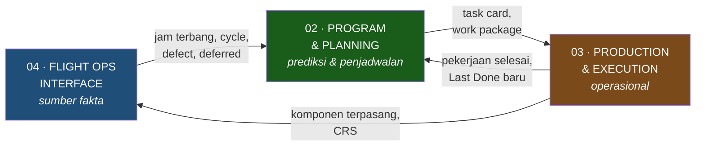

# ERP/MRO Rimbun Air — Modul Eza

**Audiens:** 🔴 Internal saja — Berisi penilaian risiko klien dan eskalasi kontrak. **Jangan dibagikan ke Rimbun Air.**

> **Isi note ini:** dashboard — di mana posisi project sekarang, apa risikonya, dan ke mana harus membuka note lain.
> Ini satu-satunya tempat yang perlu dibuka kalau Anda cuma punya dua menit.

> **Mulai dari sini.** Baru pertama buka vault ini? Urutannya: note ini → [[Scope]] → [[Proses Manual Maintenance - DRAFT]] → [[Glosarium]] kalau ketemu istilah asing.

## Tujuan

Membangun sistem MRO untuk **Rimbun Air** (kargo & charter) bersama **Nodewave** sebagai vendor. Kontraknya 10 modul; **yang saya pegang 3** — dan ketiganya satu rantai tertutup:

Flight Ops memasok fakta → Planning memprediksi yang jatuh tempo → Production mengeksekusi → hasilnya jadi Last Done baru. Persis pekerjaan Pak Rian, plus sumber datanya di hulu dan eksekusinya di hilir.

Peta sepuluh modul beserta koreksinya ada di [[Scope]]. Alur kerja orangnya di [[BPMN & Activity Flow - DRAFT]].

Constraint utama: kepatuhan CASR/DKPPU, SDM lapangan sangat terbatas, dan semuanya masih manual.

## Stakeholder

**Nodewave** — Project Director Hardi · PM Rigen · **Product Manager Eza (saya)** & Wisnu · Technical Lead Rafi · BPMN Gama · Business Support Akil · UI/UX Annisa, Shafa · SE Andre, Wathan, Rama, Mikael, Dhito, Dony · Data Engineer Pradipta

**Rimbun Air** — **HQ di Meruya**, store di **Cengkareng** & **Halim**, fasilitas di **Bandung**.
Struktur: **Chief Maintenance · Chief PPC Engineering · Chief Inspector**.
Pak Rian (PPC planning) · **Mba Michelle** (Technical Record) · **Pak Heri** (Inspektor Maintenance) · **Pak Joko** (*Chief Line Maintenance Engineer* — inilah "Chief LM" yang selama ini menggantung: maintenance control, penyetuju WO) · **Pak Pipit** (Staff OCC, Cengkareng) · **Mas Bobby** (IT, pembuat MSS & koordinator) · Pak Andi (manajer sistem, movement/OCC) · Mas Sidiq (store) · Zainul (tools?) · Mbak Hilda (manual) · Pak Sandi (inspector, bersama Pak Heri).
Di luar maintenance: **OCC** — departemen Operasional di Cengkareng, punya sistem sendiri.
Tanda tangan akhir sebelum masuk record: **Chief Inspector**.

## Status terkini

**2026-08-03** — Dua sesi: **Pak Joko** ([[2026-08-03 Chief Line Maintenance - Pak Joko|Chief Line Maintenance]]) dan **Pak Pipit** ([[2026-08-03 Staff OCC - Pak Pipit|Staff OCC]]).

**Rantai jam terbang lengkap sampai hulu.** pilot isi AFML → co-pilot kirim (format baku) ⟷ engineer kirim foto → **OCC bandingkan keduanya** → sinkron otomatis ke MSS lewat **nomor AFML** → Michelle rekonsiliasi → TSN/CSN → PPC. **Tiga titik rekonsiliasi manual untuk satu angka** — pembenaran terkuat untuk sistem ini.

⚠️ **Titik gagalnya bukan angka, tapi nomor.** Block on/off & take off/landing hampir tidak pernah selisih. Yang sering salah **nomor AFML** — dan kalau salah, datanya **tidak muncul sama sekali** di sisi teknik. Validasi nomor AFML jadi requirement paling konkret sejauh ini.

📌 **Satu AFML = satu rute, bukan satu cycle.** CGK–UPG–CGK = satu AFML, dua cycle. Ganti kru atau engineer → AFML baru. Ini keputusan model data, harus masuk skema DB sejak awal.

**"Chief LM" akhirnya punya nama: Pak Joko** — dan dia lapisan tanda tangan yang selama ini hilang, antara planner dan inspector. Sesinya juga menutup tiga requirement yang sebelumnya kosong: **DMI/deferral**, **tool crib & kalibrasi**, dan **validasi lisensi** (ternyata ada **dua** tanggal kedaluwarsa — AMEL & Company Authorization).

⚠️ **"Erod" tidak pernah ada.** Nama yang delapan hari muncul di tujuh note ternyata salah dengar dari catatan tangan. Penyusun EO masih belum diketahui. → [[Riwayat Koreksi]] #10

**2026-07-31** — Wawancara **Mba Michelle (Technical Record)**. Sesi paling produktif sejauh ini: [[2026-07-31 PPC Technical Record]].

**TB1 tertutup penuh.** Rantai jam terbang akhirnya lengkap — engineer isi **AFML book** di lapangan → kirim foto via WhatsApp + create di MSS → data movement masuk otomatis dari **OCC** → Michelle merekonsiliasi foto vs sistem → approve → TSN/CSN terbit → PPC pakai untuk LD/ND.

**Arsip juga tertutup.** WO di-scan ke Google Drive; retensi **selama pesawat masih dioperasikan**, dan record diserahkan saat pesawat dijual.

⚠️ **Koreksi penting: MSS bukan project gagal.** Ia **dipakai setiap hari** untuk AFML dan dianggap berfungsi baik. Yang tidak memakainya cuma PPC planning. Kesalahan kita menggeneralisasi dari satu pengguna ke seluruh sistem — dan ini **mengubah arah K4**: ternyata ada database berisi flight hours, cycle, discrepancy, dan component replacement yang mungkin bisa dimigrasikan.

**Aktor baru: OCC** (Operations Control Center) — departemen Operasional di Cengkareng dengan sistem sendiri, memasok data movement. Di luar 10 modul kontrak, tapi datanya masuk ke modul saya.

**Pain point utama Michelle:** data OCC sering tidak cocok dengan AFML aktual, dan dia harus memperbaikinya manual tiap hari karena engineer tidak punya akses edit dan OCC beda departemen.

**2026-07-30** — Wawancara Inspector (Pak Heri). Perannya ternyata fungsi Quality yang luas, bukan sekadar pemeriksa dokumen. Sebagian besar kebutuhannya jatuh di modul 05, 06, 07.

**2026-07-29** — Wawancara PPC (Pak Rian). Pain point terbesar: copy-paste manual dari dokumen pabrikan. Tiga lapis tanda tangan. PPC hanya satu orang.

**2026-07-27** — Kickoff Nodewave × Rimbun Air.

## Meetings

- [[2026-08-03 Chief Line Maintenance - Pak Joko]] — Pak Joko, maintenance control & rantai tanda tangan
- [[2026-08-03 Staff OCC - Pak Pipit]] — Pak Pipit, hulu data jam terbang
- [[2026-07-31 PPC Technical Record]] — Mba Michelle, rantai AFML & arsip
- [[2026-07-30 Staff Inspector Maintenance]] — Pak Heri, fungsi Quality
- [[2026-07-30 Staff Inspector Maintenance]] — Q&A lengkap, 41 pertanyaan
- 🔜 [[Lembar Wawancara PPC Techincal Record]] — **terjadwal**, offline di Meruya
- 🔜 [[Lembar Wawancara PPC & Engineer - Sesi 2]] — lembar bawa, menargetkan titik buta terbesar
- 🔜 [[Lembar Wawancara Inspector - Sesi 2]] — lembar bawa sesi lanjutan
- [[Lembar Wawancara Inspector - Sesi 2]] — bahan baca
- [[2026-07-29 Staff PPC & Engineering]] — process owner modul Planning & Production
- [[2026-07-27 Kickoff Nodewave x Rimbun Air]] — konteks kontrak

## Knowledge

**Scope & AS-IS**
- [[Scope]] ← definisi kerja saya: 3 modul, 16 requirement, batas dengan modul orang lain
- [[Proses Manual Maintenance - DRAFT]] ← satu-satunya AS-IS milik Rimbun Air, bukan riset generik

**Domain per modul** *(hasil deep research)*
- [[Interval, Due Date & Forecasting Maintenance]] ← Planning: aritmetika LD/ND, [[Glosarium#W|WCF]], toleransi
- [[Eksekusi Work Order, Kewenangan & Kalibrasi]] ← Production: siklus WO, [[Glosarium#R|RII]], lisensi, [[Glosarium#C|CRS]]
- [[Tech Log, Defect & Reliability Analysis]] ← Flight Ops: [[Glosarium#A|AFML]], MEL/deferral, [[Glosarium#E|ECTM]], reliability

**Desain**
- [[BPMN & Activity Flow - DRAFT]] ← **end-to-end + 4 proses digambar** · register 80 aktivitas · user activity per aktor · audit kelengkapan

**Lintas modul**
- [[Regulasi & Kepatuhan CASR Indonesia]] ← requirement non-fungsional paling keras
- [[Glosarium]] ← 82 istilah, tiap entri menaut ke note sumbernya

## Decisions

| Decision | Status |
|---|---|
| [[Decision - Single Source of Truth Flight Leg & Part Master]] | 🔴 Open — paling siap diputuskan, terkait langsung TB1 |
| [[Decision - E-Signature & Electronic Recordkeeping]] | 🟠 Turun prioritas — ttd basah dikonfirmasi, bukan gap |
| [[Decision - Strategi Offline-First & Conflict Resolution]] | 🔴 Open — terblokir K2, butuh data konektivitas |

Decision project-level yang sudah tertutup ada di `02-Decisions/_di-luar-scope/`.

## Risiko yang dipantau

Ini daftar risiko yang aktif. Kalau butuh alasan lengkapnya, ikuti tautan di kolom terakhir.

| Risiko | Kenapa serius | Tindakan | Detail |
|---|---|---|---|
| 🔴 **Data awal tidak masuk scope migrasi** | Sistem lama bukan sistem maintenance, jadi LD/ND dan dokumen kerja semuanya di spreadsheet dan kertas — persis yang dikecualikan kontrak. Migrasi pun baru dijadwalkan setelah go-live | Eskalasi ke Rigen & Hardi. Putuskan siapa mengisi data awal | [[Rekonsiliasi Scope - Riset vs Kontrak]] |
| 🔴 **Kebutuhan inti PPC jatuh di modul orang lain** | Merakit dokumen dan repositori manual sebagian masuk modul 07 Publication, yang bukan scope saya | Pagari ke Rafi sebelum PRD | [[Scope]] |
| 🟢 **Offline-first kemungkinan tidak dibutuhkan** | Premis "bandara perintis" tidak berlaku — armada jet, basis di Jakarta & Bandung. Kontrak juga tidak menjanjikannya | Konfirmasi daftar lokasi operasi, lalu tutup isunya | [[Riwayat Koreksi]] |
| 🟠 **Setup template jadi matriks** | Template ada per tipe pesawat **dan** per jenis dokumen. Empat tipe dikali beberapa jenis dokumen = belasan template yang harus disiapkan, diverifikasi ke Maintenance Program, lalu dipelihara tiap MP direvisi (Boeing tiap 3–4 bulan) | Hitung jumlahnya dan masukkan ke work plan | [[Proses Manual Maintenance - DRAFT]] |
| 🟠 **PPC hanya satu orang** | Risiko adopsi terkonsentrasi; tidak ada pembanding untuk memverifikasi pemahaman proses | Validasi AS-IS langsung ke Pak Rian; sesuaikan rencana training | [[Proses Manual Maintenance - DRAFT]] |
| 🟠 **Task card disalin tanpa jejak revisi** | Kalau task card tidak mencantumkan nomor revisi sumber, isinya bisa usang tanpa ada yang sadar. Ini soal kepatuhan, bukan efisiensi | Belum tergali di sesi 30 Jul — masuk agenda sesi lanjutan | [[2026-07-30 Staff Inspector Maintenance]] |
| 🟠 **Angka regulasi belum diverifikasi** | Riset banyak bersumber sekunder; ada konflik angka retensi antar-note | Butir G di checklist; cek ke JDIH Kemenhub | [[Checklist Data dari Rimbun Air]] |
| 🟡 **Data master masih tipis** | Fleet register, [[Glosarium#M\|MEL]], AMP, [[Glosarium#L\|LLP]] belum ada | Prioritaskan butir 🔥 di checklist | [[Checklist Data dari Rimbun Air]] |

## Tindakan berikutnya

Semua action item dari tiga MoM, digabung dan dibuang duplikatnya. Detailnya tetap di MoM masing-masing.

> ⏳ **Menunggu jawaban Anda:** [[Tanya Jawab - Sesi 3 Agustus]] — verifikasi transkrip Pak Joko & Pak Pipit sebelum dua MoM ditulis.

### 🔴 Eskalasi — menganggur, kirim hari ini

| Tindakan | Ke | Sejak | Kenapa mendesak |
|---|---|---|---|
| **K4 — migrasi data setelah go-live.** Sistem lama bukan sistem maintenance, jadi hampir semua data awal ada di spreadsheet & kertas, persis yang dikecualikan kontrak | Rigen & Hardi | 27 Jul | Risiko go-live terbesar. Makin lama makin mahal mengubah rencana |
| **Batas modul 07.** Pain point terbesar PPC (rakit dokumen) dan permintaan Pak Heri (repositori manual) keduanya jatuh di modul yang bukan saya. **Diperkuat 6 Agu:** di peta modul, Publication menggantung tanpa satu pun sambungan | Rafi | 30 Jul | Kalau tidak dipagari sebelum PRD, kebutuhan pengguna utama tidak ada yang memiliki |
| **PPC hanya satu orang** — dampaknya ke rencana training, UAT, dan risiko adopsi | Rigen | 29 Jul | Asumsi "role-based training" di deck perlu disesuaikan |
| **Kebutuhan Pak Heri sebagian di modul 05/06/07** — perlu diteruskan ke PM terkait | Rigen | 30 Jul | Kalau tidak, dia sudah diwawancarai tapi keluhannya tidak sampai ke siapa pun |
| **Tidak ada modul HR di antara 10 modul kontrak** — padahal validasi lisensi ada di modul saya | Rafi | 6 Agu | Data induk pegawai & lisensi tidak punya pemilik. Kemungkinan jatuh ke saya — **menambah scope**, harus dipastikan sebelum PRD |
| **Peta modul hasil brainstorm belum cocok dengan AS-IS** — 12 serah-terima teramati tidak punya panah, 1 panah bertentangan (04→03 seharusnya 04→02), 2 modul tanpa dasar AS-IS | Rafi & tim | 6 Agu | Peta versi terkoreksi + tabel pencocokan sudah siap di [[Scope]] bagian *Pencocokan peta modul*. Bahan brainstorm berikutnya |
| **Harbour Energy menguji kehandalan sistem Rimbun** — konsultan mereka menekan soal akurasi kontrol jam terbang dan jejak audit *(Pak Joko, 3 Agu)* | Rigen | 3 Agu | Klien charter jadi penguji mutu dari luar. Ini menetapkan **tolok ukur non-fungsional** yang harus dipenuhi sistem: akurasi jam & traceability audit. Perlu jadi acceptance criteria, bukan sekadar catatan |

### 🟠 Validasi — murah, berdampak besar

| Tindakan | Kenapa |
|---|---|
| 🔥 **Validasi diagram AS-IS ke narasumber** — sudah siap di [[BPMN & Activity Flow - DRAFT]] bagian 1 | **Belum ada satu pun orang Rimbun Air yang memvalidasi model proses kita**, padahal empat proses sudah digambar. Ini penutup risiko terbesar dan cuma butuh 15 menit. Paling cocok ke Pak Rian sesi 2 — sekaligus menutup B5 & B4 |
| Luruskan pemahaman **ATA chapter** sebelum BPMN difinalkan | Kalau relasi "ATA = model pesawat" masuk skema DB, struktur dokumen teknis salah sejak awal |
| 🔴 **Lima requirement belum punya aktivitas AS-IS sama sekali** — AD/SB/SL/EO · forecast · CRS · fluid consumption · reliability | Ketahuan dari audit kelengkapan di [[BPMN & Activity Flow - DRAFT]] bagian 9. Kalau tidak digali, kelimanya akan dirancang tanpa dasar. Semuanya bisa ditutup dalam satu sesi Pak Rian |
| **Putuskan: line check harian masuk modul saya atau tidak** | Pre-flight/transit/daily/weekly tidak lewat WO dan tidak punya padanan di scope kontrak, padahal jauh lebih sering terjadi. Perlu diputuskan bersama Rafi sebelum PRD |
| **Kirim diagram ke Gama** | Paket ekspornya sudah siap di [[Ekspor ke Lucid - untuk Gama]] — Mermaid siap impor + CSV cadangan. Dia bisa mulai memodelkan sambil menunggu enam blok tersisa |

### 📄 Dokumen yang diminta

Koordinator Rimbun Air sudah diminta menyiapkan **folder Drive** berisi dokumen yang biasa dikerjakan tiap tim. Yang perlu dipantau sekarang bukan permintaannya, tapi **apakah foldernya benar-benar terisi**.

**Satu file LD/ND tetap yang paling berharga** — menjawab lebih banyak daripada dua sesi wawancara.

- [ ] ⭐ **Salinan file LD/ND**
- [ ] Satu paket dokumen lengkap yang pernah diserahkan ke engineer
- [ ] Maintenance Program versi terbaru — satu tipe cukup
- [ ] Template task card untuk satu model
- [ ] Contoh non-routine card · Inspection Report · Form 21-18 · [[Glosarium#D|DMI]] berjalan
- [ ] Daftar lisensi personel · daftar alat + jadwal kalibrasi
- [ ] Foto tempat arsip

### 🎤 Wawancara

| Sesi | Status | Lembar |
|---|---|---|
| Chief Line Maintenance | ✅ Selesai 3 Agu — Pak Joko. Menutup DMI, tool crib, validasi lisensi | [[2026-08-03 Chief Line Maintenance - Pak Joko]] |
| Staff OCC | ✅ Selesai 3 Agu — Pak Pipit. Menutup hulu jam terbang | [[2026-08-03 Staff OCC - Pak Pipit]] |
| PPC Technical Record | ✅ Selesai 31 Jul — menutup TB1 & B3 | [[2026-07-31 PPC Technical Record]] |
| **Engineer lapangan — observasi di Cengkareng** | 🔥 **Prioritas tertinggi.** Pengguna utama modul 02, lane B7 masih sepenuhnya tangan kedua. **Pintunya sudah terbuka** — Pak Pipit mempersilakan, dan engineer satu lokasi dengan OCC di Cengkareng. Tinggal dijadwalkan lewat Mas Bobby | — |
| **Pak Rian sesi 2** | 🔥 Naik prioritas — menargetkan **5 requirement tanpa aktivitas** (AD/SB/SL/EO · forecast · CRS · fluid · reliability), plus B5 & B4, plus validasi diagram. Semuanya pekerjaan meja, tidak perlu ke lapangan | [[Lembar Wawancara PPC & Engineer - Sesi 2]] |
| Pak Heri sesi 2 | Menargetkan alur penolakan (B6) & RII | [[Lembar Wawancara Inspector - Sesi 2]] |
| Mbak Hilda | Pengelola manual, kalau relevan | — |

### 🔍 Verifikasi

- [ ] **Putar ulang rekaman inspector**, ekstrak bagian alur penolakan — kemungkinan sudah dibahas tapi tidak tercatat
- [ ] **Angka [[Glosarium#C|CASR]] ke JDIH Kemenhub** — semua nomor pasal masih dari sumber sekunder (butir G8)
- [ ] **Toleransi ke dokumen AMP atau QA** — jangan ke PPC, jawabannya ada di dokumen (butir G1)
- [ ] **Daftar lokasi operasi** — ini yang menutup K2

### Bukan tugas saya

- [ ] PIC tunggal Rimbun Air — **Rigen**, diminta sejak kickoff
- [ ] Process owner per modul — **Rigen**, diminta sejak kickoff

## Peta note — buka yang mana?

| Kalau butuh… | Buka |
|---|---|
| **Besok harus ngapain** | bagian *Tindakan berikutnya* di atas |
| Apa yang harus dibangun | [[Scope]] |
| Cara kerja Rimbun Air sekarang + **pertanyaan proses yang belum terjawab (TB)** | [[Proses Manual Maintenance - DRAFT]] |
| **Dokumen/data yang harus diminta** ke klien | [[Checklist Data dari Rimbun Air]] |
| Teori domain per modul | tiga note di bagian Knowledge di atas |
| Arti singkatan | [[Glosarium]] |
| Latar konflik scope vs kontrak | [[Rekonsiliasi Scope - Riset vs Kontrak]] |
| Apa yang dijanjikan ke klien di kontrak | [[2026-07-27 Kickoff Nodewave x Rimbun Air]] |

**Dua daftar bernomor, jangan tertukar:**
- **TB1–TB6** = pertanyaan proses yang belum terjawab → ada di [[Proses Manual Maintenance - DRAFT]]
- **A–E, G** = dokumen & data yang harus diminta → ada di [[Checklist Data dari Rimbun Air]]

## Yang di luar scope

`03-Knowledge/_di-luar-scope/` dan `02-Decisions/_di-luar-scope/` menyimpan riset di luar modul saya: kargo, sparepart, benchmark vendor, dan tiga decision project-level. Catatan khusus: note **konteks Papua & offline-first** di sana bukan cuma di luar scope — **premisnya salah**, jangan dipakai lagi.

Sumber mentah semua riset ada di `03-Knowledge/_sumber-mentah/`.
